# Melbourne Blender design walkthrough

This is an authored aerial Melbourne scene based on retained public geography. All surface colours, relief and detail meshes are our own; the latest saved-scene inspection found no material or world image-texture nodes. Present-day Melbourne is the target, but historical surveys and current redevelopment remain unreconciled. The scene is unfinished.

## Open the saved design

Open `assets/source/environment/city-observatory.blend`. The saved active camera is **36 Federation Atrium inspection**. Hover the viewport and press numpad 0, then choose **Rendered** shading, the rightmost sphere in the viewport header. Solid shading conceals the materials and lighting.

The Atrium enclosure pass was applied in the open Blender window and saved with a clean title. A fresh background render verifies the saved revision independently. Older images elsewhere in this walkthrough describe earlier passes.

To explore another view, select its camera in **PREVIEW - lighting and aerial camera**, hover the viewport, and press Ctrl+numpad 0 to set the active camera. Press numpad 0 to enter its view.

## Take the tour

Latest material refinement: Federation sandstone now warmer, zinc darker and neutral, glass deeper. Own procedural colours visually informed by official exterior reference; no photographic textures or pixel sampling. Earlier material graphs retained as backups. This changes appearance only; exact façade distribution and building details remain unfinished.

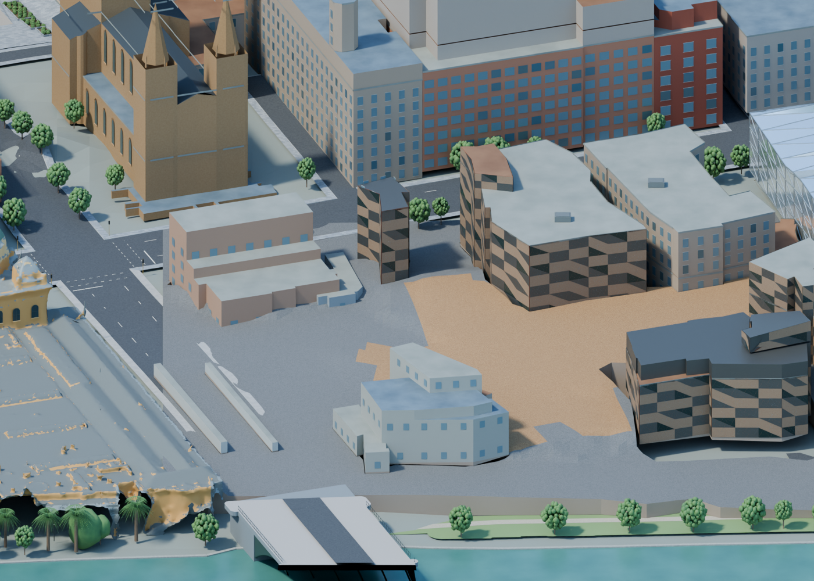

### Latest pass: Federation Atrium

The mapped corridor now reads as an authored glass and steel gallery instead of an uninterrupted generic solid. Eight overlapping objects were clipped reversibly;252 outside surface triangles retained. Original vertices/faces unchanged, original material assignments recoverable. Thirty roof facets follow local median capture heights;413 authored200mm square frame members,108 glazing panels and polished concrete material establish the gallery. Upper/lower joins follow survey boundaries.

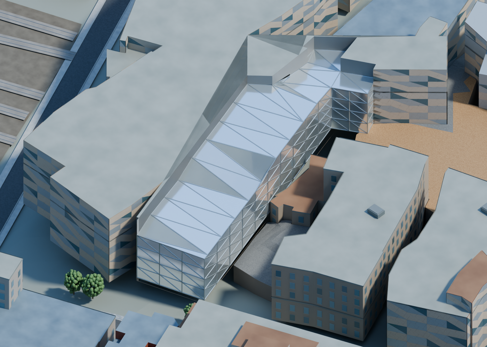

This remains a provisional architectural approximation. Roof folds and regular frame nodes are not as-built reconstruction. Floor grades from local10.7m north to12.2m south, inferred from North Atrium height and adjacent deck contact; interior elevation unverified. Precise entrance/cantilever structure, southern volume, glazing folds and neighbouring NGV/ACMI façade hierarchy still require work. No photographic textures used. [Official venue reference](https://fedsquare.com/plan-your-event/atrium), [official schematic map](https://fedsquare.com/map).

### 1. City and geography

Start at **Aerial overview**. The Yarra, Hoddle grid, public tree positions and surveyed building outlines establish the city’s layout. The model contains 8,520 active surveyed building sections, 2,990 ordinary-road features, 70 selected open-space parcels and 307 retained trail features.

Road widths, pavement bands, level ground and bridge carriageways are authored. The large neutral ground gaps and hard coverage boundary remain visible. They are incomplete areas, not established surface types.

### 2. Flinders and the railway precinct

Use **02 Flinders precinct**, then **11 Flinders platform inspection**. Muted cream and terracotta frontage guided by restoration records, green copper-like domes, authored zinc grain and roof seams supply the station’s material identity. Four shallow pitched canopies and six schematic platform decks provide the first precinct layout.

The [PTV precinct diagram](https://www.ptv.vic.gov.au/assets/DTP1124-FlindersStreetStation-Precinct-Map_Degraves-Subway_web_Stage-1_v3.pdf) informs topology, not measured dimensions. Platform 12–13 geometry remains a covered placeholder. Ballast follows explicit ordinary railway alignments; extra Flinders margins exclude retained roads and ground building footprints. Yard extents, access structures, individual tracks and clearances remain unfinished.

### 3. Buildings and streets

Use **03 Hoddle grid streets**. Sixteen authored facade palette variants share consistent assignments within retained source structures. Low-rise windows use three illustrative proportion families; taller glass and masonry surfaces have separate authored finishes. Window grids and many individual building colours still require reference-specific treatment.

Central CBD pavement bands use an illustrative bluestone finish. The [City’s 2024 operating procedure](https://mvga-prod-files.s3.ap-southeast-4.amazonaws.com/public/2024-08/operating-procedure-bluestone.pdf) gives the 1m × 0.5m paver rhythm and explicitly says existing coverage is incomplete. The model’s broad material assignment is not an existing-surface inventory. Kerbs, crossing guides and flat levels are also authored approximations.

### 4. Federation Square and St Paul’s

Use **06 Federation Square detail**, **07 Federation roof inspection**, then **10 St Pauls Cathedral inspection**. Federation Square has grouped five-piece triangular cladding, procedural sandstone/zinc grain, source-owned gable geometry, roof seams and an illustrative Main Square paving outline. [Fed Square’s design description](https://fedsquare.com/history-design) informs its panel language; exact facade material distribution and plaza slopes remain unresolved.

St Paul’s has three authored tapered spires, warm stone, pointed window bays and an interim pitched roof on retained survey outlines. The [cathedral guide](https://cathedral.org.au/wp-content/uploads/2022/11/2022-English-Guide-Sheet-Final.pdf) informs architectural character. Roof junctions, buttresses, entrances, exact fenestration and height-datum reconciliation are unfinished.

### 5. Riverfront and arts precinct

Use **12 Southbank paving inspection**, **13 Arts Centre spire inspection**, then **14 Hamer Hall inspection**. Southbank’s authored bluestone overlay follows three retained promenade parcels in an illustrative eastern reach. The [City’s completed upgrade notice](https://participate.melbourne.vic.gov.au/emerging-tech-testbed/southbank-promenade-1/works-between-princes-bridge-and-evan-walker-bridge-are-now-complete) supports bluestone there; exact works boundaries, upper/lower levels and furniture remain unresolved.

The Arts Centre upper survey blocks are replaced by an open pale steel lattice and gold skirt. The theatre now has authored concrete lower surfaces, bronze upper panels and illustrative horizontal glazing. The spire retains a 150m survey-relative top, which is not reconciled with the published 162m street-level height. Current refurbishment, exact lattice, mast and facade details remain unfinished.

Hamer Hall has a consistent concrete finish and fifteen illustrative framed bays on an east-facing sector. [ARM’s exterior description](https://armarchitecture.com.au/projects/hamer-hall/) distinguishes road-side opaque windows from irregular riverside openings. The all-around bay mesh was superseded and remains hidden. River-side carved concrete, balconies and current museum works still need reconstruction.

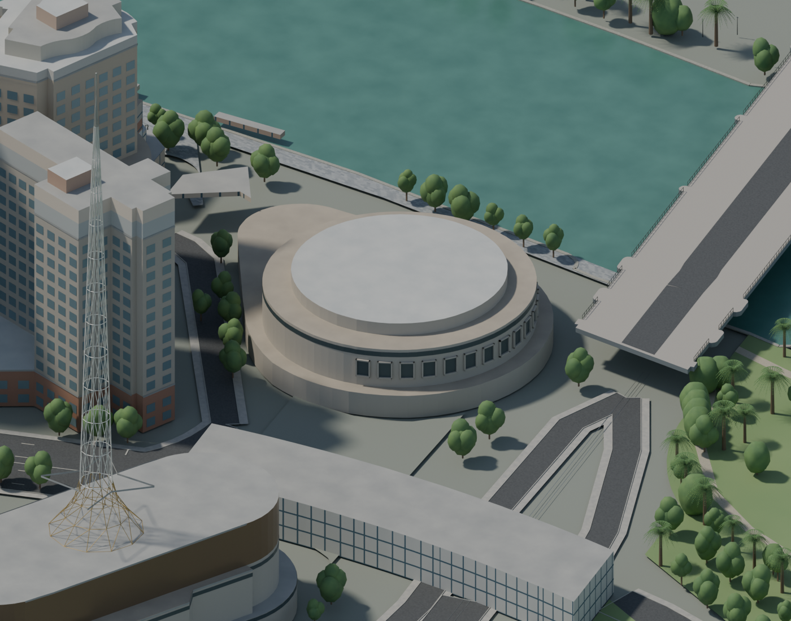

### 6. Southern Cross, trees and river details

Use **04 Southern Cross roof study** and **05 Southern Cross roof detail**. The authored dune roof, standing seams, Y supports and four diffusing rooflight bands follow a retained survey footprint. [Grimshaw](https://grimshaw.global/projects/rail-and-mass-transit/southern-cross-station/) and the project engineer inform the architectural language. Exact waves, support layout, apex vents and platform integration remain unresolved. The support cutaway is a separate explanatory render, not the normal scene state.

Use **09 Date palm grove inspection** for vegetation. Public inventory points place 15,512 trees. Ordinary trees use three authored lobed profiles; 190 Canary Island date palms have layered pinnate crowns. The other 210 palms remain generic. Crown dimensions, individual form, season and condition are authored, not measured.

Use **08 Northbank asset inspection** for mapped feature-light placeholders, bank coping and Princes Bridge finishes. Pole forms, bank construction and bridge rail details are simplified. Bridge arches, ornaments and accurate approach levels remain unfinished.

## Where the design lives

| Collection | Contents |
| --- | --- |
| CITY - surveyed envelopes with authored facade materials | Source envelopes, window batches, roof surfaces and illustrative equipment |
| CITY - reference-authored landmarks | Station, cathedral, Federation Square and arts precinct refinements |
| GROUND - official horizontal geography, authored levels | Roads, pavement, water, rail beds, bridge surfaces, parcels and paths |
| TREES - mapped locations, authored crowns | Shared crown geometry at inventory positions and batched trunks |
| PREVIEW - lighting and aerial camera | Inspection cameras, procedural atmosphere and directional sun |

Inspect Custom Properties for source IDs and limitations. Hidden original objects and prior meshes support recovery; they are not current visible design.

Principled materials, procedural grain, roughness, relief, a procedural sky, directional sun, Cycles and AgX produce the preview. Lighting is authored, not live weather.

## Reproduce and review

`scripts/blender/refine_live_city.py` applies incremental scene details without saving or reloading. Dedicated render scripts save inspection cameras while preserving the saved active camera. `render_city_review.py` refreshes overview, precinct and street renders without saving the scene. Geometry preparation scripts retain query/source digests and authored assumptions.

`docs/city-scene-audit.json` records counts, render hashes, limitations and incomplete findings. Older review images may predate newer detail passes; use their audit entries to determine scope. Historical notes are in `blender-refinement-notes.md` and `blender-pass-history.md`.

Completion still requires fuller ground coverage, reference-specific building detail, bridge and rail reconciliation, present-day redevelopment checks, a coherent city boundary and live Blender refresh. The browser continues to use older assets; these Blender passes do not prove the web scene is current.

## Mapped seating inspection

Camera 15 Mapped wooden seats inspection shows authored benches at public asset points. The City furniture export contains 446 explicit wooden-batten Type 2 seat records within the preview bounds; one inside a retained ground-building footprint is excluded. The remaining 445 retain asset IDs and source coordinates. Bench dimensions, backrests, supports, orientation and flat datum are authored assumptions. Other seat types are omitted rather than treated as wooden benches. The retained export digest and rows are in `city-authored-seats.json`.

## Building edge shading

Visible survey envelopes at least 8 m high receive a reversible 0.12 m, two-segment angle-limited bevel. This is an authored light-catching detail, not measured construction geometry. The source mesh and footprints remain recoverable without the modifier. It improves corner shading but does not resolve generic window repetition or missing reference-specific facade details. `observatory-street-edge-study.png` records the street-camera inspection.

## Queen Victoria Market roof study

Camera 16 inspects five authored A–E gable ranges fitted to survey section 24605 (structure 811022). The official conservation plan, Figure 26 and section 3.12, documents the five ranges and gabled construction. This is a historical plan, not evidence of current refurbishment status. Roof coverage, spacing, 6.8 m eave and 10 m ridge are illustrative. Southern ranges remain schematic; exact roof pitches, solar arrays, lanterns, open sides and present-day changes are unresolved. The original survey envelope is hidden and recoverable. See `qvm-source-audit.json` and `qvm-authored-roofs.json` for evidence and assumptions.

The next market pass removes the upper solid-envelope walls and inserts 218 timber posts, beam runs and dark asphalt under the five roof ranges. The conservation plan supports open construction, timber post proportions and approximately 5.2 m spacing. Exact post correspondence, flat ground height, stalls, truss details and current restoration remain unresolved. Southern envelope geometry is retained; the hidden original survey mesh remains recoverable.

The market roof finish adds procedural corrugation relief and 21 ridge/eave guide runs. The historical conservation plan supports corrugated galvanised metal; 76 mm corrugation pitch, 8 mm bump relief, grain colours and guide dimensions are authored assumptions. Camera 16 now views from the north to reduce foreground tower obstruction. No photographic material is used.

The southern market placeholder is now replaced by illustrative F and J gables plus the K–L hierarchy of a 17 m central bay flanked by 11.3 m secondary bays. These forms follow sections 3.13–3.15 of the conservation plan; the local boundaries, pitch, heights, 195 columns and pale brown F dividing wall are authored. Original survey section 24605 is hidden and recoverable. Lanterns, trusses, stall fronts, current redevelopment and solar installations remain unresolved. Preparation geometry is in `qvm-south-authored-roofs.json`.

J and K–L now have authored roof lanterns: a gabled translucent-cover approximation on J and a convex corrugated metal cover on K–L with alternating sash/louvre bands. The historical conservation plan describes these forms; lantern dimensions, 10 m maximum level, proportions and optical shading are illustrative. The translucent material is an aerial colour/roughness approximation, not physically verified polycarbonate. Exact current materials, closures, services, solar arrays and refurbishment remain unresolved.

## Recorded low-rise gable roofs

The public footprint records identify roof types as well as heights. A batch of 395 single-section, simple rectangular low-rise buildings recorded as Gable now receives pitched roof geometry within the retained maximum height. Long-axis ridge direction, pitch/eave heights and zinc appearance are authored, not measured. Complex footprints, multi-section buildings, and landmarks are excluded. Capture dates and source IDs are retained in `city-survey-gables.json`. These roofs replace flat caps and remove overlapping illustrative equipment; materials remain unverified for individual buildings.

A separate batch reconstructs 358 simple low-rise footprints recorded as Hip with four sloped roof planes. Selection uses single-section buildings and near-rectangular footprints, excluding complex landmarks. The source maximum stays fixed; ridge orientation, pitch/eave heights and zinc finish are authored. `city-survey-hips.json` retains source IDs, capture dates, geometry and limitations. The roof classification supports the form, not individual roof colour or present-day condition.

## Parking markings inspection

Camera 18 shows 900 illustrative parking bay outlines at retained City parking asset points. The fetched current export supplies points rather than the polygons described in the catalogue. Parallel 5.5 × 2.2 m rectangles, nearest-Vicmap-road orientation, 90 mm paint width and flat height are authored. Only complete rectangles covered by the modelled asphalt and at least 1.5 m clear of mapped tree points are retained. This is neither an actual paint inventory nor an occupancy/restriction claim; no private vehicle tracking is used. `city-parking-markings.json` retains IDs, source dates, geometry and digest.

## Daylight presentation

The preview uses AgX Medium High Contrast, +0.45 exposure and a more neutral authored sun colour. This makes water, foliage and facade colours clearer while retaining roof shading. It is presentation lighting, not calibrated material colour, current Melbourne weather or a geographical sun calculation. `observatory-daylight-study.png` records the inspected Flinders view.

## Eureka Tower crown

Camera 19 inspects authored gold glazing on the retained Eureka structure 815210, captured in 2018. Fender Katsalidis documents the gold crown; the operator guide describes the gold-plated upper ten floors. The 265 m lower colour boundary and optical gold palette are illustrative, not measured floor boundaries or calibrated glass. Survey top and footprint sections remain intact. Red stripe, exact blue/white facade composition, crown rakes and current finish details remain unresolved. Source records and links are in `eureka-source-audit.json`.

## Princes Bridge arch structure

Camera 20 looks along the river at three authored iron arch spans and bluestone piers. [Museums Victoria](https://collections.museumsvictoria.com.au/items/1396611) describes the bridge as 120 m long and 30 m wide, with three riveted iron girder arch spans. The retained section 36402 footprint is about 150 × 34 m, so an illustrative 120 m structural core is centred within its approach envelope. The original solid envelope is preserved hidden; the visible envelope becomes a deck slab to expose the arches. Six ribs per span, parabolic profile, spring/crown levels, pier widths, materials and alignment are authored assumptions. Exact ornamental ironwork, granite cutwaters, lampstands and present-day condition remain unresolved.

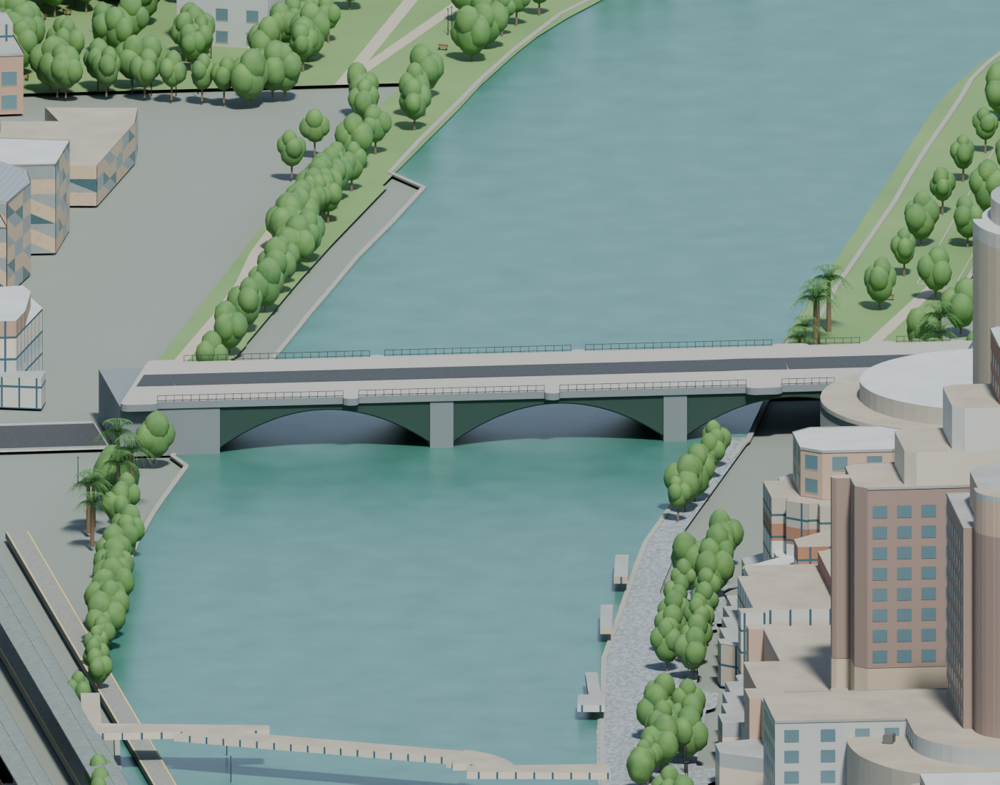

## Structure colour consistency

Generic sections of the same public structure previously received different deterministic palettes. The consistency pass chooses the section with the largest vertical wall area and shares its authored facade finish across eligible sections of that structure. Original finish names are retained per object and in `city-facade-colour-consistency.json`. Individually authored landmark finishes are excluded. This removes arbitrary colour changes; it does not verify actual materials or mixed podium/facade zones. Roof caps and authored window meshes are retained.

## Eastern railway coverage gap

A study of retained explicit ordinary railway features east of the station (model X −15 to 800 m, Y −170 to 25 m) yielded only four source features and about 176 m² of authored buffered surface after road/building exclusions. This does not support a whole-yard reconstruction, so no new surface was applied. `flinders-east-coverage-audit.json` records the source digest and IDs. Additional public track geometry or a yard/reference plan is needed before replacing the broad unfinished ground convincingly.

## Expanded railway source retained

The original corridor rail query covers longitude 144.949–144.972 and latitude −37.8245–−37.814, smaller than the city preview. A new official Vicmap query covers the same expanded bounds used for roads (144.942–144.984, −37.827–−37.800). It retains 475 unique features: 156 railway, 140 tramway, 114 underground, 60 operational bridge and five siding features. `city-rails-expanded.json` preserves geometry, source attributes, query, fetch time and raw response digest. This import has not yet changed the Blender scene. New surface rails must be reconciled with bridge/tunnel classes and retained station geometry; flat placement cannot establish actual track elevation or multiplicity.

## Expanded ordinary surface railway pass

The expanded official source supplies 106 additional explicit ordinary railway features absent from the original corridor query. Their illustrative 3.6 m ballast beds are unioned and clipped to the model bounds, adding about 33,706 m² in 558 triangles. Authored steel pairs use 1.6 m gauge and a flat 0.50 m top datum. Only complete alignment segments inside the preview bounds receive steel. Original corridor rails remain; feature IDs prevent duplication across imports. Underground, bridge, siding and tramway classes are excluded from this pass. Individual track count, exact gauge, sleepers, bridge/tunnel transitions and surveyed vertical clearances remain unresolved; this is not a measured complete railway network or yard boundary.

## Expanded railway sleeper detail

Camera 21 inspects the added ordinary surface railways. 13,791 authored concrete sleepers repeat at 0.65 m spacing on complete retained line segments inside the preview bounds. Their 2.44 × 0.24 m plan dimensions and flat 0.405–0.445 m levels match the existing illustrative treatment. The public source supports alignment, not sleeper specification, individual track multiplicity or surveyed elevation. Junction equipment, turnouts and clearance reconciliation remain incomplete. The dedicated preview records this pass; the earlier full-city renders precede these sleepers.

The expanded sleeper footprints are now unioned before triangulation, removing coplanar overlapping top faces at schematic junctions. The 13,791 illustrative footprints produce about 8,052 m² of non-overlapping top surface and 83,682 top/edge faces. Original box geometry is preserved in a hidden reference object. This fixes shading overlap; switch rails, junction equipment and realistic turnout sleeper arrangements remain unresolved.

## Rialto retained-envelope inspection

Camera 22 records the existing generic treatment of candidate Rialto structure 803943 (19 retained sections). Identification uses location near the [official address](https://rialto.com.au/contact/), not a named source attribute. [Rialto's history](https://rialto.com.au/discover/) identifies Gerard de Preu and Partners with Perrott Lyon Mathieson for the towers and Woods Bagot for later podium/lobby work. No new facade material claim is made: curtain-wall layout, optical glass properties and present-day podium remain unresolved. A linked leasing PDF returned 404. The inspection is evidence for the next modelling decision, not a finished landmark pass.

Rialto's eligible generic upper sections (base ≥31.5 m) now share the retained main section 16342's authored glazing finish. This removes arbitrary facade colour bands across stepped sections. Separate roof caps remain, and previous finish names are retained on changed objects and in `rialto-colour-consistency.json`. The cutoff and optical palette remain illustrative; this does not reproduce measured glass specifications, curtain-wall mullions or refurbishment details. Camera 22 is rerendered after this correction.

## Generic upper-tower finish consistency

299 public structure groups now share a consistent authored finish across eligible upper sections, changing 821 section assignments. Eligibility requires source structure height >45 m and section base ≥20 m; the largest eligible vertical wall area supplies the finish. Both grouped glazing and generic tall masonry are included. Rialto, Eureka, St Paul's, Queen Victoria Market and the arts-precinct bespoke structures are excluded. Roof caps remain separate, lower sections retain their finishes, and original upper-section assignments are stored per object and in `city-upper-tower-consistency.json`. This corrects arbitrary generated palette changes, not surveyed material zones: actual colour, podium transitions, optical glass and individual curtain-wall detail remain unverified.

## Saved colour preview and material coverage

A reopened-file audit found the Layout viewport still in Solid shading. Layout is now saved in Material Preview, camera view, with scene lighting/world enabled and overlays hidden. Saved camera remains 02 Flinders precinct. Reopening headlessly verified these settings persisted. The current file has 24,617 render-visible meshes, no missing material assignments and no material image-texture nodes. This establishes material coverage and absence of photographic texture nodes, not correctness of individual real colours or complete geometry. Live viewport appearance remains unverified while the Mac is locked; render images are the current visual evidence. `city-material-coverage-audit.json` records the audit.

## Tram stop source for street refinement

170 Metro Tram stop points within the preview bounds are retained from Transport Victoria's official Public Transport Stops GeoJSON, with dataset metadata modified 28 September 2026. `city-tram-stops.json` stores source features, projected points, resource metadata, license ID, fetch time and response digest. The City Circle-only export was not used to establish present-day geometry because its inspected record had a 2011 source date. No platform mesh has been added: stop points do not establish platform outlines, pole positions, current service or accessible boarding layout. Those details need further primary references.

## Tram platform placement check

Yarra Trams/DTP's 2023–2024 La Trobe upgrade notices support raised platforms, shelters, seats and lighting, but do not supply measured as-built outlines or prove present-day completion. Exhibition Street points 46867/46868 lie about 1.76/4.04 m from their nearest retained tram line. A guessed 2.8 m-wide platform centred on 46867 would overlap the authored rail gauge. No such platform is added; point coordinates cannot be assumed to be platform centroids. `tram-platform-reference-audit.json` preserves references and this clearance finding. Accurate placement needs an as-built footprint or a clear primary plan.

## Mapped stainless steel seat detail

292 public inventory records explicitly described as `Seat - Stainless Steel Straight Seat` now receive shared authored seat meshes; two points inside retained ground-building footprints are excluded. Camera 23 inspects a local cluster. The stainless material is supported by the model description, but slat/back/support shape, dimensions, finish roughness, nearest-street parallel orientation and flat level are illustrative. Exact asset appearance, access clearance and current existence remain unverified. Source records and digest are retained in `city-authored-steel-seats.json`. The furniture endpoint currently returned only seats despite its broader catalogue title; no bins were inferred.

## Local Bourke side paving reconciliation

A local authored paving overlay on Vicmap segment 76347243 reduces the broad generic asphalt appearance beneath part of the mapped seat/tree cluster. Side bands run 6–9 m from the retained centreline, with 20 m trimmed at each segment end and ground-building exclusions. This adds about 154 m² in six triangles at a flat 0.30 m level. Bluestone shading is authored; dimensions, kerb position, lane allocation and current surface are not measured. The inventory identifies Bourke Street between Russell and Swanston, but does not supply a footpath polygon. Camera 23 records the local correction; it is not a whole-block streetscape reconstruction.

## Hardware Lane bluestone reach

Camera 24 inspects an authored bluestone overlay on retained Vicmap Hardware Lane segment 76809583 between Bourke and Little Bourke streets. [The City's completion notice](https://participate.melbourne.vic.gov.au/hardware-lane/stage-one-works-complete), dated13 November2023, confirms bluestone paving, trees and vehicle barriers for this stage. The model adds about344 m² in10 triangles, using a6.4 m ribbon,10 m endpoint trims, ground-building exclusions and flat0.30 m level. The documented material supports the finish; exact width, joint pattern, kerbs, barriers, outdoor dining layout and2026 condition remain unverified. No photographic texture is used.

## Generic roof tonal depth

The three existing generic pale, warm and zinc roof materials use darker authored colour ranges with restrained roughness/metal response. Source geometry, procedural grain and preview lighting remain intact; previous ramp colours are retained on the material datablocks. This reduces the very pale roof appearance in the city render. Individual real roof colours, reflectance, roofing system and weathering remain unmeasured; this is an authored presentation pass, not additional photographic evidence.

### Irregular tree crown pass

Replaced the three five-lobe non-palm crown meshes with seven shared thirteen-cluster authored silhouettes on 15,112 tree objects. Public inventory positions and existing illustrative object scales remain unchanged; these shapes do not measure individual canopy geometry, species form, branches, season or condition. Palms retain their earlier geometry. The Bourke stainless-seat study was freshly rendered and inspected after this change; full overview images precede this pass. Smaller lobes improve variation, but close views remain stylised and street furniture clearance still needs work.

### Generic glazing tonal pass

88,825 previously generic window-bay faces receive three restrained authored blue-grey tones with roughness 0.24–0.32. Named landmark material overrides remain excluded. No glass specifications, blind states or occupancy were inferred from this pattern; it is a presentation approximation. The first high-contrast render was rejected during visual inspection and the palette reduced before the final review renders. Shader parameters follow the [Blender Principled BSDF documentation](https://docs.blender.org/manual/en/5.1/render/shader_nodes/shader/principled.html); material values remain artistic assumptions. Overview, Flinders and CBD review images include this pass and the irregular tree crowns. Repeated generic facade geometry and incomplete street clearance remain visible.

### Flinders ballast normal correction

A saved-scene audit found all 70 wider ballast-margin faces pointed downward. Corrected their winding in the existing Blender mesh and in the geometry generator; retained 13 source railway features and the 15,247.945 m² illustrative footprint. The current platform close-up was rendered and inspected. This fixes a mesh/shading defect, not the station's outstanding fidelity issues: platform widths and levels are schematic, the track approach and adjacent neutral ground need further reconciliation, and nearby generic facades remain stylised. Full aerial images currently precede this normal correction.

### Flinders restored colour direction

The earlier mustard/gold appearance did not follow the documented restoration direction. The Victorian Government's restoration announcement specifies lighter stone, darker terracotta/maroon and darker green trim. Dulux's primary case study page 4 publishes Cream Munsell 10YR 7/4, Terracotta 10R 3/8 and Dark Green 10GY 2/2. Its page photograph was inspected as reference only; it is not used as a texture. Four existing material batches now use restrained authored RGB approximations with explicit sRGB-to-linear conversion. These are not calibrated Munsell conversions or current paint measurements. Existing schematic geometry/material boundaries, dome copper and roof materials remain; exact facade proportions still require improvement. The latest platform study render was inspected after the pass. Full aerial images precede this palette revision.

References: [Victorian restoration announcement](https://www.premier.vic.gov.au/flinders-street-station-be-repainted-its-original-colours), [Dulux restoration case study](https://assets.ctfassets.net/j001bqnk84dk/1Ettb2QUEi8Lpt9QsWfOMi/3d7d79aa7a321122b17616960243b255/dulux_case__study_flinders_st_web.pdf).

### Flinders painted masonry joints

The [Local Jobs First restoration account](https://localjobsfirst.vic.gov.au/commissioner/newsroom/news-items/flinders-st-redevelopment) describes repainting the bricks and dark lines among the mortar joints. The inspected Dulux page-4 reference also shows a joint rhythm. Added procedural, locally projected masonry to the existing terracotta batch, including separate projections for long walls and end faces. Authored 0.60 × 0.25 m courses, 6 mm dark joints and subtle 3 mm shader relief are illustrative dimensions; exact courses, joints and current weathering are unmeasured. No photographic textures were introduced. The platform study is the current inspection view; earlier full-city images precede this pass.

Camera `25 Flinders masonry inspection` provides a dedicated facade close-up with a near clipping plane 15 m before its target to omit obstructing foreground buildings. This is a detail inspection, not an uncut city view. Its render is `docs/images/observatory-flinders-masonry-study.png`; the main saved aerial camera remains `02 Flinders precinct`.

### Flinders fitted window heads

The close facade view exposed rectangular glass above the rounded render heads. Replaced 282 imported illustrative glass boxes with closed, twelve-segment semicircular-head prisms, retaining each opening's bounding width, height, depth and location. Other glass batches remain unchanged. The generator now also creates rounded panes for these bays. This corrects the model's internal fit; it does not establish exact surveyed fenestration or restoration dimensions. The imported GLB stores boxes as 24 duplicated vertices and 12 triangles; safety checks confirmed those groups before replacement. Camera 25 remains a clipped detail inspection.

### Retained civic parcel coverage

The park pipeline selected only `Parkland and garden`, omitting seven records explicitly classified `Civic square and promenade`. Added generic authored paving on six retained parcel IDs: M020718, P378294, M021968, M012907, M020717 and M021969, totalling 11,043.25 m² after clipping/exclusions. Q002052 is excluded to retain the separately authored Federation/Flinders precinct. Existing park, road, paving, Southbank overlay and ground-building footprints are subtracted. Source properties and digest are retained in `city-civic-surfaces.json`. The [VEAC catalogue](https://discover.data.vic.gov.au/dataset/veac-metropolitan-melbourne-open-space-inventory) describes public open-space polygons and category/ownership, not material or land-cover polygons. Its July 2026 catalogue update does not establish individual parcel capture dates. Paving material, flat level and present-day condition remain authored/unverified. Several parcels intersect the hard preview boundary; this pass does not repair that boundary or all neutral ground gaps. Camera 26 inspects M020718; full-city renders precede this pass.

### Civic coverage review

Cameras 27 and 28 inspect the three retained Docklands waterfront parcels and P378294 harbour parcel. Their rendered paving remains within the clipped source geometry; the hard preview edge, generic surrounding roof geometry and unspecific ground beyond the parcels are clearly visible. M020717 is mostly represented in camera 26 but its northern edge lies just outside that frame, so a complete individual visual review remains outstanding. No current-condition or exact paving-material claim follows from this inspection.

The Docklands render identifies the stadium roof as a high-impact next refinement. The [stadium operator](https://www.marvelstadium.com.au/about-the-stadium) and [original engineering consultant](https://www.aurecongroup.com/projects/property/marvel-stadium) confirm a retractable roof. This is source direction only; exact roof geometry, source structure identity and present-day configuration have not yet been reconciled or modelled.

### Docklands stadium roof reference audit

The candidate stadium group is retained public structure **808392**, comprising 16 sections captured 11 May 2023. Coordinates match the stadium location; the source has no explicit stadium name. Section 934 supplies a roughly43,366 m² upper footprint with relative top40.7 m (source maximum42.7 m minus datum2 m). The survey's Flat roof classification does not describe the retractable mechanism.

The original engineers' paper, *Three New World Class Sporting Facilities in Melbourne*, Mark Sheldon, Peter Chancellor and Brian Dean, Connell Mott MacDonald, IABSE Melbourne2002, section2.2.1, describes two168 ×52 m moving panels, east-west travel and parking above the fixed side roofs. Its summary elsewhere mentions54 m width; detailed descriptions consistently use52 m. The paper also describes an approximately160 ×100 m opening and raised supporting trusses. These are historical design dimensions, not a present-day as-built measurement. [Paper reproduction](https://www.slideshare.net/slideshow/iabse-2002/54054492). The [current operator](https://www.marvelstadium.com.au/about-the-stadium) confirms the retractable mechanism but does not supply an exact roof mesh or live position.

`stadium-roof-reference.json` retains complete source records, digest, main footprint and an authored long axis from its minimum rectangle. Camera29 records the current generic roof as a baseline. New roof geometry is still outstanding; cladding, curvature, truss setout, refurbishment and roof operational state remain unverified.

### Stadium fixed roof and closed panels

Replaced the generic upper section934 block and 65 overlapping roof-cap faces with a survey-bounded authored fixed roof (705 triangles) and two168 ×52 m closed panel surfaces (2,184 quads). A shallow authored cross-curve stays below relative40.7 m; the fixed perimeter is31.35 m, separated50 mm from the retained31.3 m cap to avoid coplanar artifacts. Twenty-seven procedural seam guides at4 m spacing are illustrative. Pale coatings, slope, curvature and joint rhythm are not measured cladding specifications. The depicted closed position is a presentation choice, not realtime roof status.

The first render exposed422 floating generic window faces and844 sill/lintel faces near the former upper block; they were removed from the shared meshes within a400 mm footprint tolerance and height31.5–40.71 m. Original meshes are preserved as named reference datablocks; section934 is retained hidden. Lower stadium masses and generic facade treatment remain unresolved, along with exact raised trusses, roof mechanism, seating and present-day refurbishment. Camera29 is the updated inspection view; earlier full-city renders precede this roof pass.

### Stadium panel support silhouette

The original engineer paper section2.2.1 specifies two three-dimensional support trusses per moving panel, approximately12 m deep with a165 m clear span. Four authored triangular-section supports now distinguish the moving panel structure from the roof sheets. Their parabolic top chords, sixteen bays,1.3 m width,150 mm member radius and detailed setout are illustrative, not extracted from a verified section drawing. The paper figure image could not be inspected through the available web tool; no exact topology claim is made.

Panel sheets now sit at an authored relative28.7 m datum, with12 m support rise reaching40.7 m at the chord centre (tube radius adds150 mm). Fixed-roof slopes join the lower sheet datum to the retained perimeter, rather than conflating the maximum survey height with the cladding plane. Removed65 underlying31.3 m cap faces which would obscure these surfaces. This is a model-height reconciliation, not an as-built roof survey. Fixed end runway trusses, bogies, precise facade/roof junctions and present-day refurbishment remain outstanding.

Paper metadata is independently indexed under DOI [10.2749/222137802796336090](https://doi.org/10.2749/222137802796336090); full-text dimensions were read from the [engineers' paper reproduction](https://www.slideshare.net/slideshow/iabse-2002/54054492).

A second roof review found48 additional cap faces in source925's wider outline. Removed them, then restored the required outer band as the exact925-minus934 polygon difference:1,765.115 m²,64 triangles, authored flat datum31.36 m. The final inspection shows the exposed dark wedges closed and the four supports visible; exact as-built roof junctions remain unresolved. This pass supersedes the earlier panel-sheet maximum-height interpretation and hides its seam guides.

## Saved-scene review — 6 October 2026

The overview, Flinders precinct and Hoddle-grid previews were freshly rendered from the saved scene after the stadium support pass. A saved-datablock audit found material assignments on all 24,920 render-visible meshes, no material or world image-texture nodes, and Material Preview with scene lights and world enabled in Layout. The saved camera remains 02 Flinders precinct. See `saved-city-material-audit.json` for the scene hash and limits.

This verifies material coverage, not architectural completeness. Generic facades, neutral rail-yard ground, street widths and the hard dataset boundary still need refinement. The Mac remained locked, so the live Blender window and walkthrough interaction were not verified.

## Railway ballast grain

The four retained ballast meshes have 1,251 upward-facing polygons and no downward-facing polygons. Their shared authored material now separates metre-scale tonal variation from approximately 50 mm procedural Voronoi stone cells, with 8 mm inverted bump, roughness 0.92 and zero metallic response. This changes shading only; it does not fill unclassified rail-yard ground or add measured stones.

Reference: [ARTC Ballast Specification ETA-04-01, revision 1.3, 19 February 2025](https://extranet.artc.com.au/docs/eng/track-civil/procedures/ballast/eta-04-01.pdf), which describes crushed aggregate and grading. This general engineering reference does not establish the Melbourne metropolitan network specification. Cell size, bump, weathering and colour are authored approximations.

## Flinders schematic platform ends

The official one-page [PTV station precinct map](https://www.ptv.vic.gov.au/assets/DTP1124-FlindersStreetStation-Precinct-Map_Degraves-Subway_web_Stage-1_v3.pdf) was visually inspected. The six existing schematic decks now have tapered eastern ends, with paired safety strips following the taper. The 15 m taper length, 65 percent terminal width, exact orientation and yellow strip widths are authored approximations; the diagram establishes grouping and illustrative form, not surveyed dimensions. Current construction notices on this map were not adopted as current operational facts. Existing canopy and rail clearances remain unresolved.

## CBD midblock lane guides

Added 452 authored white dash strips on 57 retained Vicmap sections of King, Queen, Russell, Exhibition and Lonsdale streets. Selection requires bidirectional vehicular access and DS (divided road represented by one centreline), per the [Vicmap product description](https://www.land.vic.gov.au/__data/assets/pdf_file/0030/629661/Vicmap-Transport-Version-4.2-28-March%2C-2023.pdf). Geometry remains within the central preview and leaves at least 24 m from source segment endpoints.

The 100 mm, 3 m line / 9 m gap pattern follows published VicRoads Supplement to AS1742.2 guidance (primary URL currently returns 404; search-index text retained as the available evidence). Two offsets of 3.2 m are authored and do not establish actual lane counts or exact current markings. No centre divider, arrows, turning pockets or signal states are inferred. This adds street rhythm; actual median geometry and street widths remain unresolved.

## Queen Victoria Market interior carpark ground

The [operator parking page](https://qvm.com.au/parking/) still lists open-air parking. Its [Gurrowa Place update](https://qvm.com.au/gurrowa-place-update/) describes conversion around 2028, so the planned park has not been substituted into this present-day scene. A conservative asphalt patch is authored south of the sheds, informed by the visually inspected 2002 conservation-plan block diagram and the retained roof coordinate frame. Roads, paving and ground-building footprints are excluded.

This is an interior presentation patch, not a surveyed boundary or verified current construction stage. The colour, flat level and extent are approximate. Parking bays, vehicles and occupancy are not inferred. The larger precinct remains incomplete.

## Authored flat-roof parapet relief

Added restrained parapet relief to 173 single-section, near-rectangular buildings with an explicit Flat roof class, height 6–25 m and footprint area 60–1,200 m² in the central preview. Source footprint boundaries remain the basis for placement; the [City dataset](https://data.melbourne.vic.gov.au/explore/dataset/2023-building-footprints/) defines wall footprints rather than measured roofprints. Mixed historical capture dates are retained per source ID.

Parapet presence is an authored architectural assumption. Width 0.22 m, rise 0.40 m, 0.025 m separation and pale matte finish are unmeasured. This adds up to 0.425 m above the retained envelope; it does not alter the original survey geometry. Exact current roof form, material and equipment remain unresolved. No photographic textures used.

## Short low-rise facade consistency

A saved-scene audit found 2,103 low-rise source sections still using original procedural facade-grid shaders. These generic stone, concrete and terracotta materials were replaced with plain authored wall finishes using their existing palette colours. Existing separate geometry windows remain. Eligible Structure sections 3–8 m high receive restrained separate window quads, with 3.8 m spacing, 1.4 m width and 1.8 m height as authored proportions.

This corrects inconsistent presentation rather than claiming measured fenestration. Public source envelopes and structure groups remain unchanged. Bespoke landmark materials are excluded. Exact individual walls, openings, occupancy and current building condition remain unverified.

## Current consolidated review

The visual walkthrough now contains 17 views, including the short low-rise facade correction and current Flinders platform inspection. The repeatable refinement entrypoint includes the completed ballast, platform-end, midblock lane-guide, QVM interior asphalt, flat parapet and short-facade passes. The entire historical pipeline was not rerun; the updated entrypoint was syntax-checked and these passes were individually applied and rendered.

A fresh saved-scene audit covers 24,924 render-visible meshes, with no missing polygon material assignments and no material/world photographic image nodes. Saved Layout uses Material Preview with scene lights/world, and camera 02 Flinders precinct remains active. Computer-use connection failed during this review, so live-window refresh remains unverified.

## Aerial material colour separation

Following feedback that the city looked too grey, authored material families were separated more clearly: warm stone, muted brick/terracotta, cooler concrete, cool metal roofing, warm mineral roofing and varied deeper glazing tints. Geometry and lighting were held fixed for the initial comparison. Bespoke landmark materials remain separately referenced.

These generic RGB palettes are authored artistic decisions, not surveyed individual building colours or calibrated material samples. Historical public footprint geometry remains the placement evidence; roof colour does not establish roof construction. No photographic texture nodes were added. Exact present-day finishes and large neutral ground gaps remain unresolved.

## Railway precinct ground from open map geometry

A bounded direct OpenStreetMap API extract returned eight complete closed railway land-use ways, retained with IDs, versions and timestamps in `city-rail-land-osm.json`. After clipping and excluding existing roads/paving, park and civic surfaces, ground-building footprints and river, the authored ground layer covers 128,531.7 m² in 649 triangles. Existing trackbeds and station decks remain above this flat 0.05 m presentation level.

The [landuse=railway definition](https://wiki.openstreetmap.org/wiki/Tag:landuse%3Drailway) supports railway operation/support areas, not their exact surfacing. The brown-grey aggregate finish is authored and does not claim all railway land is ballast. Community boundaries, current materials, terrain and coverage remain unverified. Data: © OpenStreetMap contributors, [ODbL 1.0](https://www.openstreetmap.org/copyright). Retained source and derived rail-ground JSON are ODbL data; other project assets keep their existing licences.

## Tagged pedestrian-area infill

Sixteen ground-level public pedestrian polygons add 12,684.7 m² of non-overlapping surface infill. The retained OSM extract includes explicit asphalt, paving_stones, paved or compacted tags. Unknown surfaces, elevated layers and covered areas were skipped. Existing roads/paving, parks, civic paving, Federation plaza, retained paths, ground-building footprints and river were excluded.

Community surface tags establish a mapped family, not calibrated current material or colour. Generic asphalt, stone pavement and compacted aggregate finishes and the flat 0.335 m datum are authored. Exact grades, joints and present condition remain unresolved. Data: © OpenStreetMap contributors, ODbL 1.0; source and derived pedestrian JSON retain source way IDs, versions and timestamps.

## Town Hall source footprint and material pass

Location-derived structure 818838 matches Melbourne Town Hall at Swanston/Collins. The [City Libraries heritage record](https://librarysearch.melbourne.vic.gov.au/cgi-bin/spydus.exe/ENQ/OPAC/ARCENQ?RNI=1272729&SETLVL=) describes freestone, a bluestone plinth, slate mansard roofs and a corner clock tower. Eight retained envelope sections receive a distinct authored freestone/slate material treatment. Raw tower section 27719 was absent from the generic building list; its historical footprint is restored with relative top 34 m.

The cap depth 4.5 m, simple pyramidal form, clock radius 1.05 m, placement and decorative 10:10 hands are authored. The material families are referenced; RGB values are not measured. Main mansard geometry, bluestone plinth, detailed classical facade and current condition remain unfinished. Raw source records and mixed capture dates are retained in `town-hall-source-reference.json`. Camera 30 Town Hall inspection is available; the saved active camera remains Flinders.

### Town Hall slate roof interpretation
Replaced historical hip section 27721 with an authored three-ring mansard interpretation, preserving its footprint and relative minimum/maximum height. Removed 21 generic cap triangles. The City Libraries heritage record documents slate mansard roofs, but this shape is not traced from a section: ring scales 1/.85/.75 and shoulder 1.2m below the maximum are assumptions. Dormers, classical facades, cupola and current roof condition remain unresolved. The other Town Hall roof sections remain unfinished.

### Town Hall roof junction correction and live refresh
Replaced centroid-scaled bands with triangulated true offsets at2m and4m. 95 upward triangles cover the1199.08m² source outline exactly in plan without overlaps or gaps. Render inspection confirms the earlier black crack is gone; authored roof proportions and adjoining sections still require work. Reloaded the saved file through Blender File Revert and verified the native aerial Material Preview screenshot now shows the newer warm facade/roof palette, restored Flinders colours and railway ground.

### Town Hall source-classified gable
Section27720 is explicitly classified Gable in the retained public footprint data. Replaced its flat generic cap with20 pitched roof/end faces preserving its1118.76m² footprint, relative base24.4m and maximum29.9m. Direction is the longer axis of a near-square minimum rectangle and remains uncertain; cool metal-like finish and symmetric slope are authored. Lovell Chen describes recent repairs to the Main Hall roof separately from mansard pavilion conservation and flat membrane replacements: https://www.lovellchen.com.au/projects/melbourne-town-hall/. This supports treating roof sections separately, but does not establish this section’s exact finish or ridge. Adjacent survey roofs, classical facades and dormers remain unfinished.

### Current full-city visual review
Refreshed overview, Flinders and Hoddle-grid renders from the current saved scene after colour, railway ground, pedestrian infill and Town Hall passes. Material coverage audit now finds24942 render-visible meshes, zero missing assignments and zero material image nodes. Inspected all three images: warmer masonry separation is visible, while repetitive towers, civic ground gaps and abrupt dataset boundaries remain unfinished. Reloaded saved file through Blender File Revert and verified its native Material Preview screenshot. Detailed architectural fidelity and browser walkthrough interaction remain unproven.

### Town Hall street-facing stone relief
Added15 simplified pilasters across5 west-facing retained boundary segments of27725, with cornice bands and an authored bluestone base.390 mesh faces give the frontage visible depth and shadow in the inspected Town Hall render. The heritage description documents giant-order columns/pilasters and a bluestone plinth; the4.8m target spacing, shaft heights and all projections are authored assumptions. Capitals are plain blocks, not reproduced Corinthian carving. Portico, true window order and adjacent faces remain incomplete.

### Traffic signal hardware from official site points
Transport Victoria Victorian Traffic Signals CSV lists60 retained intersection sites within the chosen CBD bounds.236 authored poles use four12m grid-axis corner offsets per site;4 building conflicts excluded with historical public ground-footprint polygons. Shared hardware uses a4.2m muted-yellow pole, black head and dark unlit lenses, with no emission/live state. Actual pole coordinates, signal configuration, dimensions and colours are not in the inventory. Inspected camera31 Swanston Flinders signal study: hardware gives the schematic junction a clearer corner rhythm. Wider collisions, kerb alignment and actual crossing layouts remain unresolved. Source CC BY4.0: https://discover.data.vic.gov.au/dataset/victorian-traffic-signals . City pedestrian network API was also inspected but lacks crossing classification in the returned record, so it was not used to invent crossing markings.

### Fine authored foliage clusters
Replaced15112 non-palm crown meshes with seven shared85-cluster variants,1700 triangular faces each. Smaller irregular clusters replace13 large smooth lobes. Source City Urban Forest inventory positions and existing illustrative object scales remain unchanged; canopy dimensions, species morphology, leaves, branches, season and current condition are unmeasured. The source query retained names, locations and trunk DBH, but DBH was not converted into canopy measurements. Camera31 compares the same street view against the earlier signal preview.

### Latest whole-city review (6 October 2026)

Re-rendered the overview, Flinders precinct and Hoddle grid from the saved scene after the Town Hall facade, official-site signal hardware and fine foliage passes. Material coverage now includes 25,179 render-visible meshes: no missing material assignments and no material image-texture nodes. This proves assignment coverage, not real building finishes.

The inspected aerial views still show broad neutral ground, repeated generic window patterns and simplified roof architecture. The scene remains unfinished. Live Blender refresh was cancelled after automatic approval review rejected Revert because of possible unsaved-state loss; these saved-file renders are current, while the live window has not been verified as current.

### Bluestone grain shading

Refined the two authored Southbank/CBD bluestone materials with subtle procedural grain, 0.68–0.90 roughness variation and recessed joint bump. The existing paving geometry, indicative coverage and one-metre by half-metre rhythm remain unchanged. Grain and weathering are authored assumptions, not measurements of current paving. Inspected `observatory-bluestone-grain-study.png`; the effect is subtle at this camera distance and does not address large uncovered grey precinct surfaces.

### Foliage cluster shading comparison

Applied smooth polygon normals to the seven shared fine-crown meshes. No geometry, mapped inventory positions, object scale or material colours changed. Compared the same Swanston/Flinders camera against the preceding pavement study: angular face highlights are softened, but the overlapping cluster silhouettes remain stylised. This is an authored visual refinement, not verification of species morphology or current tree condition. Latest comparison: `observatory-smooth-foliage-study.png`.

### Neutral-ground coverage investigation

The grey-ground audit identifies the fallback plane plus ten retained neutral open-space meshes. The plane's 20,090,000 m² mesh area includes ground underneath the city and outside coverage; it is not a measurement of exposed gaps. M010918 is an unnamed retained parcel near City Square. Current official City Square information describes a redesigned public space with 12,000 custom-laid pavers, landscaping, artworks and the Town Hall Station entrance. The present scene lacks that rebuilt entrance and exact public-space layout. Further precinct modelling requires as-built geometry evidence; old inventory category alone cannot justify blanket grass or paving assignment. See `city-neutral-ground-audit.json`.

### City Square precinct inspection

Added camera `32 City Square precinct inspection` and inspected its saved-file render. It reveals an empty neutral forecourt, repetitive generic hotel facades and several foreground survey-derived structures; the new station entrance and landscaped public realm are absent. Those source structures must be identified against current geometry before removal. Primary hardscape plan provenance is retained in `city-square-reference.json`; extracted legend and labels were readable, but drawing pixels were not verified. The plan is a development submission, not an as-built construction record. Latest diagnostic view: `observatory-city-square-existing-study.png`.

### City Square authored surface zones

Chrome successfully displayed the official public-realm legend and hardscape sheet 01. Interpreted the granite event-space rectangle, two garden-bed rows and bluestone perimeter on the retained M010918 parcel: about 549 m² granite, 359 m² garden soil and 2,056 m² bluestone. Affine alignment from drawing landmarks to older parcel corners is approximate. Triangulation area and upward normals checked; ground-building overlaps excluded. Existing mapped trees were retained. Render inspected from a raised precinct camera. Exact paver layouts, colours, levels, planting, retaining walls, cultural artworks, station entrance and ancillary structures remain unfinished. The development plan is not an as-built record.

### City Square garden depth

Added stone edges around eight interpreted garden beds: 192 wall faces, authored 0.22 m width and 0.46 m rise. Added 118 illustrative low shrubs inside bed boundaries, keeping 1.3 m clearance from mapped tree trunks. Existing mapped trees were retained. Compared the same precinct camera render and confirmed visible bed edges and low planting. Plant forms, spacing, wall dimensions and finish remain authored assumptions; no species or installed condition claim. Station entrance, ancillary buildings and cultural artworks remain unfinished. Preview: `observatory-city-square-gardens-study.png`.

### City Square portal terrace seating

Visually inspected official Appendix C page12, section sheet744207 G.5: portal axonometric and three terrace seating sections. Added three U-shaped bluestone tiers with 54 closed-box faces. Section heights10.716,11.118,11.549 are represented relative an illustrative unified outside10.133 datum, translated to scene ground. Actual drawing external levels differ by section; horizontal treads and alignment approximate. Recalculated outward normals on terraces and existing authored garden edges, then inspected a fresh precinct render. The raised terrace seating now reads in shadow; its central portal area is still flat and unfinished. Glass canopy, underground opening and escalators remain unmodelled. Latest view: `observatory-city-square-terraces-study.png`.

### City Square canopy form

Visually inspected the official station-design gallery image2. Added an authored open canopy with four branching pale-steel supports, 408 steel faces and 462 glass panes, using physical transmission and reflections. Roof level7.55–8.05m and approximate23.9m footprint dimensions, support count and pane rhythm are authored, not a measured installed structure. Branch endpoints constrained to roof perimeter. No photograph or artist impression used as a surface texture. The underlying portal remains flat; below-ground opening, escalators, louvres, exact structural members and joints remain unfinished. Preview: `observatory-city-square-canopy-study.png`.

### City Square descending portal

Cut a roughly150 m² opening through the authored bluestone surface and verified base plane, preserving their surrounding area with constrained triangulation. Added concrete recess walls and a dark lower floor, plus five illustrative escalator flights with36 steps each. The official November2025 release supports five escalators; the4.7m descent, widths, tread geometry, rails and recess depth are authored approximations. Ground cut triangles face upward; escalator boxes use outward normals. Inspected the precinct render: the opening now reads beneath the transparent canopy, though the roof grid obscures small step details at this distance. Balustrades, landings and actual concourse geometry remain incomplete. Latest preview: `observatory-city-square-portal-study.png`.

### City Square portal glass guards

Added 24 perimeter glass panels and ten escalator side panels, plus 180 metal rail/post faces. The visually inspected Appendix C portal axonometric informs their placement; 1.1 m perimeter height, 0.85 m escalator side height, 15 mm glazing and post sizes remain authored approximations. Camera 33 inspects this detail. The normal canopy render obscures small guards, so a separate diagnostic cutaway temporarily hides canopy objects in memory only; the saved scene retains them. Actual landings, handrail returns and concourse geometry remain unfinished.

### Current city-wide material review

Rerendered and visually inspected Aerial overview, 02 Flinders precinct and 03 Hoddle grid streets after the City Square guard pass. Large fallback-ground regions, pale roofs, repeated window grids and flat façades remain prominent. Current renders do not establish completion. Next façade candidate is structure804903 beside City Square; its identity requires verification before editing. A September2000 National Precast construction account documents sandstone-look acid-washed panels and projecting cast sills, retained in westin-facade-reference.json. This historical source supports material construction, not current finish condition or measured colour.

### Westin main facade material and projecting sills

Inspected the September2000 National Precast page4 western-elevation photograph and construction account, alongside the municipal 205 Collins Street listing. Survey structure804903 is inferred from location and its long City Square boundary; no source building name establishes that identity. Main section26410 now has a warm authored sandstone-look precast material with fine procedural grain. Added252 sill boxes aligned with existing illustrative window quads, 1512 outward-facing box faces. The .25m projection, .12m thickness, spacing, RGB palette and allocation across this main section are authored, not measured installed details. Existing upper-section roof/facade colours remain inconsistent; bay windows, balconies, podium openings and panel joints still need work. Inspected observatory-westin-facade-study.png: warm main wall and sill shadows visible, repeated generic windows remain prominent. No photographic texture nodes added.

### Westin west-elevation relief

Added three horizontal projecting bands and four narrow vertical glazed divisions flanked by stone strips, interpreted from the inspected historical western-elevation photograph. 282 closed-box faces use outward normals. Heights, four-part bay placement, frame thickness and materials are authored. The same precinct camera confirms visible dark vertical divisions and modest cornice shadows; the generic window grid still dominates, and actual projecting bay windows, balconies and podium remain unresolved. The upper survey sections still use generic finishes. Preview: observatory-westin-relief-study.png.

### Westin section finish coordination

Coordinated 11 inferred Westin sections with a warm main wall, pale warm upper walls, mineral horizontal terrace caps and neutral roof caps. The first render revealed that visible caps belong to the merged Continuous surveyed roofs mesh, so individual survey slot changes alone were ineffective. Updated144 merged cap triangles using matching source top heights and centroids inside section rings, then rerendered: the large orange horizontal strip is now a warm mineral surface and upper caps have a coordinated neutral finish. Colours and cap materials remain authored, not calibrated or installed-finish evidence. Historical elevation informs the wall relationship; actual upper geometry, balconies, bay projections and present condition remain unresolved. Preview: observatory-westin-finishes-study.png.

### Westin crown finish correction from municipal exterior photograph

Visually inspected the first municipal hotel-listing carousel image. It shows a substantial silver-blue metal-like mansard crown, revising the earlier pale-upper-wall interpretation. Source section26404 (relative34–49m) now uses an authored metallic, mildly varied silver-blue shader. Inspected observatory-westin-mansard-study.png: the material distinction is visible, but the retained vertical survey walls do not reproduce the photographed slope, projecting windows, balcony bands or irregular bay layout. Photograph capture date and exact cladding specification are unknown. No image texture used. Further crown geometry is necessary; this material pass does not establish realism.

### Westin authored sloping crown shell

Added a true-offset triangulated metal-like shell around source section26404, 99 upward triangles covering2700.61m² in plan without gaps or overlaps. Lower eaves project an authored2m outward at34m; top follows the retained upper section footprint at49m. Added176 sloped glazing quads and704 frame strips with four illustrative rows. Original source body and generic upper windows are retained behind the shell and occluded rather than deleted; ground footprint is unchanged. Inspected observatory-westin-sloping-crown.png: roof slope, corners and framed glazing visibly change the silhouette. Roof projection, profile and window rhythm are authored, not as-built measurements. Actual projecting bays, balconies, end-roof composition and panel seams remain unresolved.

### Exposed placeholder-ground diagnostic

Rendered the saved scene through camera02 with emission categories: red fallback plane, yellow neutral open-space parcels, black other geometry. Counted56,747 red interior pixels out of800,000 (7.093%) and344 yellow pixels (0.043%). This is screen coverage within this diagnostic camera frame, not city land area. Aspect differs from standard review and glass becomes opaque for geometry occlusion. Inspecting the mask prioritises platform approaches, river-edge strips and broad Southbank surfaces over the small neutral parcels in this view. Materials changed only in memory; saved city retained. Optimised helper to process shared mesh datablocks once for future runs; faster timing not measured.

### Flinders authored rail-ground margins

Added112 upward triangles covering5205.16m² of authored aggregate margins around13 retained ordinary railway features. Eight-metre half-width and clipped study bounds are illustrative, not surveyed rail land-use or actual yard edges. Existing road/pavement, parks, civic surfaces, rail ground/ballast, ground-building footprints and river excluded. Inspected observatory-flinders-ground-margins.png: some track-side gaps now read as aggregate; broad station forecourts and other neutral surfaces remain incomplete. Dataset placement supports alignments, not measured ground finish, levels or rail clearances.

### Ground-gap root cause: overly broad station exclusion

Post rail-margin mask falls from56,747 to56,229 fallback pixels (7.093% to7.029% of diagnostic frame), a modest518-pixel reduction. World projection of largest cells exposed survey structures29064,36285,1139 and1146 absent from both prepared data and saved scene. prepare-city.mjs discards an entire latitude/longitude rectangle for the authored station replacement; the rectangle contains neighbouring CBD buildings, not only station sections. This invalidates treating all these blank regions as public forecourts. Retained flinders-broad-exclusion-audit.json for exact candidate exclusions and restoration; no building geometry restored in this diagnostic pass. Southbank completion notice does not support arbitrary westward paving expansion.

## Flinders station: captured geometry, own materials

User requested replacement across available survey coverage. Main station and platform precinct now use municipal May 2020 photomesh cropped against station structure804817 survey footprint with an authored 1m tolerance. Source photographic textures are omitted. Current scan has213666 vertices and397536 imported triangles; Blender removed51 invalid source faces. Thirteen covered authored station objects remain hidden for rollback. Eastern platforms12–13 remain authored because this extracted scan footprint does not cover them.

Own masonry, dome metal, zinc and ground materials use survey-section zones plus illustrative height/normal rules. Three gentle smoothing iterations reduce scan noise. These colours and cleanup are authored; scan date is2020, not present-day capture. Surface holes, jagged edges and absent photographic facade detail remain visible: this is a source-grounded improvement pass, not finished realism. No claim of complete station access, platform clearance or current rail operation.

Also restored50 neighbouring survey sections and4444 illustrative window quads accidentally excluded by a broad station rectangle. Existing prepared source records remain unchanged. Exact station structure exclusion now replaces that broad rectangle.

Preview: `docs/images/observatory-flinders-scanned-station.png`; wider precinct: `docs/images/observatory-flinders-scanned-overview.png`. Geometry source and retained hashes: `assets/source/environment/flinders-photomesh-download-index.json`.

Reproduce geometry download with `python3 scripts/download-flinders-photomesh.py`; extraction needsNumPy,PyProj andShapely, plus existing raw municipal building export at the path in `scripts/prepare-flinders-photomesh.py`. Download skips photographic textures. Scan OBJ crops are stored in local east/north/up metres with authored AHD4.1m offset.

## Conservative station scan fragment cleanup

After inspecting189 disconnected source components, removed54 components totalling295 triangles and12.5034m² surface area. Rule: component area below1m², maximum bounding span below2m, outside protected surveyed main-building zones.135 components retained. This author-selected heuristic may remove small uncovered platform details; it does not prove each removed piece is an artefact. Main-building details protected, raw captured OBJ unchanged. Current station mesh:213307 vertices,397241 triangles.

Wider aerial preview refreshed and inspected. Visual change modest; major rough connected boundaries, larger holes and absent facade detailing remain. Current scene is still unfinished. `docs/flinders-scan-fragment-cleanup.json` records every removed component bound and area.

## Captured station: projected authored facade relief

Added209 panes:100 north-facing,109 south-facing;151 candidate panes rejected where six scan support rays missed walls, hit unsuitable normals, or exceeded.75m relative surface variation. 113 upper panes have12-segment arches; lower panes rectangular. Geometry supplies frames, mullions and shallow projecting sills. Scan mesh preserved. Source forms: visually inspected1905 signed street elevation and undated south-facade archival photo at Our Station Flinders Street. Photos are references only; no photographic textures.

Spacing3.8m, levels3.5/8.5/14m, window dimensions, frame widths, sills and dark glass/paint colours remain authored approximations, not measured present-day openings. Every accepted pane records support projection and source envelope edge in `docs/flinders-scan-facade-relief-audit.json`. Facade openings are overlaid geometry, not actual cuts into scan. Patch gaps and unmodelled larger entrances, clock faces, balcony/verandah details and ornament remain.

Camera34 and `docs/images/observatory-flinders-scan-facade-relief.png` inspect south-side relief on captured form. Wider aerial preview refreshed after this pass.

## Conservative captured roof infill

Nine enclosed roof gaps repaired with105 triangles, following evaluated scan boundaries. Raw boundary area2.7916m². Selected near-planar upward-facing loops below2m², span below5m, plane deviation below0.2m, centre height6–32m. Adjacent captured materials reused; no photographic textures. Source mesh unchanged. This small pass does not repair large torn platform canopies, branched boundaries or missing roof areas. Those remain visibly incomplete.

Preview: `docs/images/observatory-flinders-scan-roof-repair.png`. Audit and verification: `docs/flinders-scan-roof-repair-audit.json`, `docs/flinders-scan-roof-repair-verification.json`.

## Captured low canopy roof surfaces

Fitted authored metal skins to12129 roof support samples from the evaluated municipal May2020 scan. Surface grid0.75m; heights4.7–6.2m and upward normals above0.6, outside protected main-building zones.9737 cells cover5477.0625m² in horizontal projection,19474 triangles.30 missing samples interpolated only with support in four directions within2.25m and height spread below0.35m. Skin offset0.055m and charcoal-zinc finish are authored assumptions, not measured installed finishes. Procedural fine grain supplies subtle shading; no photographic textures. Captured station mesh unchanged.

Inspected render confirms more continuous canopy tops, but ragged outer boundaries and large side openings remain prominent. This pass is not completed station repair. Preview: `docs/images/observatory-flinders-canopy-surface-repair.png`. Audit: `docs/flinders-canopy-surface-repair-audit.json`; verification: `docs/flinders-canopy-surface-repair-verification.json`.

## Five canopy panels: cleaner scan-supported edges

Five largest captured low canopy strips now use smooth planar fits. Support RMS errors0.0445–0.0740m. Each outline closes narrow tears with1.2m morphological radius, then simplifies grid stair-steps at0.3m tolerance. Panels cover4141.7567m² projected area, filling196.0657m² and trimming10.9340m² relative to the previous authored support grid. New geometry includes598 roof triangles,608 fascia quads and183 raised seam quads. Eave depth0.28m, seams0.018m wide at0.9m spacing, lift above fitted planes and charcoal zinc finishes are authored assumptions, not measured installed roof details. Source scan remains213307 vertices/397241 triangles; raw OBJ unchanged. Larger tears, jagged captured sides and other roofs remain incomplete.

Render inspected: `docs/images/observatory-flinders-clean-canopy-panels.png`. Audit: `docs/flinders-canopy-panel-repair-audit.json`; repeat-build and geometry verification: `docs/flinders-canopy-panel-repair-verification.json`. Historical2020 scan does not establish present-day as-built condition.

Reproduce planar fit: run Blender headlessly with `scripts/blender/export_flinders_canopy_support_grid.py`, then run `scripts/prepare-flinders-canopy-panels.py --output assets/source/environment/flinders-captured-canopy-panels.json` using NumPy andShapely2.1. Finally execute `refine_flinders_canopy_surfaces.py` then `refine_flinders_canopy_panels.py` in Blender. Exporter does not save the scene.

Live preview refreshed after preserving unsaved session in `assets/source/environment/city-session-preserved-20261006-roof-review.blend`. Separate headless validation successfully opened that backup, finding25037 objects/8761 meshes. Blender native title verified without unsaved marker and material-preview screenshot shows the latest city and captured station. Backup remains local and untracked for recovery.

Wider aerial render refreshed after canopy panel repair and inspected: `docs/images/observatory-flinders-scanned-overview.png`. Remaining broad ground/rail alignment and building-detail limitations still apply.

## Reversible canopy overlap visibility cleanup

31590 captured triangles directly covered by the five repaired roof footprints now use a transparent repair material. Every vertex must fall inside its fitted panel and within0.6m of its plane. Captured vertices/faces unchanged; original per-face material slots are preserved in Blender Text block `Flinders canopy overlap original material slots.json`. Verified that restoring these slots succeeds and reapplying the mask produces identical assignments. Geometry digest remains unchanged. This is presentation cleanup, not removal of scan evidence or a claim that the scan surfaces were artefacts.

Render inspected: `docs/images/observatory-flinders-covered-roof-overlaps.png`. Visible improvement small: large noisy canopy sides remain. Diagnostic camera rays found some visible side surfaces about2m below fitted roofs, outside the narrow cleanup band. They need separate source-supported underside repair; increasing this band blindly could hide real supports. Audit: `docs/flinders-canopy-overlap-cleanup-audit.json`; verification: `docs/flinders-canopy-overlap-cleanup-verification.json`; geometric ray observations: `docs/flinders-canopy-visible-edge-diagnostic.json`. Scene ray casting returns nearest geometry, including transparent surfaces; these observations identify geometry, not final optical visibility of every picked face.

To restore original face slots in Blender console: load JSON from the named Text block, find the captured station object, then assign `obj.data.polygons[index].material_index = slot` for every pair in `original_materials`. Geometry counts and digest in that record should match first. Re-importing the retained raw OBJ and rerunning the material pipeline also recovers the original captured finish assignments.

Latest live Blender cleanup marker inspected in console; returned to material-preview viewport, deselected objects and saved. Native title has no unsaved marker.

### Canopy edge experiment — rejected

Temporary render hid 7,544 captured triangles within 1.2 m of fitted roof boundaries, 0.6–2.3 m below roof planes. It exposed rails through roof gaps and retained chunky remnants. This is diagnostic evidence, not an accepted repair; the source Blender scene was not saved. Next pass needs fitted fascia geometry and tighter selection. Preview: `images/observatory-flinders-edge-experiment.png`. Reproduce with `scripts/blender/preview_flinders_canopy_edges.py`; this script deliberately renders without saving the scene.

### Procedural daylight fill

Retuned the existing Blender 5 multiple-scattering procedural sky: previous strength 0.055 with a saturation node; new strength 0.12 without that desaturation stage. Earlier description of uniform fill was incorrect; the retained original world shader confirmed the existing procedural sky. Existing SUN retains its direction, intensity and shadows; sky sun disc disabled to avoid duplicate direct sunlight. Atmospheric densities are artistic defaults, not measured Melbourne weather or calibrated time. Previous world `Authored neutral daylight` remains in the blend with a fake user for reversal. No photograph or environment image used. Source: [Blender Sky Texture](https://docs.blender.org/manual/en/5.1/render/shader_nodes/textures/sky.html).

Compared sky strengths 0.05 and 0.20; chose the middle setting for clearer shadowed facades without the stronger preview's washed-out colours. Final render: `images/observatory-procedural-daylight.png`. Scene geometry, existing material colours and SUN verified unchanged; repeat run creates no duplicate world. Native Blender refreshed and visibly shows the saved daylight.

Further roof trial: complete upper-band masking plus deeper fascias still exposed torn lower surfaces; not saved or accepted. Canopy undersides require better reconstruction and scan coverage selection. Streets, ground surface completeness and landmark detail remain open.

### Straightened scan-supported canopy outlines

The five fitted roof polygons retained 608 stair-stepped boundary points. Increasing outline simplification from 0.3 m to an authored 1.5 m reduced this to 52 points. Roofs retain the same captured support samples, fitted planes and heights. Maximum outline displacement from the captured grid is 2.011 m, below the existing 2.5 m repair envelope; each new polygon remains inside its source polygon's bounding box. These are authored presentation edges, not surveyed as-built eaves.

New roof assembly has 42 top triangles, 52 fascia quads and 92 seam quads. Covered scan visibility mask refreshed to 32,674 faces; original geometry and material recovery remain intact. Source OBJ hash and captured mesh geometry unchanged; repeated generation identical, upward roof normals and nonzero faces verified. Preview: `images/observatory-flinders-straightened-canopies.png`; wider view: `images/observatory-straightened-canopy-overview.png`. Lower torn scan remnants still require repair.

Saved source reopened: original material slots restored and reapplied identically. Native Blender console confirmed the latest assembly has 186 faces; city viewport restored and saved.

## Canopy underside repair — 6 October 2026

Five existing scan-fitted roof outlines now have 0.55m authored folded fascia instead of 0.28m. A reversible material mask additionally hides 22,351 damaged captured faces in a bounded edge/underside band, bringing total masked faces to 55,025. Every selected vertex must stay above local2.4m, between0.8m above and3.5m below its roof plane and inside the fitted outline or within1.5m of its outer boundary. Main station zones1145/1146/1148 and holes are excluded from this extra selection. The scan's 213,307 vertices and397,241 faces remain unchanged. Original material slots recover exactly from the embedded Text block; repeat application produces identical geometry and masking.

132 authored posts and66 crossbeams provide simple visual structure. Eight metre bays,0.8m edge inset,0.24m post diameter,0.18m beams and local1.2m platform bases are explicit presentation assumptions. The aerial scan did not yield surfaces below these posts; all132 bases use the assumed height. These are not surveyed support placements or construction dimensions. Roof planes and outer repair outlines retain their existing captured-grid basis. Materials are authored, with no photographic textures.

Choose camera **34 Flinders captured facade inspection** for the new supports and fascia; **02 Flinders precinct** remains the saved wider view. Fresh render: `images/observatory-flinders-repaired-undersides.png`. Recovery and repeat evidence: `flinders-canopy-support-repair-verification.json` and `flinders-canopy-overlap-cleanup-audit.json`.

This remains a partial station repair. Ragged lower scan fragments, gaps between canopies, main roof and ornament damage remain visible. Taller foreground chunks may include cropped vegetation; they were retained rather than treated as roof damage without evidence. Streets, junctions and generic neighbouring façades still need refinement before claiming the whole CBD complete.

## Footpath level diagnostic — 6 October 2026

Saved mesh inspection confirms roads at local0.255m, pavement bands0.20m, authored kerbs0.255–0.38m. Trial raised pavement bands to0.38m without changing XY geometry, materials or saved source scene. Close-up comparison at Princes Bridge/Federation Square shows only minor alignment improvement; broad surface gaps, flat plaza and simplified landmark massing remain dominant. Trial not adopted. These levels are authored assumptions; Vicmap road centrelines provide horizontal alignment, not measured footpath elevations.

Before: `images/observatory-pavement-level-before.png`; trial: `images/observatory-pavement-level-trial.png`; inspection: `cbd-pavement-height-diagnostic.json`. Next substantive precinct repair needs surface coverage and plaza/road relationships rather than a global height-only adjustment. Scene remains the committed canopy repair.

## Federation precinct datum audit — 6 October 2026

Primary Heritage Council determination (printed page6, paragraph03) confirms the Square rises approximately6m eastward. Linear rise trial on the existing approximate polygon exposes open deck edges and conflicts with existing building bases; not adopted. Preview: `images/observatory-federation-slope-diagnostic.png`.

Root cause identified in `scripts/prepare-city.mjs`: each section base subtracts its own `structure_min_elevation`. This preserves section stacking within each structure but removes the elevation differences between structures. Retained Federation records have structure minima5.5,8.1,10,10.5 and12.5 in source units. Live scene inspection confirms ground sections all start at local0. Raw records and exact object ownership are retained in `federation-precinct-datum-audit.json`.

These minima describe building geometry extents, not measured entrance thresholds. Reconciliation must verify a common datum, update section-owned cladding/gables and generic grouped roof/window geometry together, and join plaza/deck boundaries to adjacent surfaces. Raising the plaza alone or translating only survey objects would leave conflicting authored overlays. Accepted scene unchanged pending a coherent precinct repair.

## Captured-ground hybrid diagnostic — 6 October 2026

Retained municipal2020 tiles cover the precinct: diagnostic rectangle crop produced356020 vertices/683376 source triangles; Blender importer retained683285 faces. Ground candidate selection retained229996 faces after removing selected building footprints plus0.3m margin and applying authored horizontal/height bounds. This heuristic is not semantic terrain classification: captured clutter and tears remain. No photographic textures used.

Transport Hotel structure816815 was missing from the prior selected precinct set. Its source minimum is10.7m AHD; trial offset6.6m uses the same authored AHD4.1m local reference as station import. Expanding merged detail selection westward corrected separated roof/window overlays. Existing ground, source mesh and accepted Blender scene remain unchanged: preview is diagnostic only.

Preview: `images/observatory-federation-hybrid-ground-diagnostic.png`; metadata: `federation-hybrid-ground-diagnostic.json`. Reproduce after preparing `/tmp/federation-photomesh-2020-trial.obj` from retained source tiles: run `scripts/prepare-federation-datum-trial.py`, then Blender `scripts/blender/preview_federation_captured_ground.py`. This script renders to `/tmp/federation-hybrid-ground-trial.png` without saving. Broader terrain filtering, terrace edges, holes and building entrance relationships remain unresolved; do not adopt it as a completed precinct.

## Captured terrain fitting and ownership checks — 6 October 2026

One metre upward-ray grid obtained17,056 captured ground samples. Local rejection removed404 elevated outliers;16 narrow gaps interpolated, leaving16,668 samples and28,326 triangles. The trial produced square holes and stair-stepped boundaries and lost fine captured steps. Rejected; no source scene save. Keeping raw captured terraces beneath the fitted surface removes many raster holes but preserves torn edges, captured clutter and a damaged exposed deck. This comparison is also rejected. Preview: `images/observatory-federation-retained-terrain-diagnostic.png`. A future terrain repair must distinguish plaza, terrace edges and vertical deck faces instead of replacing the whole crop with a sparse raster.

Merged-detail safety check passes for all seven selected meshes: no selected vertex belongs to an unselected face, and no selected vertex receives conflicting elevation offsets. Face/vertex counts: grouped windows631/2524; sill bands1262/5048; cornices136/272; rooftop equipment36/48; roofs254/762; short windows95/380; triangular cladding20060/60180. The diagnostic now asserts this ownership closure before translating vertices. This verifies topological isolation only; spatial attribution and common-datum calibration remain authored and need visual review.

## Partial fitted Federation deck — 6 October 2026

User approved a clean authored deck fitted to captured heights. Raw capture geometry supplies4,490 upward-facing height samples; authored11×11 median smoothing and high-point rejection retain4,146 samples. Closing/simplification joins fragmented coverage;45.38m² of small capture tears filled. Result covers18,126.74m² of the broader precinct, not the official5,000m² Main Square venue. Own sandstone shader retained. No photographic textures. This replaces the visible flat approximate plaza, which remains hidden and recoverable.

Surface has6,323 vertices/10,823 triangles;1,829 authored boundary walls close exposed deck edges to assumed local0.38m. Seven structures use retained municipal section minima with the existing authored AHD−4.1m reference. Their grouped façade/roof details move together; shared-vertex isolation verified.58 approximate base closure quads connect source building minima to fitted terrain; two mapped crowns and matching trunks raised together. These closures are presentation repairs, not measured podiums, thresholds or structural details.

Camera **35 Federation fitted deck inspection** shows the pass; **02 Flinders precinct** retains its original wider camera. Saved renders: `images/observatory-federation-fitted-deck.png` and `images/observatory-federation-fitted-deck-wide.png`. Source capture remains May2020, not a present-day survey. Boundary closing4m, simplification2m, sample spacing2m, median window20m, inverse-distance interpolation and wall bases are authored assumptions. Artwork and individual steps are not faithfully reproduced.

Important remaining defects: adjacent streets still use flat local levels, producing an exaggerated western deck/street difference; source minima do not establish entrance levels; some terrain bumps and eastern coverage gaps remain. This is an incremental geometry repair, not a completed precinct. Next pass must reconcile surrounding street/access levels using captured ground and references before treating the terrain as accurate. Whole CBD goal remains open.

Retained samples and generated deck live under `assets/source/environment/federation-*.json`. `scripts/prepare-federation-fitted-deck.py` deterministically rebuilds terrain using NumPy/Shapely. `scripts/blender/refine_federation_captured_deck.py` applies once to the preceding scene; a revision guard prevents duplicate elevation shifts. Do not run the full base-city builder over this incremental scene: it can regenerate merged details at old heights. Recovery uses the prior committed Blender file plus retained hidden flat plaza and original source records. Evidence: `federation-fitted-deck-verification.json`, `federation-captured-ground-provenance.json`.

## Partial street/precinct height reconciliation — 6 October 2026

User approved fitting bordering streets and pavements to captured ground, moving neighbouring building details together with approximate boundary transitions. Expanded geometry-only crop from the same four municipal2020 tiles retained4,924,143 triangles/2,563,494 vertices. Sampling4m points in road corridors outside building footprints returned1,322 heights from4,004 requested positions.12m neighbourhood median and1.2m elevated-point rejection retain1,191 samples. Coverage is partial; it does not establish a full CBD terrain model or present-day construction state.

Six visible road/pavement/kerb/marking meshes now share a captured-height field. Long surface edges subdivided toward8m before deformation. Pavement bands raised from old local0.20m to the assumed kerb-top level0.38m before applying the common road offset; retained kerbs still have authored0.125m rise. Street support tapers over authored50m bounds and sampled-point distances12–40m. This improves the previously exaggerated western deck/street gap. It is not a surveyed kerb or access-gradient model.

42 neighbouring structures/119 prepared sections shifted from municipal building minima using the same AHD−4.1m reference, with bounded presentation weights. St Paul’s body, three spires, roof and lancets shift4m together. Repeated object ID27587 has three source footprints: each matched to its own survey object, avoiding duplicate translation of the first tower. Existing Federation deck sections excluded. Generic detail ownership inferred from connected-component centre, nearby source boundary and roof height; topological isolation asserted. An earlier face-by-face trial stopped on eight cornice conflicts; the connected strip approach resolves them without splitting a quad’s two triangles. Attribution remains authored rather than an exact facade inventory.

57 mapped crowns and corresponding trunk vertices shifted together. The neutral base ground receives a bounded3,584-triangle patch, preserving the City Square portal opening. City Square details follow the same field, rather than being buried by the new ground. Materials retained; no photographic textures. Broad preview and City Square inspection checked before saving.

Camera35 close preview: `images/observatory-federation-reconciled-streets.png`; camera02 wide: `images/observatory-federation-reconciled-streets-wide.png`; camera32 entrance: `images/observatory-reconciled-city-square.png`. Evidence: `federation-street-level-audit.json`, `federation-street-level-verification.json`, `federation-street-capture-provenance.json`. Station captured geometry unchanged and repeat application does not shift meshes or objects again.

Remaining: detailed plaza/access steps, local terrace/entrance relationships, transition edges, eastern terrain gaps and consistent broader CBD levels. Some interpolated surfaces and older source buildings remain simplified. Building minima describe geometry extents, not measured entrance thresholds. Preserve this partial scene; do not regenerate the full base-city builder over its shifted details. Whole city still incomplete.

### Cathedral stone and lancet relief — 6 October 2026

Incremental authored material pass after street fitting. Cathedral guide identifies sandstone, limestone and bluestone; this supports material families, not exact RGB values. Warm masonry and darker spire stone receive procedural colour variation and small noise-driven normal relief. Slate roof darkened as an illustrative finish. No image texture nodes used. Existing pointed bays receive raised stone surrounds following their authored contours; these are approximate surrounds, not measured tracery. Survey vertices, spire/roof silhouette and fitted datum retained. Reference: https://cathedral.org.au/wp-content/uploads/2022/11/2022-English-Guide-Sheet-Final.pdf . Remaining: buttresses, exact entrances, rose/Te Deum windows, true stone courses and finer architectural ornament. City goal remains incomplete.

Preview: `images/observatory-st-pauls-stone-relief.png`. Verification retains all existing mesh vertices, topology and locations; repeat guard checked. Blue horizontal remnants and simplified tower geometry remain visible and require a later geometry pass.

### Federation captured roof comparison and bounded fit — 6 October 2026

User reported the precinct looks strange. Compared captured May2020 roof geometry against the current authored scene. Retained roof samples come from the same municipal crop used in the street audit: upward triangles with normal.z >0.45, local z12–65m; downward rays on a2m grid inside retained section footprints. Roof observations have partial eastern coverage. Data URL: https://discover.data.vic.gov.au/dataset/city-of-melbourne-3d-textured-mesh-photomesh-2020 . CC BY4.0; MGA55/AHD mapped to authored city axes with AHD−4.1m vertical reference. Capture age and datum assumptions remain.

Rejected a two-section six-neighbour IDW roof trial: it produced jagged folds and exposed openings. Section20248 alone supports a coherent sloping plane:30 of38 samples retained by six robust least-squares iterations, authored residual threshold max(0.4m,2.5×median absolute residual). Median retained residual0.027m describes fit consistency, not absolute survey accuracy. Revised roof follows that plane rather than the earlier illustrative symmetric gable. Existing section walls and source-owned cladding conform vertically; simple zinc edge closures bridge to the section base. Closures and material are authored assumptions. Larger section20247 keeps its previous roof shape; decorative seams/trim from the combined old study are hidden. Old roof objects and pre-fit mesh copies retained for recovery.

Current preview: `images/observatory-federation-captured-roof-fit.png`. Data/model: `federation-roof-captured-samples.json`, `federation-captured-roof-fit.json`; reproducible plane generator `scripts/prepare-federation-captured-roofs.py`. Station geometry, existing object locations and repeat application verified unchanged. Broad plaza, roof masses, actual glazing/material distribution and nested façade hierarchy still unresolved. This narrow roof correction does not complete Federation Square or the city.

## Federation paving response — 6 October 2026

Warmer authored sandstone and shallower procedural joints reduce aerial contour-like shading. Saved source inspected in open Blender; fresh render and repeat guard checked. Original material retained as `Federation paving before aerial response`. No photographic textures.

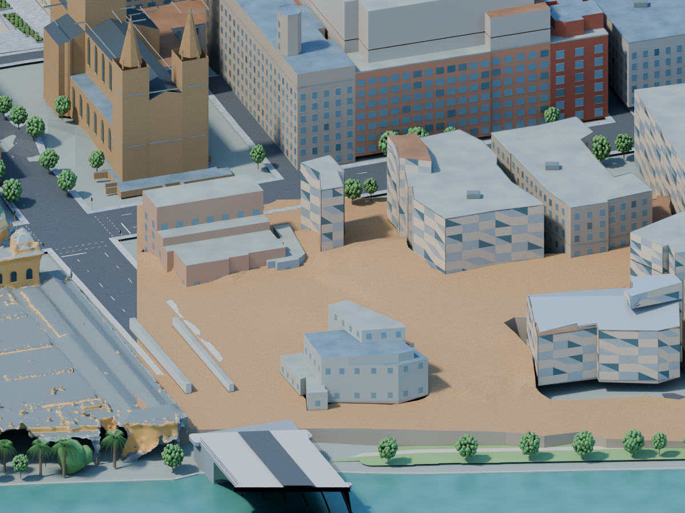

[Official Main Square reference](https://fedsquare.com/venues/main-square) identifies sandstone cobblestones. [Supplier reference](https://anston.com.au/projects/federation-square/) identifies charcoal paving in unspecified portions; no exact region assignment inferred. Linked official site-plan PDFs returned 404. Colours, joint dimensions and existing cobble layout are authored assumptions. Broad deck boundary and plaza subdivision remain unresolved. Nested cladding trial added 80,150 faces without meaningful aerial benefit and was rejected; saved cladding unchanged.

## Federation reconstruction diagnostics

Two replacement/overlap trials rejected after visual inspection: source mesh has torn roofs, and broad merged roof masking exposes open shells. Accepted scene unchanged. See [trial images and next repair requirements](federation-review-and-web-handoff.md#reconstruction-trials--rejected-6-october-2026). Roof reconstruction must establish complete coverage before removing existing caps.

## Western Federation shard roof — 6 October 2026

Section4607 now uses a complete five-triangle zinc-like roof fitted to34 retained May2020 samples, median fit residual0.022m. This residual measures agreement with selected samples, not absolute survey accuracy. Sixteen source vertices and3,360 source-owned cladding vertices follow the fitted roof; floor level retained. Five covered merged cap faces and twelve illustrative cornice faces are reversibly masked. Original source/cladding meshes retained with fake users; material assignments embedded in Blender text blocks.

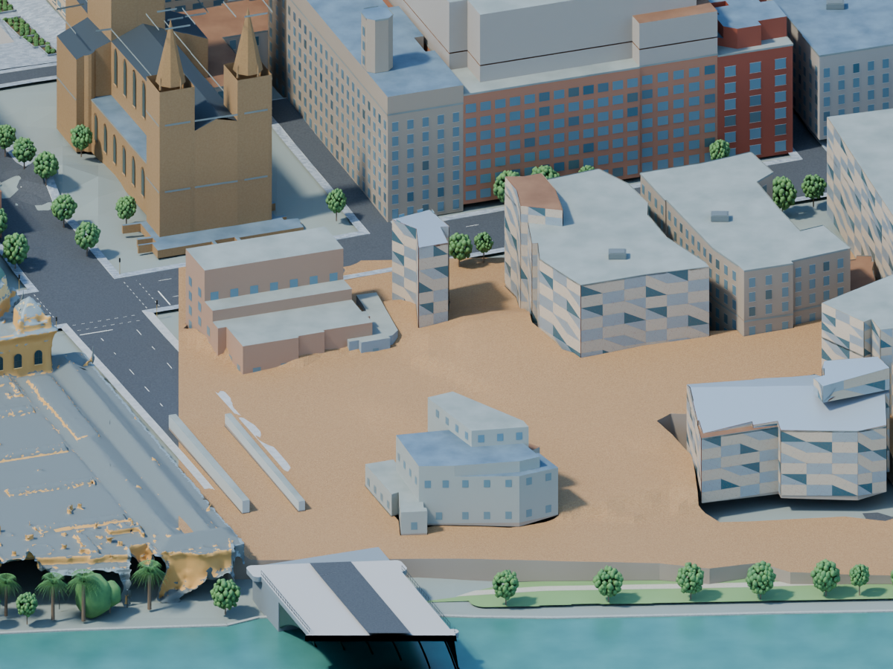

Existing object locations and25,429 other mesh geometries checked unchanged before application; repeat run unchanged. Fresh saved-scene render checked separately. Larger roofs, cladding layout and broad plaza remain incomplete. Own zinc finish and reconstruction method approximate; no photographic textures.

## Larger shallow Federation roof — 6 October 2026

Section20247’s steep illustrative gable replaced with a shallow plane from retained May2020 capture. Excluding higher section20248 leaves196 samples;176 support the plane within the authored0.6m residual threshold. Median inlier residual0.117m measures fit consistency only. Complete projected footprint coverage checked at954.885m²; symmetric difference below0.01m².

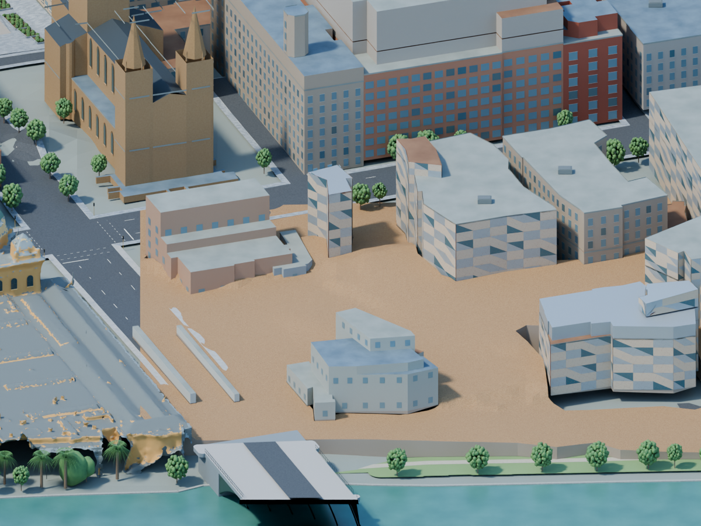

Original gable roof and survey upper body remain hidden for recovery. Original upper cladding assignments embedded in Blender text; source mesh vertices unchanged. Twenty-one roof triangles and56 approximate zinc perimeter closure faces replace the gable. Exact upper facade materials, plant and edge details unresolved. Broad plaza and other roofs still incomplete; no photographic textures.

## Defined Square paving region — 6 October 2026

[Official interactive visitor map](https://fedsquare.com/map) provides separate Square and building polygons. Its schematic Square boundary is transformed to our local coordinates and clips the existing captured-height deck. Warm stone now covers5,475.91m² of the deck;12,650.83m² outside uses an authored neutral stone assumption. These are model intersection areas, not authoritative Main Square measurements. Official map polygon area is6,245.8m²; venue references describe Main Square as5,000m², so cartography must not be treated as surveyed extent.

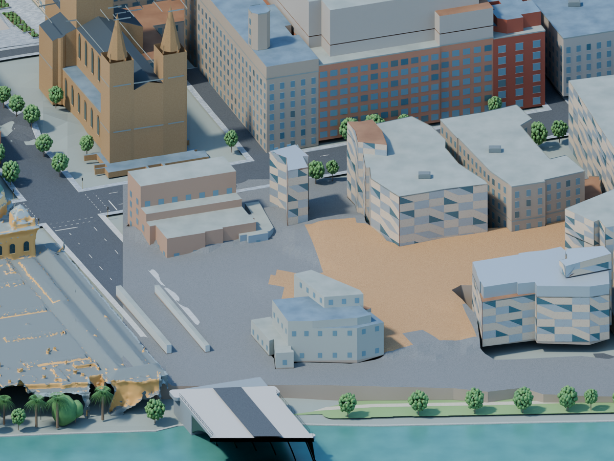

Partition preserves original terrain planes and total projected area18,126.74m². Original deck mesh retained recoverably. No map imagery or photographic textures. Exact paving distribution, terraces, steps, missing Atrium form and landmark finishes remain incomplete. Retained map geometry is a reference snapshot; map data reuse terms need review before public asset publication.

## ACMI and Beer Deluxe classification repair

Official precinct-map overlap identifies source sections17198/17199 (structure805929) as ACMI/Beer Deluxe envelopes. They were omitted from the original Federation cladding selection. Incremental pass adds3540 authored triangles using existing warm sandstone, dark zinc and glass materials at the currently saved survey levels7.05–15.55m and15.55–28.05m. Prior Atrium cuts and fitted roofs preserved. Generic detail meshes have no explicit section ownership attributes, so they were retained rather than masked speculatively; visible front blue grids are occluded by new panels in camera36. Original geometry remains recoverable.

Fresh preview: `images/observatory-federation-acmi-cladding.png`. This is a classification/material repair, not finished architecture: panel placement is approximate, repeating horizontal cells remain too regular, roof shapes and exact mega-panel grouping still need refinement. No photographic textures. Script: `scripts/blender/refine_federation_acmi_facade.py`; audit: `docs/federation-acmi-facade-audit.json`.

## ACMI captured slope repair

Upper source envelope17199 and its authored cladding now follow robust May2020 roof plane;1180/1274 grid samples retained, median residual0.0721m, p90 residual0.1453m. Fifteen matching cap triangles receive authored zinc finish. Source outline preserved; adjacent roof faces share no changed vertices. Three original meshes retained as fake-user backups named in object properties. Fine relief, plant placement, generic trim and present-day condition remain unresolved. This shallow roof pass does not resolve the larger precinct’s boxy masses or exact facade grouping.

Saved-file render: `images/observatory-federation-acmi-roof.png`, camera36. Scene marker `federation_acmi_roof_revision=captured-slope-v1`. Geometry uses historical municipal capture; material authored, no image texture.

Visual check exposed floating original roof strips after slope repair. Reconciled26 cornice faces and12 illustrative equipment faces vertically to fitted plane; original detail meshes backed up. Placement/existence remain authored assumptions. Saved-file geometry verification proves45 cap vertices fit plane within0.1mm, other-section cladding vertices unchanged, roof topology retained, no image-texture nodes in Federation finish materials.

## ACMI two-level façade grouping

Bounded ACMI pass replaces horizontal stripe-like one-level panel cells with nested five-triangle groups:7400 leaf triangles,1480 intermediate panels. Each parent triangle contains five panels, each panel five leaves. Macro target12×6m and material allocation68% sandstone/26% zinc/6% glass authored, not a measured schedule. Source envelopes and fitted roof retained; earlier3540-triangle cladding hidden, recoverable. Trial visually improved diagonal grouping without the rejected80,150-face precinct-wide cost. Still an approximation: individual buildings need exact skin geometry and openings.

References checked: [official design account](https://fedsquare.com/history-design), five-triangle panel and five-panel mega-panel description; [Heritage Council determination,26 August2019](https://assets.heritagecouncil.vic.gov.au/assets/Determination-Federation-Square-FINAL.pdf), paragraph98, outer skin independent from interiors and adapted to each building. Neither establishes this authored layout. Screenshot `images/observatory-federation-acmi-panels.png`; camera36. No photographic textures.

## Whole-city review and sediment-toned water

Fresh1920×1400 aerial overview inspected after ACMI refinements.8573 survey mesh objects,8561 render-visible; counts do not prove realism or present-day completeness. No image texture nodes found in saved material inventory. Broad CBD coverage legible, but generic tower grids, pale road/rail land and detailed precinct transitions remain incomplete; current findings in `city-completion-review.json`.

Yarra shared water material now uses authored brown/ochre range, roughness0.24, IOR1.333, restrained procedural relief and0.02 transmission. [Melbourne Water](https://www.melbournewater.com.au/water-and-environment/water-management/rivers-and-creeks/yarra-river) explains the lower river’s muddy colour from eroded clay soils. Colour values and water appearance are authored, not live turbidity or measured seasonal conditions. Shared surface includes dock water; exact spatial variation remains unresolved. Vicmap boundary and water level unchanged; original material graph backed up. Saved active camera now **Aerial overview**.

Preview: `images/observatory-city-sediment-water.png`. Broader street/rail ground review next; website export and Sites publication remain outstanding.

## Northern Atrium opening trial — rejected

The Galvanizers Association of Australia account, republished [3 May 2007](https://www.azobuild.com/article.aspx?ArticleID=8004), describes the northern end as open. Saved provisional enclosure closes that end. Background-only trial removes12 end glazing faces and212 steel faces below25.5m, then280 nearby original cladding faces within an authored1.5m plane tolerance. An opaque underlying surface remains in the rendered opening, so this is not an accepted repair. Canonical and open scene unchanged. Screenshot: `images/observatory-atrium-north-opening-rejected.png`; reproducible no-save trial: `scripts/blender/trial_federation_north_entrance.py`. Next repair must identify and reconcile underlying source shells and floor contact before applying an entrance opening. Historical account does not establish exact present-day entrance dimensions or cantilever nodes.

## Open northern entrance — bounded accepted pass

Follow-up optical diagnosis corrects the prior trial interpretation: survey_16221 ray hits are already transparent masked faces; bevel evaluation changes face indices, so evaluated index363 maps to source face4 when bevel disabled. The pale rendered opening is principally the inferred concrete floor, not proof of an opaque survey wall. Source floor remains10.7m at north end while nearby retained street samples around(200,146) are6.46m; exact threshold and floor transition require capture extraction and reconciliation.

Applied only the historical-account-supported opening:12 north glazing faces and212 authored steel faces below25.5m removed. Upper framing, floor, original source shells and cladding untouched. Original glazing/frame meshes retained with fake users and recovery properties; repeat runs guarded by scene marker. This fixes a sealed prototype end, not the entire entrance or Atrium architecture. Fresh saved-scene preview: `images/observatory-atrium-open-north.png`. Exact framing cut and dimensions authored; no photographic textures. Source: [Galvanizers Association account republished by AZoBuild](https://www.azobuild.com/article.aspx?ArticleID=8004),2007; current condition unverified.

## Northern entrance captured ground evidence

Retained May2020 untextured street-context crop now sampled over x185–235,y125–160,z0–13m:10,305 upward triangle centres reduce to1,240 one-metre median cells. Around entrance centre(204,137), nearest captured cells predominantly6.75–7.03m; current inferred northern floor10.70m is unsupported by these exterior returns. `federation-entrance-ground-audit.json` documents bounded cluster filtering and median. Interior beneath glazing lacks reliable coverage; do not extrapolate exterior plane across whole Atrium. Next repair: captured-height entrance apron and explicit reconciliation of interior floor/side-frame contact. Scene unchanged during extraction. Source is historical municipal geometry, CC BY4.0; no image surfaces imported.

## Captured entrance datum and approximate interior grade

North floor now6.765m from filtered historical entrance ground median; south retains12.2m. Intermediate floor grade authored, not a measured interior profile. Nonplanar floor n-gon triangulated into10 faces. Lower glazing and frame vertices follow a vertical taper that vanishes at25.5m; roof mesh unchanged. Original three meshes retained with fake users and recovery properties. Trial render shows entrance no longer presents the former raised slab; precise threshold, adjoining paving/closures and interior grade remain incomplete.

Saved preview: `images/observatory-atrium-floor-contact.png`. Native controls repeatedly failed with noWindowsAvailable/frontmostApplicationChanged; application via background Blender save. Open window reload remains unverified; do not claim this pass visible natively until verified. No photographic textures or source building edits. Audit `federation-atrium-floor-contact-audit.json` records altered vertices and roof invariant.

## Thin authored Atrium glazing

Zero-thickness prototype panes now use transparent transmission mixed with restrained glossy reflection by Fresnel, authored IOR1.45, roughness0.08 and neutral tint(0.94,0.97,0.96). This is a thin-surface approximation, not measured optical performance; volumetric absorption/refraction omitted. Original material graph retained with fake user. Geometry unchanged. Saved-file marker and prior floor marker both asserted before fresh render, `images/observatory-atrium-thin-glazing.png`; repeat application reports already applied.

Native reload of the prior floor repair succeeded; live shader application saved and verified through reopened background file. Native screenshot shows updated geometry, but viewport reverted to Solid shading on reload. Attempts to restore Rendered shading again failed with noWindowsAvailable; restoring native rendered colour view remains pending. Exact folded roof/cantilever geometry, entrances, adjacent finish distribution and whole-city review remain incomplete.

## Native rendered preview restored

Rendered shading explicitly set on retained VIEW_3D spaces through the live Blender console, then viewport restored and scene saved. Native screenshot visually confirms coloured/shaded Federation precinct, thin-glass reflections, lower entrance floor and open northern end. This resolves the previous pending native colour-preview state. Preview audit: `native-rendered-preview-audit.json`. Background reopening reports Solid shading; persistent reopening into Rendered mode is unproven despite verified live rendered screenshot. The geometry remains approximate and city completion audit remains open; entrance-to-street paving transition is next.

## Northern entrance apron and bounded exterior ground

Added65-vertex/96-triangle concrete-like apron, authored7m depth across schematic northern opening. Outer heights use nearest-nine medians of retained May2020 ground cells filtered6–7.4m; inner edge follows current approximate floor grade. Source boundary and paving finish are assumptions, not as-built dimensions. Trial apron alone exposed floating edges and was superseded by bounded neutral-ground fit:399 vertices adjusted, authored8m transition falloff. Ground beneath apron sits25mm below its triangulated surface to avoid overlaps. Original ground mesh retained as fake-user backup; City Square portal geometry outside this local repair preserved.

Applied live, saved and saved-file revision checked before fresh render `images/observatory-atrium-entrance-apron.png`. Repeat run guarded against duplicate apron or repeated ground shift. Capture provenance and limits: `federation-entrance-apron-audit.json`. Exact threshold, paving joints, stairs, neighbouring building base contacts and present-day condition unresolved. No photographic textures.

## NGV roof finish classification repair

Rendered-ray diagnostic, with bevel disabled and transparent source masks skipped, identifies dominant pale NGV roof as generic `Authored pale roof finish`. Merged roof mesh lacks section attributes. Change therefore requires every cap vertex to match one of sections16221/16222/16223 footprints and its saved top height within5mm;83 flat faces match. They now use existing authored Federation zinc material. Original assignments stored in Blender recovery text; geometry, adjacent roof faces and Atrium masks untouched.

Primary reference: City of Melbourne Federation Square heritage nomination, December2018 agenda attachment, physical description p30, roof zinc sheeting and glazing as a fifth facade: https://mvga-prod-files.s3.ap-southeast-4.amazonaws.com/public/about-council/committees-meetings/meeting-archive/MeetingAgendaItemAttachments/843/15077/DEC18%2520FMC2%2520AGENDA%2520ITEM%25206.4.pdf . This establishes material vocabulary, not exact pane distribution or present-day colour; uniform zinc assignment to matched flat caps remains approximate. Folded roof geometry, glazing openings and trim unresolved. Saved-file render `images/observatory-federation-ngv-roof-finish.png`; audit `federation-ngv-roof-finish-audit.json`. No photographic textures.

### NGV roof geometry evidence — compound surfaces unresolved

Retained May2020 municipal geometry yields23,087 upward triangle centres and2,653 one-metre median cells inside section16222. Current authored cap is32.4m; sampled median is28.504m. These samples mix roof regions, Atrium and possible plant, so their difference does not justify uniformly lowering the roof. A single plane leaves0.677m median residual and1.834m90th-percentile residual: rejected as a replacement. Next reconstruction must partition surfaces and reconcile facade tops. No Blender geometry changed during this evidence pass. Historical capture cannot establish present-day condition. No photographic textures used.

Evidence: `federation-ngv-roof-shape-audit.json`; retained samples: `../assets/source/environment/federation-ngv-roof-evidence.json`.

### NGV roof regions after Atrium exclusion

Diagnostic excludes schematic Atrium polygon plus0.5m and heights below24m. Remaining978 one-metre cells show different roof regions. Northern100–150m band:496cells, single-plane median residual0.179m; middle60–100m:112cells,0.550m; southern0–60m:370cells,1.445m. These arbitrary northing bands are evidence filters, not construction boundaries. Northern fitted slope is a candidate for further robust fitting; other regions need separate boundaries. No scene edit approved from this diagnostic alone.

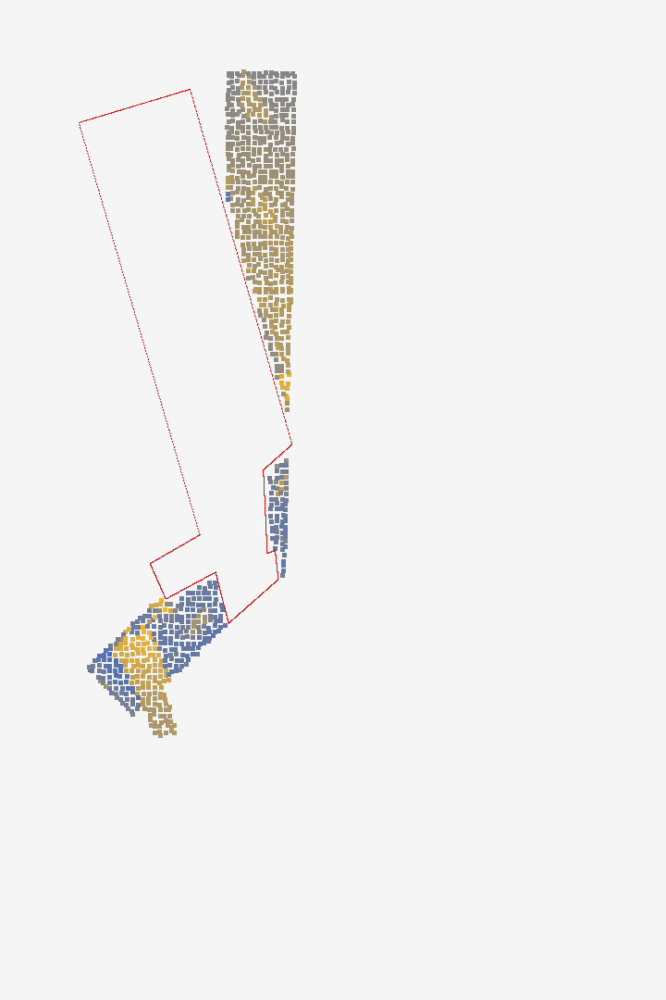

Map: north up;6pixels/metre; left coordinate185m, top150m with30pixel margin. Blue24m→gold33m, white unsampled; red schematic Atrium boundary. Historical2020 geometry does not prove present-day condition.

### Rejected northern NGV roof deformation trial

Northern captured plane trial lowered upper envelope above27.9m, with authored95–105m transition. Render revealed an unsupported large diagonal crease: existing long cap triangles span both regions. Rejected; canonical Blender scene unchanged. Further fitting requires explicit roof-region topology, then material and façade reconciliation.

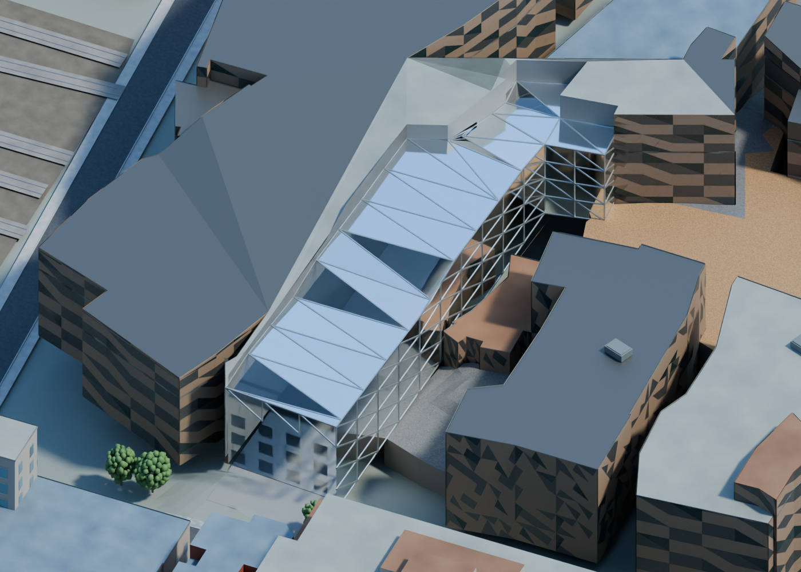

### NGV cap topology trial — closure joins unresolved

Second no-save trial cuts matched NGV cap faces at95,100,105m northing before height deformation. Render shows shorter transition faces instead of long diagonal cap triangles. Adjacent closure walls still span the transition without matching topology, leaving distorted joins. Rejected for canonical scene; roof and boundary-wall regions must be reconstructed together. Transition boundaries remain authored approximations, not captured construction joints.

### NGV envelope trial — ownership selection gap

Third no-save trial adds matching northing cuts to source envelope and authored closure objects. Render still shows inconsistent upper-wall joins: section footprint selection excludes some authored closure vertices outside the survey ring. Not accepted. Closure vertices need selection by object ownership; other adjacent closures must remain separately constrained. Canonical file unchanged.

### Northern NGV envelope height correction — applied partial pass

Northern roof and adjoining NGV closure tops now follow the historical captured plane. Roof and wall meshes cut at95,100,105m before deformation; closure objects selected through retained NGV ownership records, including vertices outside the source footprint. Original seven meshes retained as fake-user recovery copies. Fresh-file check:29 northern top vertices match fitted plane within0.005m (maximum error0.0000024m). Render inspected after reopening saved file.

This is a partial height correction:95–105m transition is authored, upper deformation base27.9m is approximate; southern roof geometry, pale closure materials, glazing distribution and fine details remain incomplete. Native reload failed through UI control; visible Blender scene not verified updated.

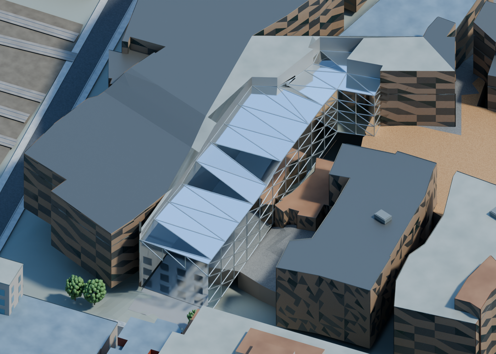

### Native preview restored after northern NGV correction

Reloaded canonical scene through Blender console. Current northern-envelope revision asserted, Rendered shading restored, viewport visually inspected and saved with clean window title. Earlier native-reload limitation now resolved. Pale Atrium closure surfaces and southern roof shape remain incomplete.

### NGV authored nested pinwheel façade — applied

Official Federation Square design describes five triangles per panel and five panels per megapanel. New NGV façade uses both levels, replacing repetitive simple triangles with16,900 leaf triangles on retained source wall edges. Target macro groups12m wide by6m high,68/26/6 sandstone/zinc/glass weighting and seam spacing are authored, not measured panel schedules. Retained visitor-map Atrium polygon clips panels around opening; current northern fitted roof heights carried through. Old façade meshes retained as recovery copies and replaced faces masked.

An initial251,500-triangle trial looked too noisy and was rejected before saving. Larger groups accepted after render inspection. Exact façade folds, openings and material distribution still unresolved; pale Atrium closures remain unfinished. No photographic textures.

Reference: https://fedsquare.com/history-design

### Full-city review after NGV panels

Fresh1920×1400 saved-scene aerial render inspected. Skyline, parks and Yarra legible; western railway yards still broadly pale; repeated blue tower grids and hard dataset boundaries weaken realism. Full objective remains incomplete. Updated HTML walkthrough now begins with this overview and includes recent NGV and Atrium previews. Next city-wide repair: inspect western railway-yard ground coverage against retained mapped rail land.

### Western railway ballast margins — bounded authored pass

Retained Vicmap ordinary rail/siding alignments guide 6.4m-wide aggregate margins, clipped around roads, paving, buildings and river. 39 source UFIs, 30,952m² and 298 upward triangles. Width and flat 0.05m level authored; underground and bridge classes excluded. This does not establish complete yard boundaries. Existing tracks and original ground retained.

Fresh saved-file revision and triangle count passed; railway detail render inspected. Aggregate strips clearer, but broad pale gaps and simplified bridge/building geometry remain unfinished. No photographic textures.

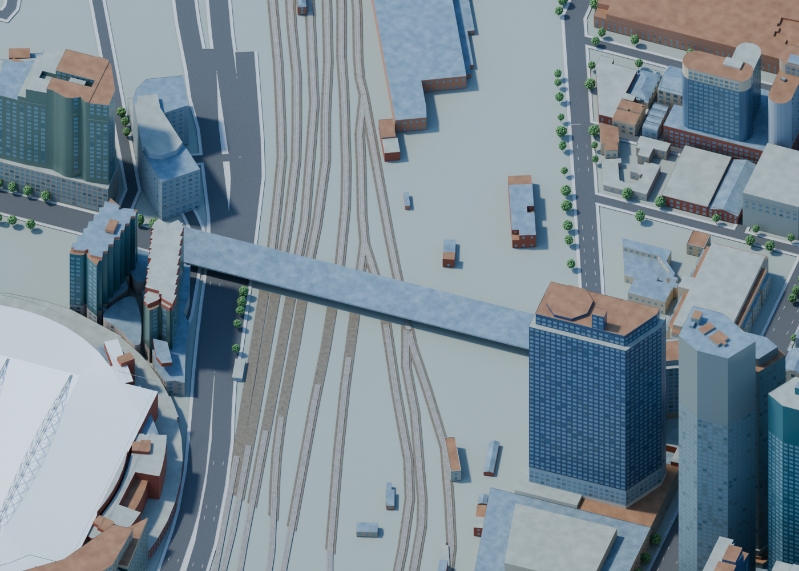

### Southern NGV roof evidence — no blanket plane accepted

Diagnostic RANSAC on455 retained one-metre cells finds168 cells near a shallow roof plane (median4.7cm) and100 cells near a steeper plane (median7.1cm). Support map shows the largest fit joins disconnected patches; a low residual alone does not establish a roof boundary. No scene geometry changed from these fits. Next repair must separate connected captured surfaces and reconcile their wall joins rather than flatten the whole southern envelope.

Support colours: first fit ochre, second blue; remaining fits purple, green, red and teal. North up. Historical May2020 geometry;0.18m inlier tolerance authored.

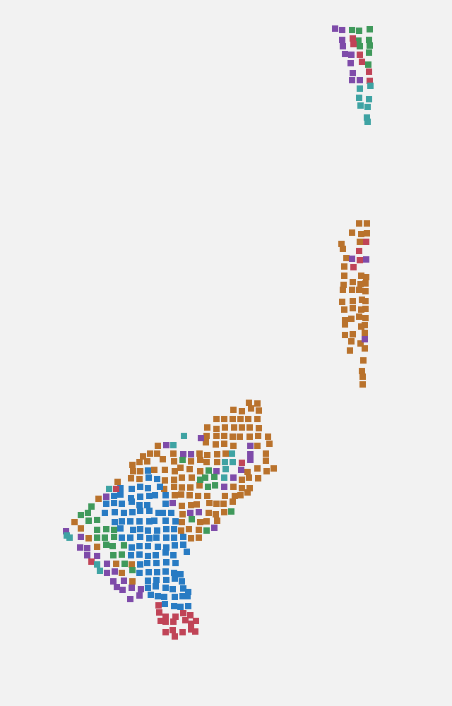

### Restrained generic glazing — applied after full-city trial

Four shared generic window materials now use darker muted tints,0.18 roughness/metallic and a small coat response. This reduces bright-blue grids while preserving authored window geometry. Original four materials retained as fake-user recovery copies. Named Eureka, Federation and station scan glass unchanged.

Tint and response are authored opaque glazing proxies, not measured facade schedules or interiors. Generic window spacing remains approximate. Whole-city trial inspected; fresh saved-scene and native verification recorded in generic-glazing-response-audit.json. No photographic textures.

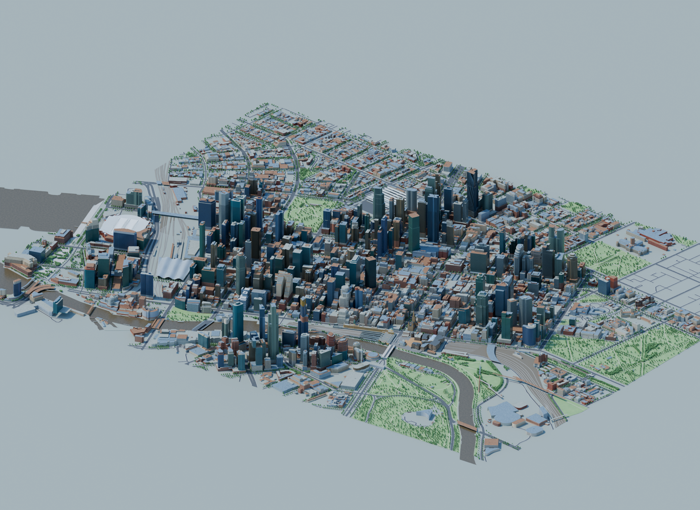

### Focused CBD review camera

Camera37 provides a higher, tighter aerial view of CBD streets and Flinders/Federation. Full-city camera retained; framing does not satisfy unresolved dataset-edge or landmark work. First wider trial rejected for visible southern edges and cropped tower tops. Higher second composition accepted as an additional review view. Fresh saved-file camera/scale assertions and render completed.

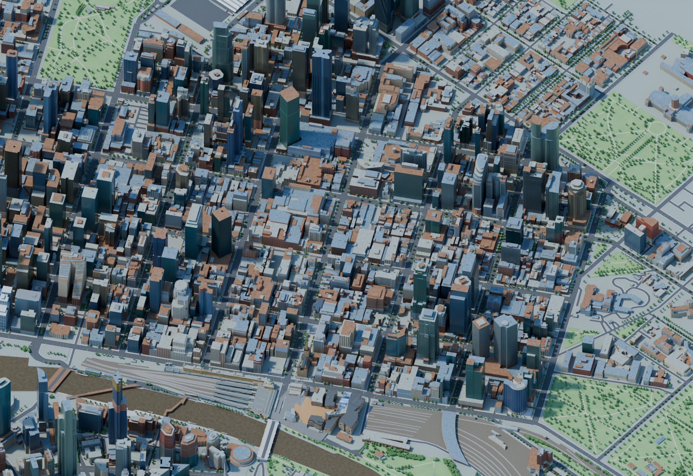

### Connected southern NGV capture

1.85m connectivity splits the largest plane fit into41-cell and112-cell patches; steeper fit remains100 connected cells. Extracted953 original upward triangles near steeper fitted plane, using authored hull and0.3m tolerance. Own zinc finish shown in isolated evidence render; no photographic textures. Jagged edges and small holes remain. Not applied as finished city roof replacement.

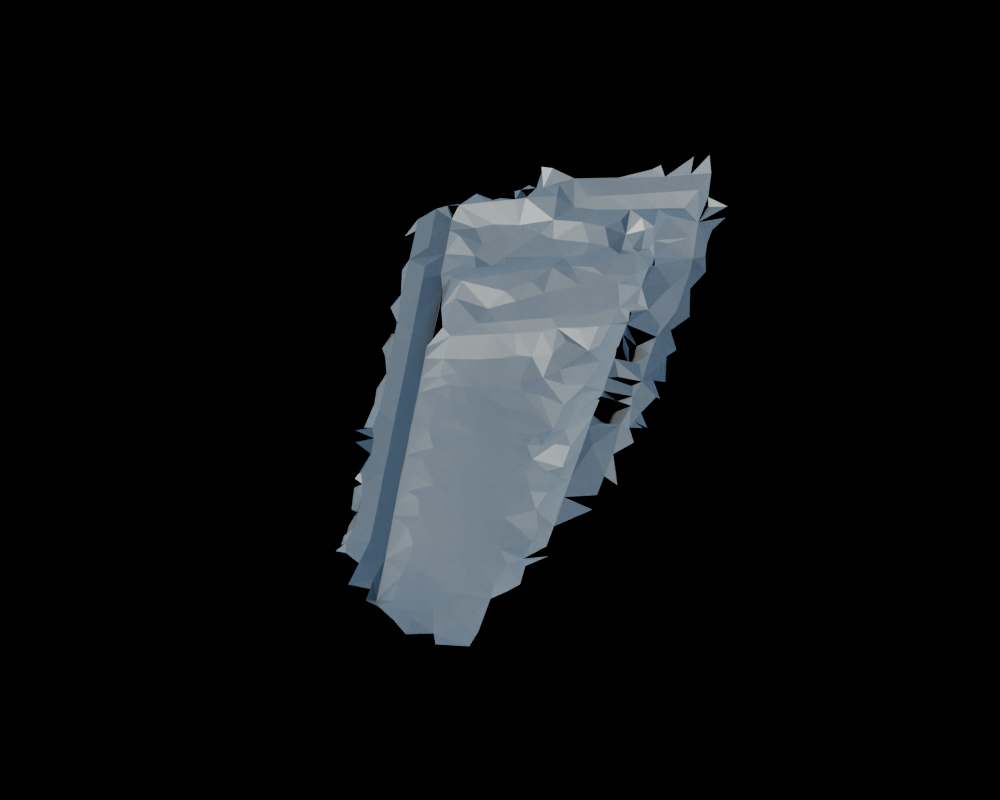

### Southern NGV lower roof finish and broader capture

Forty lower cap faces previously retained generic light zinc because the earlier finish pass selected only pale-roof materials. Source-footprint and height matching now assigns the existing authored Federation zinc. Original material assignments retained in Blender text for recovery. Geometry unchanged; this corrects finish consistency, not the unresolved roof levels or facade joins. Trial close-up compared before/after; saved-file revision, all40 assignments and recovery data verified before a fresh render.

Expanded evidence uses the union of three stacked NGV footprints:7,934.85m²; upper footprint covers84.81%.30,398 upward captured triangles reduce to3,485 one-metre median cells. Atrium-excluded southern cells contain several lower levels. A blanket plane has1.76m median residual, so is rejected. May2020 capture remains historical evidence; filters and own zinc colour are authored approximations. No photographic textures.

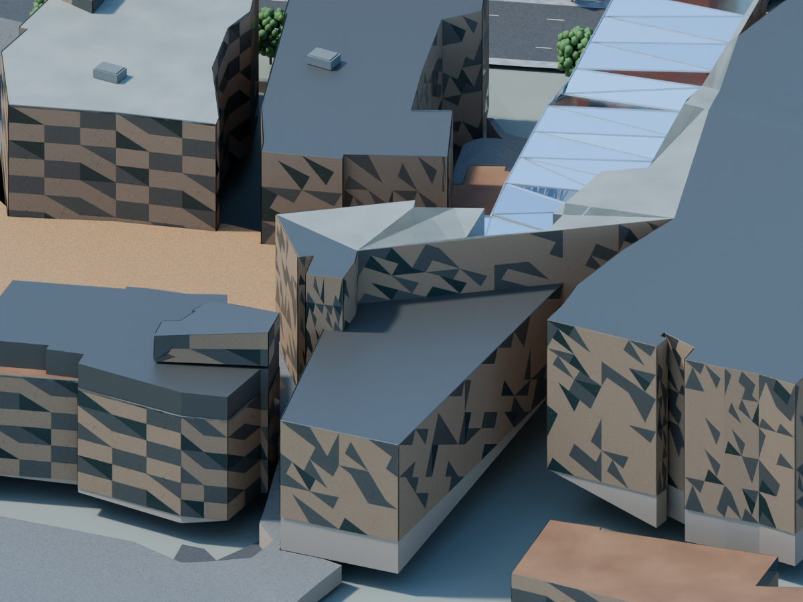

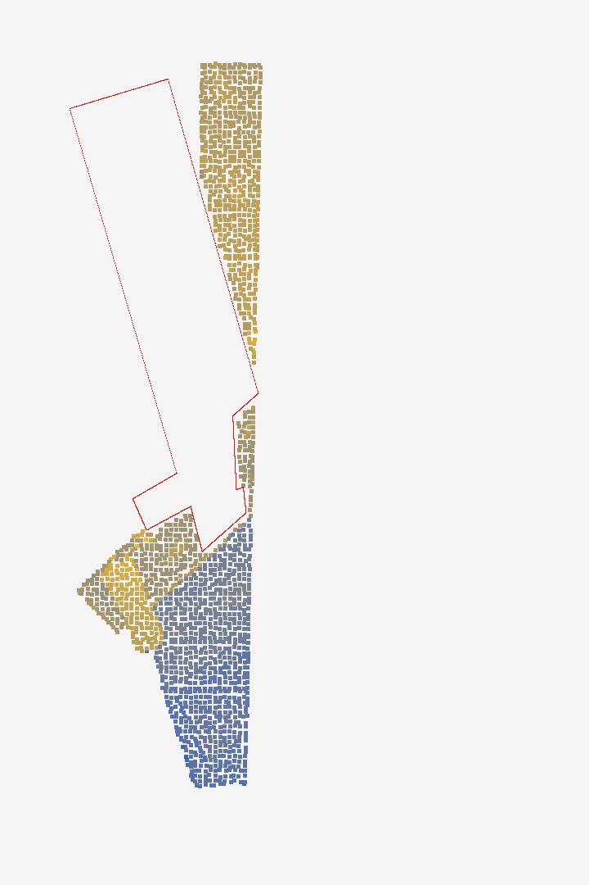

Evidence map: blue low15m to ochre high35m; red schematic Atrium exclusion. Diagnostic bands do not establish construction boundaries.

### NGV capture coverage correction — missing eastern tile

Live municipal download-grid query identifies C4-29 and C4-30 across the lower NGV footprint. Earlier precinct extraction reused station tiles and omitted C4-30. Approximate local footprint overlap:43.34% in retained C4-29,56.66% in newly retrieved C4-30. Earlier roof fits describe only the western captured portion; they cannot establish a complete NGV roof. Expanded stacked-footprint selection alone did not fix this tile omission.

C4-30 OBJ-only entry downloaded from the municipal archive;344,535,081 decompressed bytes and ZIP CRC verified. SHA256 recorded in federation-east-capture-download-audit.json. Photographic assets omitted. New two-tile evidence extraction retains original upward geometry; capture remains May2020 and cannot verify present-day condition.

Lower captured-profile trial rejected: first version moved cladding without matching sparse cap vertices; subdivided version exposed overlap and an artificial boundary rim. Neither trial saved to the city. Broader geometry must be inspected before further roof fitting.

Two-tile extraction now retains68,026 upward triangles and7,701 median cells; samples extend east to284.30m rather than232.82m. Isolated own-zinc render inspected: roof folds and skylight/plant relief are visible across the full precinct, with jagged scan edges and holes. This evidence is not installed as a finished roof. The open Blender city remains the previously verified coloured scene.

### Two-tile roof reconstruction studies

One-metre Delaunay skin rejected: coarse relief and jagged gaps despite14,054 bounded triangles. Original captured geometry with0.1mm welding and25% decimation preserves folds better. Neither study installed in the city.

Captured envelope study includes135,413 source triangles, with an authored0.2m footprint buffer and6..40m height range. Own zinc for upward faces, own sandstone elsewhere, illustrative normal-based assignment. Render reveals missing wall patches, fragmented Atrium region and ragged edges; not approved as a complete replacement. Original geometry retained.

New eastern northern validation:843 cells, median absolute residual1.386m against the earlier western northern plane; only45 cells within0.25m. Earlier western plane must not be treated as a verified eastern roof fit. Separate eastern fitting and envelope joins remain required.

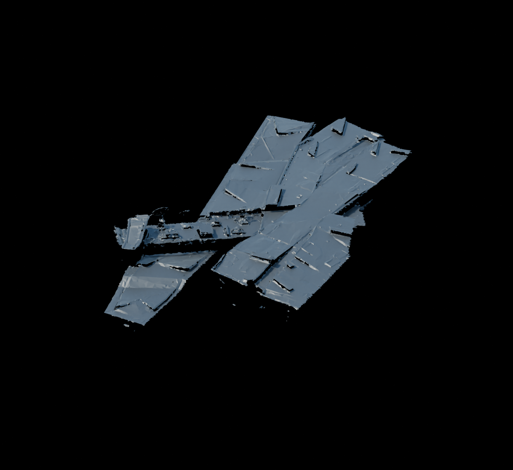

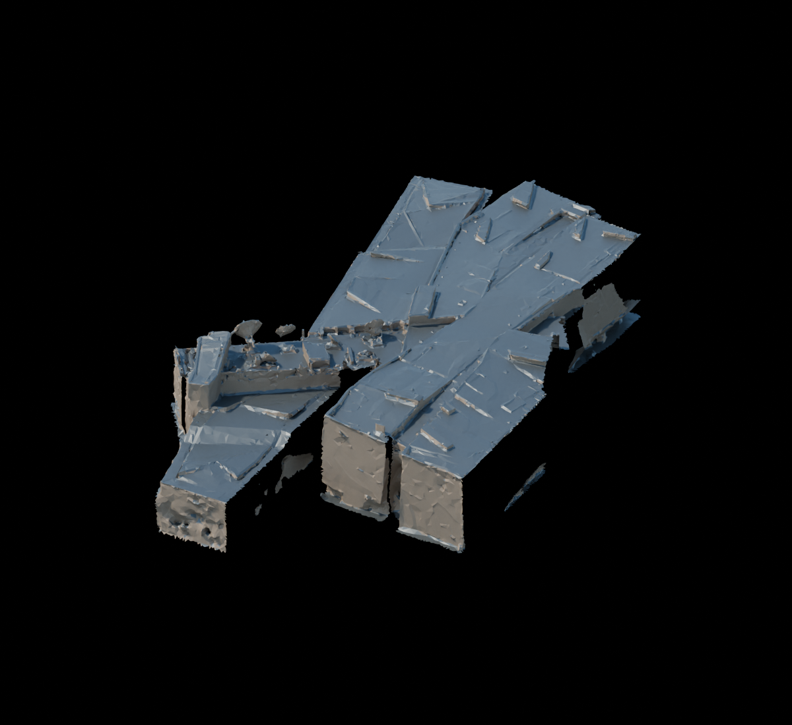

### Eastern northern NGV envelope correction — applied

Recovered eastern capture supports a separate dominant roof plane from542 of1,121 candidate cells: median9.1cm residual,90th percentile15.6cm. Original meshes retained for recovery. Dedicated roof, source envelope and matching nested facade panels move together; transition faces subdivided first.69 dedicated roof vertices,1,750 nested panel vertices,1,068 legacy panel vertices and16 source-envelope vertices adjusted.

235..240m eastward and95..105m northward transition bands and27.9m deformation base are authored approximations. Broad plane correction is accepted as partial geometry improvement; transition shading, exact fold boundaries, skylights, southern roof regions and facade joins remain incomplete. Initial broad roof selection and unsplit-face trials rejected before saving.

Fresh saved-file checks: six interior rays agree with the eastern plane within0.005m; outside-precinct roof coordinate multiset unchanged against recovery mesh; no image-texture nodes; CBD camera preserved. Native coloured rendered viewport verified.

### Eastern NGV captured roof relief

Five raised features now use locally fitted top planes from the retained May 2020 municipal capture. The added mesh has 102 faces. Inlier median residuals range from 0.013 to 0.034 m. Convex support outlines and vertical closures are authored approximations; feature function and present-day condition are unverified. Own zinc material, no photographic textures. Raw jagged relief was rejected before saving. Saved-file coordinate check passed within 0.000016 m; CBD camera retained.

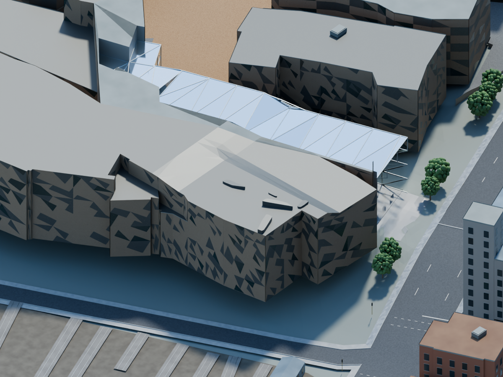

This is a partial roof pass. Broad transition strip, southern folds, envelope joins and full precinct realism remain unfinished.

### NGV transition capture diagnostic

The broad north-east roof strip is real authored geometry, not a smoothing-normal error: its 50 roof faces use flat shading and no modifiers. Comparison with 352 retained capture cells gives median absolute height residual 0.371 m. Raised features and capture artefacts are included, so this is diagnostic rather than a direct fit target. Further roof repair must separate dominant planes and locate their captured boundaries; hiding the strip with smooth shading would conceal the geometry problem. Scene unchanged during this audit.

### Captured transition fold study

Two local roof planes were recovered from 173 and 122 retained capture cells, with median residuals 0.032 and 0.037 m. Their diagnostic support hulls overlap by 105.24 m²: installing both whole hulls would create overlapping roof caps. The isolated render uses two authored diagnostic colours to distinguish slopes; these are not verified roof materials. Canonical city geometry stays unchanged until the fold boundary is resolved.

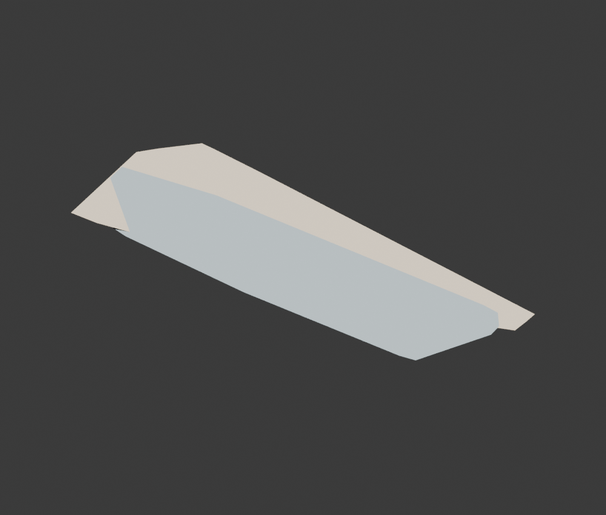

### Lit native preview and roof envelope rays

Native Blender was reloaded and switched with Z then R to Rendered shading; colours and scene shadows visibly confirmed. Saved camera zoom reset to show its frame. Reopening can fall back to Solid despite persisted shading settings. Roof transition capture rays hit 351 of 352 sample locations; median absolute error against the top captured surface is 0.394 m. Median cell-to-upper difference is effectively zero, so stacked cell averaging does not explain this mismatch. Existing roof remains pending repair.

### Contextual captured northern cap trials — rejected

16,407 original capture triangles replaced 69 authored cap faces in unsaved contextual trials. Both raw reduction and eight vertical interior smoothing iterations were rendered. Both were rejected: holes, jagged boundaries and stray captured fragments over the Atrium remain. Smoothing cannot repair missing topology. Canonical scene is unchanged. Next reconstruction must separate connected captured roof components and fit continuous supported surfaces, rather than install the raw scan.

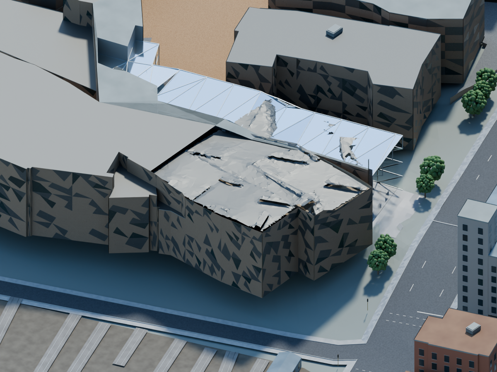

### Continuous northern roof reconstruction trial

A continuous mesh now fits 1,955 captured height cells with local robust planes on a two-metre grid (911 triangles). This fills scan holes, but is still a trial: residual bumps and western cap contact gap make it unsuitable for installation. Initial broad source footprint overlapped the Atrium; excluding the retained schematic Atrium boundary removed that spillover. Source records overlap architectural regions, so future replacements must respect the separate Atrium ownership mask. Both initial and corrected renders retained; canonical city unchanged.

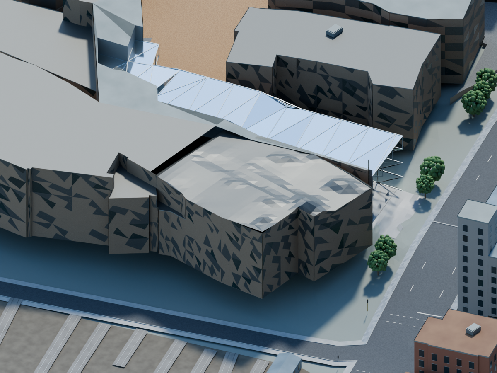

### Lighter authored Federation sandstone

Sandstone procedural colour ramp increased from (0.19,0.125,0.074)–(0.32,0.23,0.15) to (0.28,0.19,0.115)–(0.40,0.29,0.19), with roughness 0.8. These are artistic buff-stone estimates, not measured colours. Official sandstone identity retained; own procedural variation, no photographic textures. Original shader retained as a fake-user material. Saved-file ramp, recovery, camera and absence of image nodes verified; fresh render inspected. Visible-face rays confirmed this shader reaches NGV façade panels. Change is subtle; roof geometry remains unfinished. Native reload was attempted but dialog became unresponsive; closed to restore existing city view, so latest live material update is unverified.

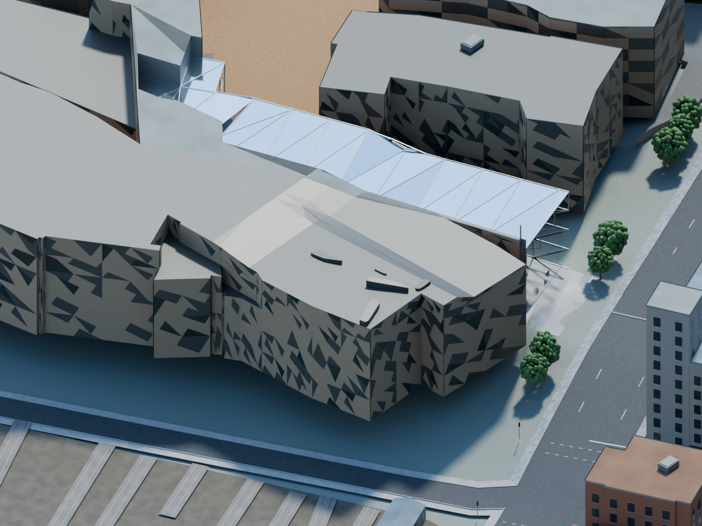

### Restrained generic roof weathering

Fresh wide CBD review showed excessive macro mottling. Three generic roof shaders now use 25% of previous ramp contrast; light zinc blue tint desaturated 70%. This is an authored aesthetic estimate, not evidence of actual roof materials or condition. Original shaders retained; surveyed geometry, face assignments and landmark materials unchanged. Saved ramps and recovery materials verified, no image textures; before/after renders inspected. Native reload succeeded using F3 → Revert → confirm, then Z → R; updated city visible with scene lighting. Roof geometry, street/rail contacts, repeated façade detail and coverage still require completion audit.

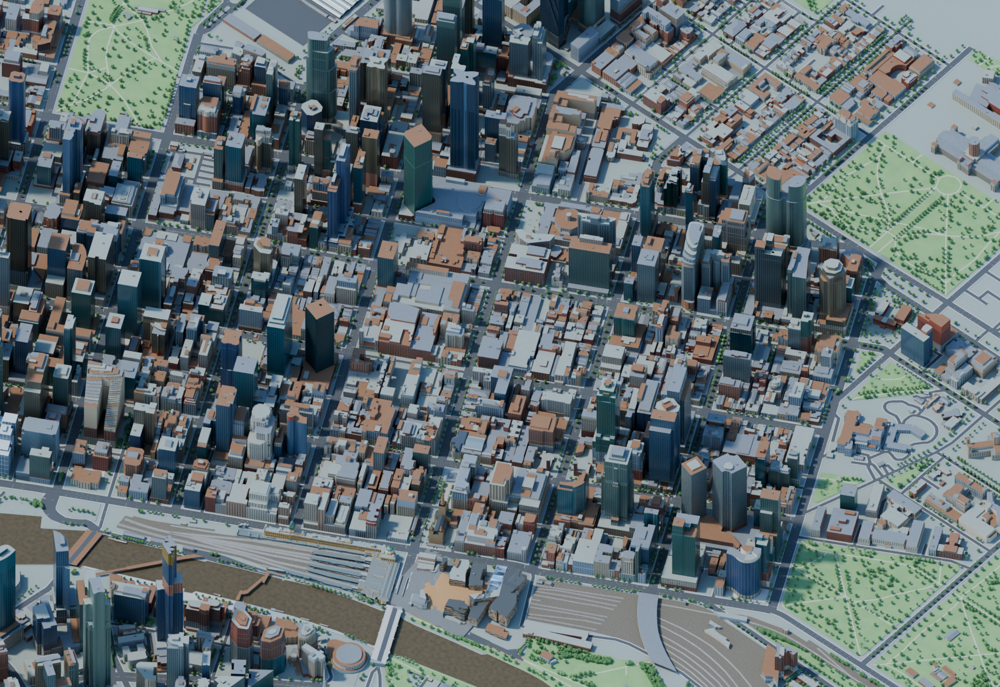

## Princes Bridge mapped road surfaces

Two municipal road carriageway assets (1425102, 1425122) now replace the assumed 9 m buffered strip. Their actual planform polygons are clipped to retained survey deck 36402: combined area 1,157.7 m², 1,357 upward-facing triangles. Original strip remains hidden and recoverable.

Source: [City of Melbourne road segments with surface type](https://data.melbourne.vic.gov.au/explore/dataset/road-segments-with-surface-type/api/). Raw response and SHA256 provenance retained locally. Flat 9.535 m deck elevation and procedural asphalt are authored approximations; exact current elevations, tram rails, markings and pavement transitions remain unresolved. No photographic textures. Saved-file coordinate and normal checks run before the fresh precinct render.

## Princes Bridge mapped pavements

Retained municipal records identify two HMA footways (1387777, 1389576), 18 dressed-bluestone kerbs and two dressed-bluestone channels. Their mapped polygon boundaries are clipped to survey deck 36402 and triangulated with upward normals. Existing authored asphalt and bluestone shaders supply colours without photographic textures. Municipal material classification informs finish choice; colours remain estimates.

Footway and kerb tops at 9.65 m and channel tops at 9.54 m are authored flat levels, not surveyed heights. Approach contacts, tram centre and markings remain unfinished. Source response reused from the carriageway pass: [municipal road surface dataset](https://data.melbourne.vic.gov.au/explore/dataset/road-segments-with-surface-type/api/).

## Princes Bridge tram formation coverage

Municipal assets 1438852 and 1438914 carry the adjoining Swanston Street road label but intersect retained bridge deck 36402. Selecting spatial intersections instead of only an exact bridge label restores 633.7 m² of mapped central tram formation. Only intersected polygons are installed. Southern mapped coverage remains incomplete.

Own grey concrete shader follows municipal material classification; 9.54 m flat height is an illustrative deck offset, not surveyed elevation. Rail geometry and road markings remain unfinished. Approach-height reconciliation also remains open: nearby retained 2020 ground samples around the northern approach read near 6.2 m, whereas the bridge uses its surveyed-envelope 9.5 m cap. These represent different evidence layers and require bridge-specific capture verification before changing the datum.

Source: [municipal road surface dataset](https://data.melbourne.vic.gov.au/explore/dataset/road-segments-with-surface-type/api/). Raw response reused with SHA256 provenance. No photographs or image textures.

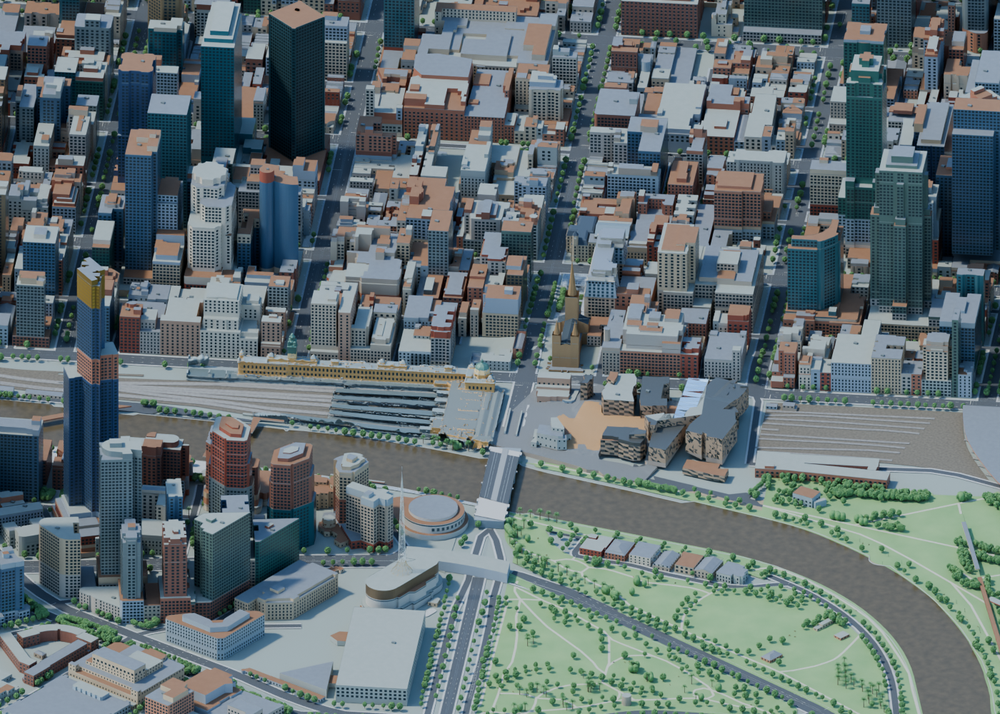

## Captured Princes Bridge datum correction

Geometry-only extraction from retained municipal May2020 tiles C4-29/C4-35 yields 35,807 upward triangles inside an inset bridge footprint; C4-35 supplies these samples. Selecting one-metre median cells inside municipal road/tram polygons inset0.5 m yields 1,494 cells: median6.206 m, 10th/90th percentiles6.186/6.229 m. This contradicts the earlier9.5 m envelope cap used as a deck level.

Authored flat deck top is now6.2 m. Municipal surfaces and balustrade translated down3.3 m; retained envelope top6.19 m avoids coplanar overlap. Authored arch/pier heights and curve ribs compressed above the retained foundation datum so upper support reaches5.4 m. Exact engineering geometry remains approximate. Original roof/arch/pier meshes, rib curves and object transforms retained for recovery; neighbouring roof XY and elevations preserved. Source capture is historical and does not prove current condition. Approach streets still need reconciliation.

## Swanston northern bridge approach

Forty municipal asset polygons outside the retained bridge footprint now define the approach: seven carriageways, three tram formations, nine footways, twelve kerbs, eight channels and one median. Combined unique planform area6,030.3 m² (summed asset areas6,033.1 m²; small source overlaps retained). Own asphalt, grey concrete and bluestone material families follow source classifications. Other/unknown paver classes use disclosed generic grey concrete.

Heights use eight nearest retained 2020 ground samples with inverse-distance weights and an authored22 m smooth transition to the6.2 m bridge deck. Maximum6 m triangle edges; road/channel offsets35 mm and footway/kerb/median offsets150 mm are authored. Historical capture does not prove current heights or conditions.

Earlier illustrative road, pavement, kerb and marking geometry is cut only inside mapped polygon coverage; original meshes remain recoverable. Outside faces, material assignments and original vertices verified preserved. Close render confirms the mapped approach is visible. Tram rails, current markings, edge closures, station scan damage and adjoining plaza detail remain unfinished. This pass does not establish full precinct completion.

## Station roof diagnostic after mapped approach

Saved scan audit finds 42,369 upward upper faces assigned authored zinc (4,405 m²) and 4,069 assigned green metal (390 m²). Selection uses local height >=18 m and normal z>=0.35; it includes domes and other upper surfaces, so these areas are not measured roof quantities. The close approach render still shows jagged roof geometry and irregular material boundaries. Missing material assignment is not the primary explanation. Next repair needs spatially bounded captured roof geometry and boundary review, rather than blanket recolouring. No scene mutation in this diagnostic.

## Captured station roof height study

Exported 3,478 one-metre cells from evaluated zinc faces with upward normals >=0.7 and height >=18 m. Most cells fall between20–25 m; 460 cells have a within-cell p90–p10 spread above1 m. This rejects a single blanket flat-roof replacement and identifies where ridges, ornament or scan noise need spatial separation. Source OBJ hash retained. Selection excludes steep slopes and may include ornament; no replacement geometry installed from this study.

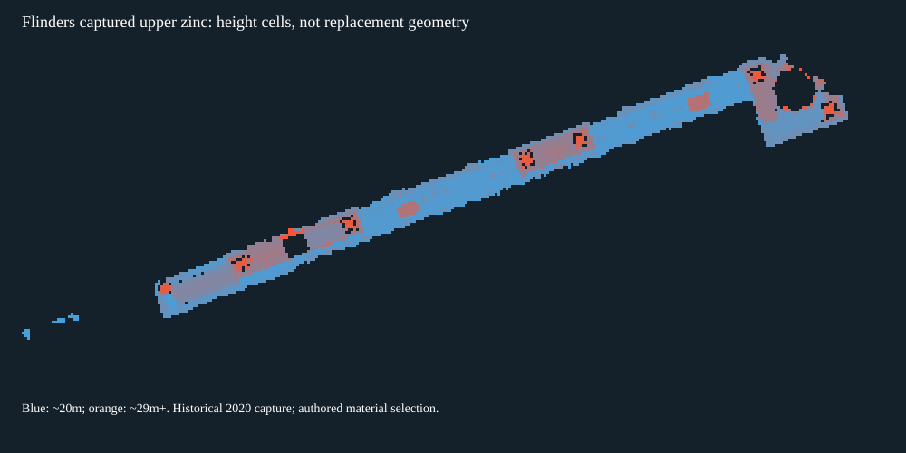

## Local roof trial rejected for current visual target

A captured fit over x−120..−80/y0..20 accepted82 cells within150 mm of its fitted plane. Trial render does not improve the dominant eastern station roof: the patch lies west of this close review. Canonical scene unchanged. The upper-height selection was too narrow for the visible damaged roof; next extraction must include lower roof elevations inside the eastern station footprint. Trial is evidence for changing repair scope, not a completed visual pass.

## Eastern lower roof scope correction

All-material capture extraction within x10..70/y−60..65 gives4,134 one-metre cells; zinc-only selection gives396. Most all-material cells sit11–14 m, below the importer's18 m roof rule. This corrects the earlier upper-roof audit: it did not cover the dominant eastern roof. A trial assigning zinc to upward faces10..15 m inside section1148 changes only a narrow strip in the close render. Not installed: surveyed section bounds and normal threshold do not establish the full roof boundary. Next repair must include steep slopes and spatial roof ownership. Both exports retain source OBJ hash; geometry remains unchanged.

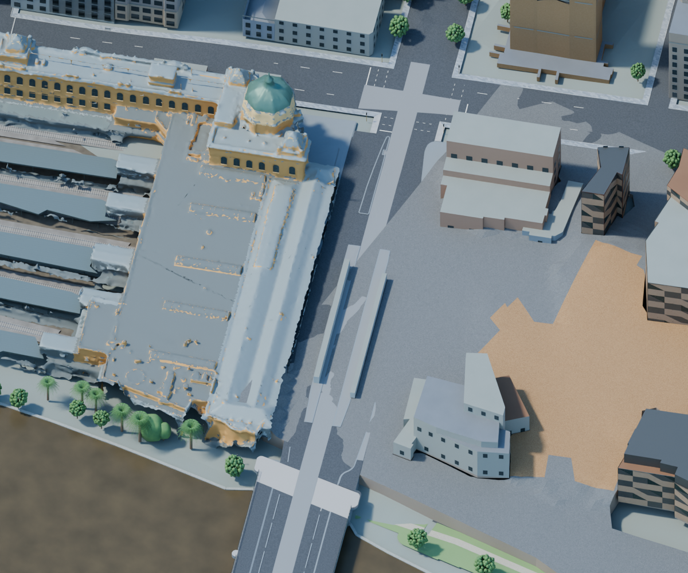

## Saved station lower roof finish correction

Close-view ray tracing identifies the dominant concourse roof at roughly12 m, formerly assigned ground finish. Corrected52,647 ground-assigned faces inside retained station section zones at10–15 m with upward normal z>0.35 to the existing authored zinc family. Height/normal classification and exact finish remain approximations; no measured material claim. Original mesh retained with fake user for recovery. Saved-file checks prove all vertices/connectivity and outside material assignments unchanged. Fresh render reviewed; native Blender reloaded in rendered shading. Roof scan damage still visibly unfinished.

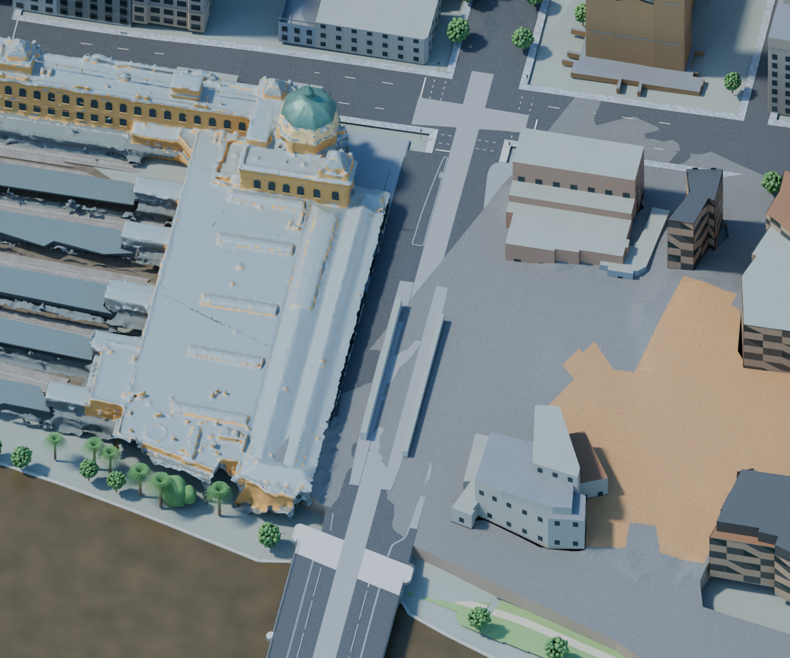

## Captured concourse roof cleanup

Installed a continuous authored zinc surface across5,828 m² of locally supported captured roof grid,11,656 triangles. One-metre cells from evaluated May2020 geometry receive3×3 median filtering; cells with at least four neighbours accepted. Isolated missing cells can fill from seven neighbouring heights spanning under1 m in a deterministic single sweep. Complete quads with height jumps below2 m receive50 mm offset. These smoothing, infill and grid-edge choices are authored approximations, not measured current roofing.

First trial left dark grid gaps and was rejected. Revised continuity improves broad roof surface while retaining captured roof bands.52,506 zinc/ground scan faces inside supported coverage and10–14.5 m height removed by centroid rule; original mesh preserved for recovery. Masonry and higher features retained. Boundary overlap seams and masonry damage remain visible. Saved-file checks preserve original vertices, outside face connectivity/materials, active aerial camera and zero photographic textures. Fresh saved render reviewed; native scene reloaded.

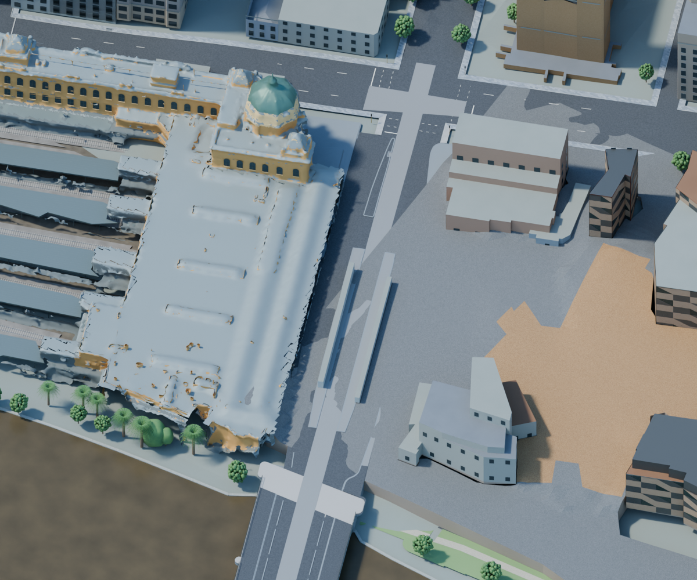

## Exact roof boundary and smoothing correction

Centroid cuts removed portions of triangles outside repaired coverage. Exact XY subtraction now restores24.1 m² of those portions from the originally smoothed capture.53,782 original faces intersect coverage; replacement scan has347,806 faces. Original full scan smoothing is baked before clipping, then its modifier disabled. Applying smoothing to disconnected clipped triangles caused them to shrink, producing dark seams; trial comparison confirms baking first reduces this artefact.

Saved-file checks match all baked source coordinates and replacement coordinates; uncut face connectivity/material assignments preserved. Original raw geometry, original smoothing settings and previous centroid-repair mesh remain recoverable. Vertical faces still use covered-centroid classification; roof height/material selection and authored skin remain approximate. This is not a verified engineering roof reconstruction. Fresh saved render reviewed; native Blender reloaded. Remaining roof perimeter, masonry and dome scan damage visible.

## Whole-city review after station repairs

Fresh1600×1100 aerial render confirms coherent skyline and street grid; it does not establish completion. Generic façade repetition, large pale ground fields, unfinished district edges and landmark detail remain visible. Street inspection found legacy tram rails at a flat0.29 m datum, now below some revised road surfaces. Retained expanded Vicmap data contains140 explicit tramway features; a road-draped trial is under review. Full goal remains incomplete.

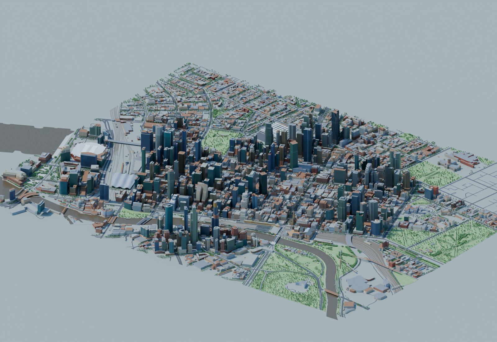

## Mapped tram rails at current road heights

Installed6,513 short railhead strips along33 retained Vicmap tram alignments. Road support now follows current authored road heights rather than the legacy flat datum.297 unsupported or abrupt-height segments omitted. Source hash and feature IDs retained. One illustrative rail pair per alignment: track multiplicity and exact rail centres unverified; 50 mm strip width,8 mm surface offset and curve joins authored.1,435 mm inner-face gauge follows retained Yarra Trams design reference on straight segments.

Saved-file checks sample303 vertex clearances and confirm upward faces, source hash and active aerial camera. A separate101-point vertical ray audit found no sampled surfaces more than20 mm above rail strips; sparse samples do not prove full visibility. Native Blender reloaded in rendered shading. Close station render still makes rails difficult to read and exposes damaged masonry, oversized pale pavement shapes and generic Federation forms. These remain incomplete.

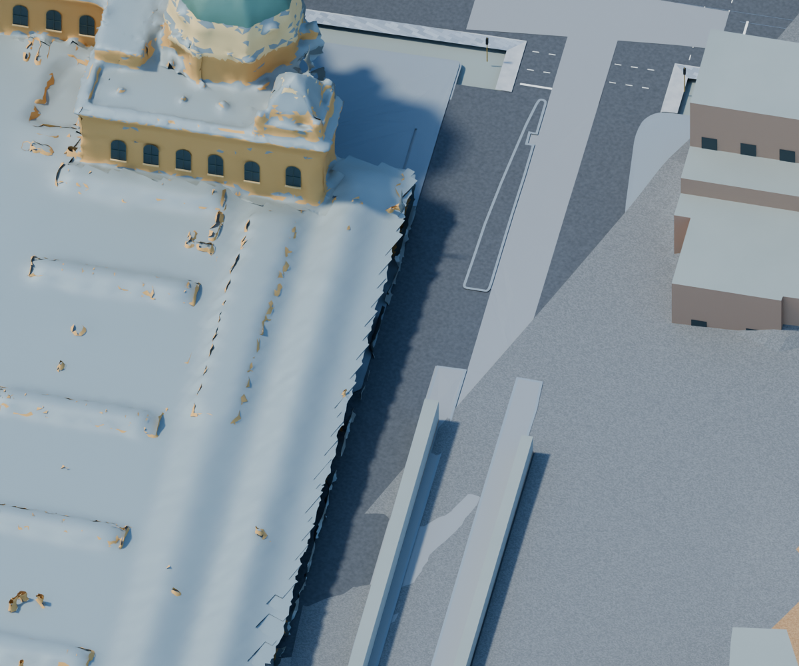

Additional saved street review shows thin rail pairs on asphalt, including through the junction. Repeated generic window grids and simplified landmark forms remain visible.

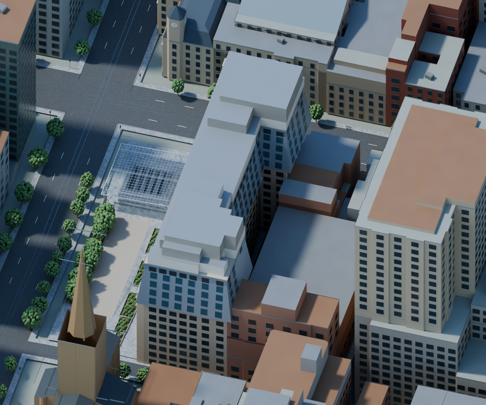

## Federation shape review and rejected finish trial

Fresh saved-scene review confirms blocky precinct forms, repeated generic surrounding facades, simplified cathedral spires, and noisy NGV cladding. Official design describes nested five-triangle panels and mega-panels ([Fed Square design reference](https://fedsquare.com/history-design)); source material identity alone does not establish actual panel distribution.

A trial grouping NGV finishes in projected12m×6m diagonal zones changes7,906 face assignments but cuts across existing nested panels, creating camouflage-like bands. Rejected; canonical scene unchanged. Further work must align finish groups with original panel ownership and improve actual landmark forms, rather than use projected colour zones.

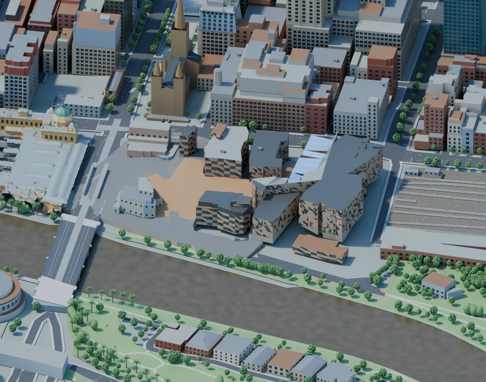

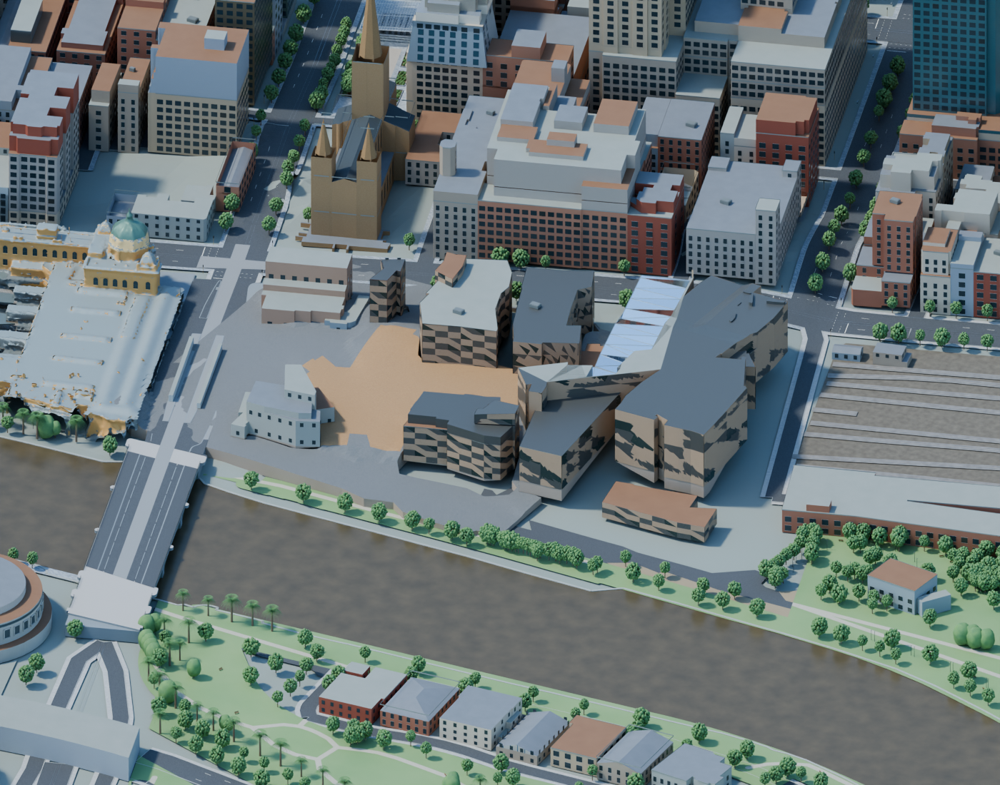

## NGV retained mega-panel finish grouping

Replaced scattered material assignments with one authored finish per intact nested25-leaf mega-panel:670 groups accepted,6 altered groups skipped;7,740 face assignments changed. Group ownership comes from retained panel-generation geometry, checked against current XY coordinates. Existing roof clipping fragments retained. Weighted stone/zinc/glass distribution is artistic, not the measured current panel schedule or glazing positions.

Fresh trial and saved render show cleaner large triangular regions than the rejected spatial-zone trial. Full saved NGV mesh check proves vertex coordinates and face connectivity unchanged, every material assignment correct against the recoverable original, and active aerial camera preserved. No image textures in affected materials. Blocky landmark forms, openings, plain precinct buildings and roof transitions remain unfinished.

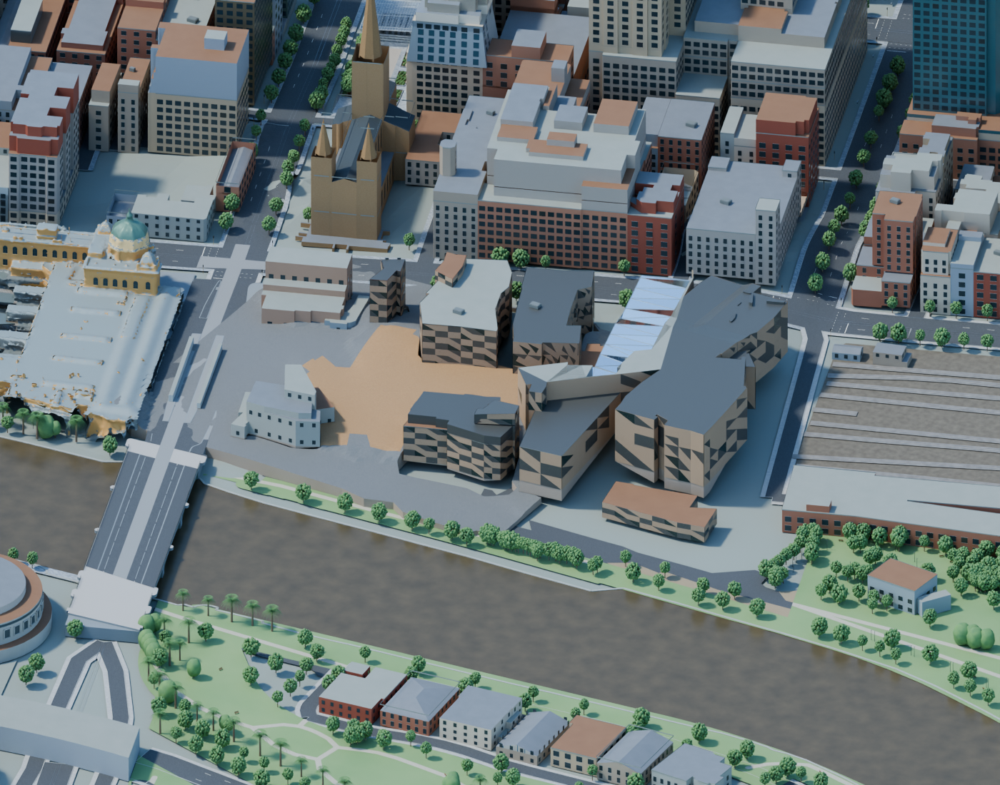

## St Paul’s belfry lancet relief

Added32 pointed lancet bays with stone surrounds, central mullions and stringcourses on existing three-tower faces;240 new faces. University research archive documents lancet windows and blind tracery ([2011 architectural photograph record](https://ausmed.arts.uwa.edu.au/items/show/752)); cathedral history identifies the later three-spire design ([cathedral history](https://cathedral.org.au/about-us/history/)). These references establish architectural language, not current measured dimensions. Bay counts, proportions, dark recess finish and placement remain authored approximations. Existing tower footprint and silhouette retained.

Initial trial missed shorter front tower faces; corrected height filter includes them. Fresh trial reviewed: upper tower faces read less plain, but spire ornament, entrances, generic horizontal strips and surrounding facades remain unfinished. No photographic textures.

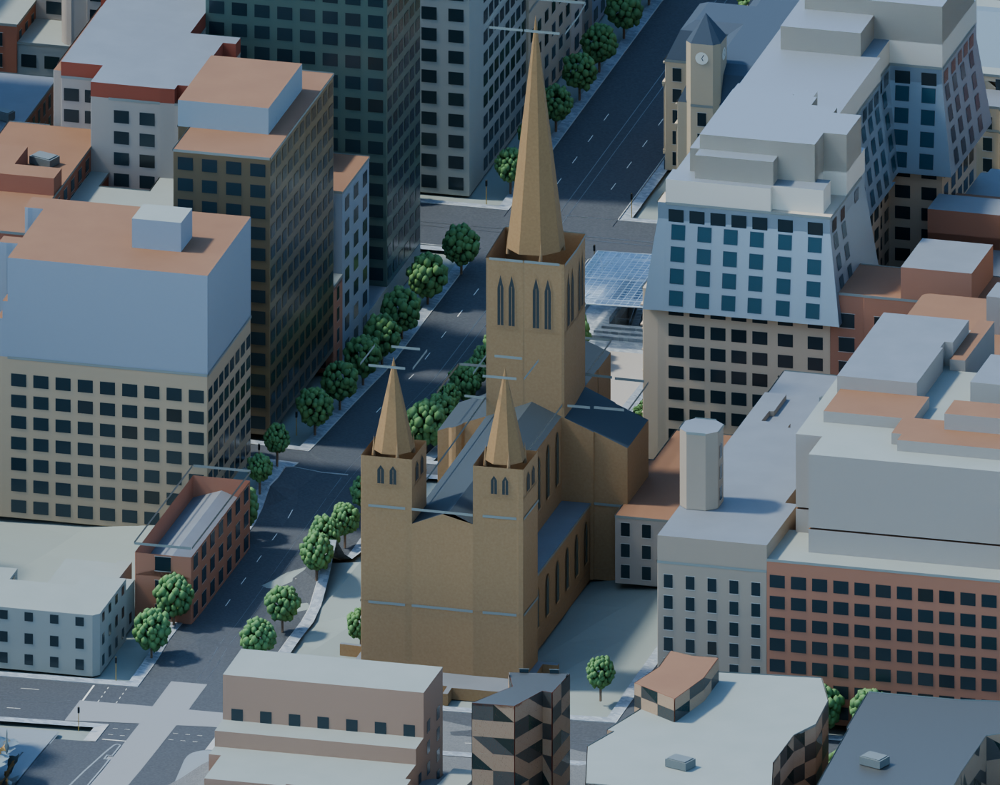

Saved-file checks confirm original tower geometry/material hash,240 positive-area detail faces and active aerial camera. Fresh saved render inspected; native Blender reloaded in coloured rendered shading.

## Upper cathedral cornice finish — scope stopped for NGV priority

Changed16 generic roof-cornice faces matched to cathedral tower wall planes to existing warm masonry. Saved-file check proves all cornice coordinates/connectivity and outside assignments unchanged; original mesh recoverable. Fresh trial inspected; upper pale edging reduced, lower strips remain. Expanded diagnostic identifies36 cornice faces across wall planes below tower-section bases, but additional changes are deferred at user’s request.

User priority now NGV first, then broad CBD consistency and aerial review. Detailed close-up cathedral/station ornament no longer blocks initial review readiness; major landmark silhouettes, majority building/landscape appearance and overall cohesion remain required.

NGV design reference identifies two main north–south gallery volumes, one straight and one doubly cranked, with circulation voids between ([NGV architectural essay](https://www.ngv.vic.gov.au/essay/enfilade-and-intrafilament-the-ian-potter-centre-ngv-australia-at-federation-square/)). Use this with retained source footprints and captured heights for the next consolidated pass.

## NGV aerial mineral palette

Priority pass replaces dark brown stone with warmer mineral tones and dark neutral zinc with muted green-grey response, visually informed by [joint architect exterior references](https://www.batessmart.com/projects/fed-square). Own procedural colours, no photographic textures or sampled pixels. Shared Federation sandstone/zinc materials affected; geometry, captured heights and panel ownership retained. Original materials recoverable. Exact current colours and finish distribution remain approximate. Fresh saved render inspected; simplified openings, roof transitions and close-up ornament remain visible and deferred under the broader aerial target.

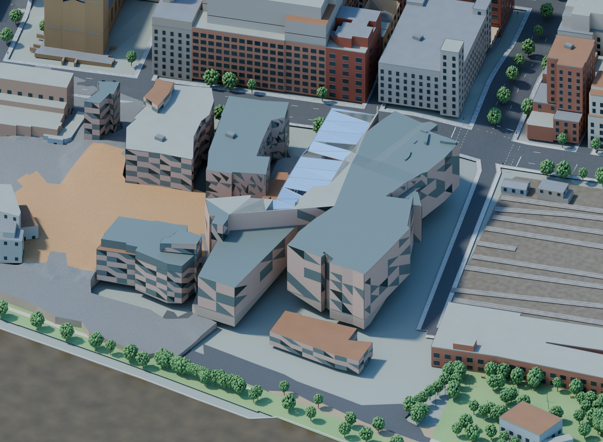

## Reduced-scope aerial review

Fresh full-city render inspected after NGV palette pass. Majority building volumes, skyline, street grid and parks form a coherent aerial model, suitable for initial review under the user’s reduced detail target. Pale precinct fields, simplified openings and unfinished outer coverage remain disclosed; no claim of complete photorealism or present-day surveyed materials. Web integration and Sites publication remain separate work.

## Final CBD-scale review and coloured reopen state

Inspected fresh1800×1300 CBD render alongside full-city and NGV reviews. Majority buildings have coherent roof/material variation and façade detail; street grid, paving, parks and rail corridors read as a complete aerial composition for initial user review. Audit of25,452 render-visible mesh objects finds no missing material slots and no image texture nodes. This proves material coverage, not measured accuracy. Layout now saves Material Preview with scene lighting/world and CBD camera framing, avoiding grey reopening. Native reload verified in coloured Material Preview on the canonical file, without an unsaved marker.

Remaining limitations: historical capture, authored façade schedules and heights where unspecified, simplified landmark openings, pale precinct paving and gaps beyond core CBD coverage. User explicitly deferred close-up detailing to finish faster. Web export/integration/Sites are separate pending deliverables.

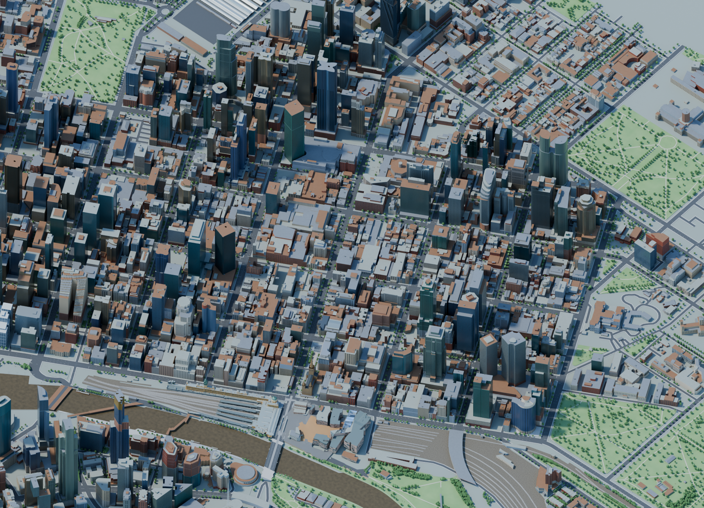

## Review reopened — NGV foundation and State Library repairs

User inspection contradicted the earlier readiness conclusion. Bridges and iconic landmark accuracy remain active repair requirements. NGV platform now uses a clean1m source-footprint apron at8.345m below retained8.4m base; vertical closures follow existing ground by rays. Exact clipping preserves outside parts of intersecting old deck/wall faces; original meshes recoverable. This is an approximate presentation plinth, not surveyed current structural podium. Saved-scene render inspected: fragmented base edges replaced, railway/trees unaffected.

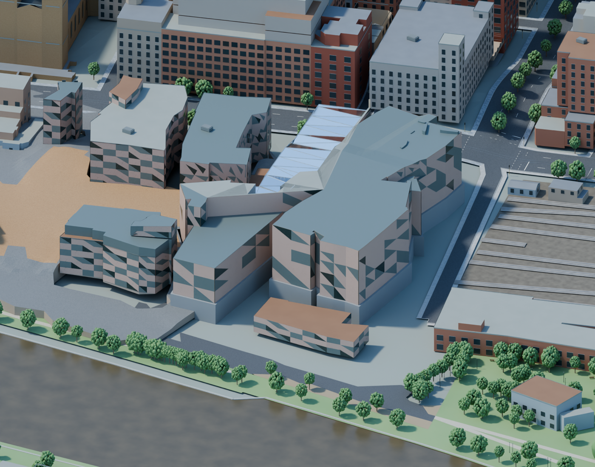

State Library receives reference-led portico,21 fitted facade bays, eight-column interpretation, octagonal dome/skylight/rib language and9.8m lantern.15 original source-envelope geometry hashes unchanged;2681 authored faces. Official Library and engineering references linked in state-library-design-notes.md; facade dimensions/profile/materials approximate. Saved render inspected; surrounding towers obscure some lower facade. Isolated front study separately inspected. No photographic texture nodes introduced.

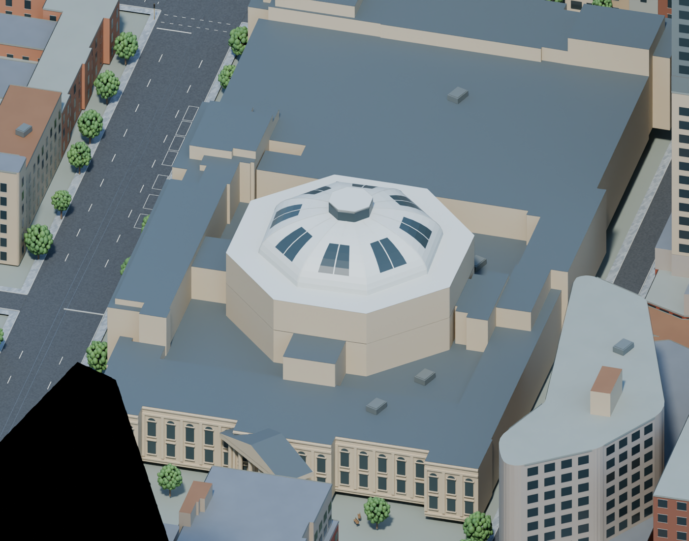

## Parliament built-frontage identity

Verified municipal listing point locates retained structure812895. Reference-led colonnade, broad steps and ordered end bays replace generic front treatment;14 original envelope geometry hashes unchanged and recoverable.12 columns,26 steps and exact bay/colour dimensions remain authored interpretations, not measured current architecture. Official built-facade reference used, unbuilt dome excluded. Saved render inspected; rear wings and carving remain simplified. Bridges and remaining landmark audit still active.

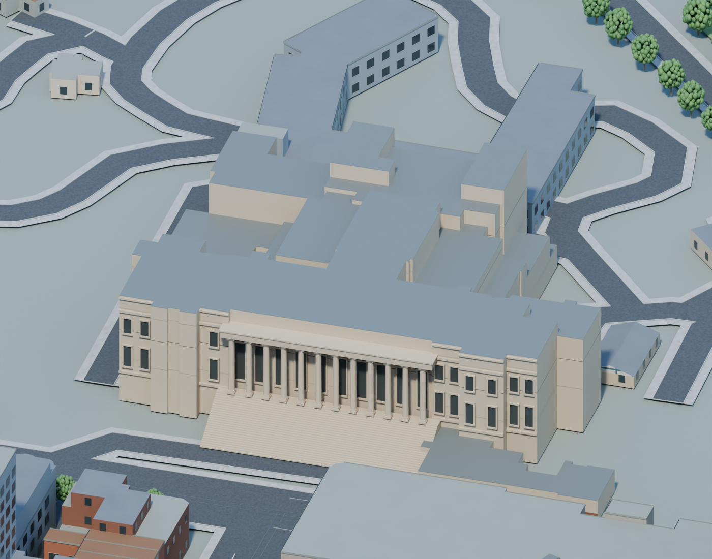
