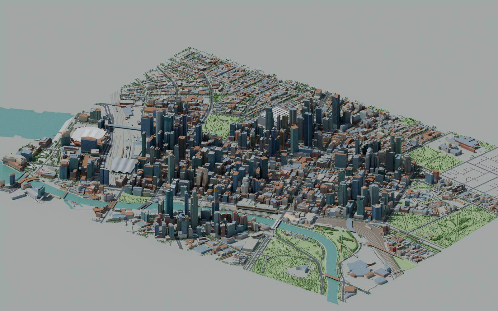
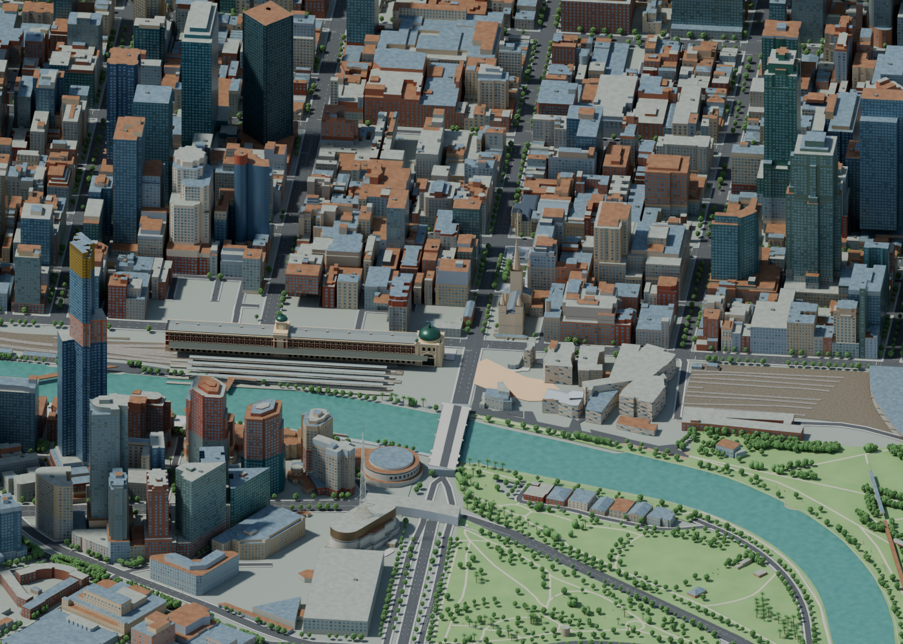
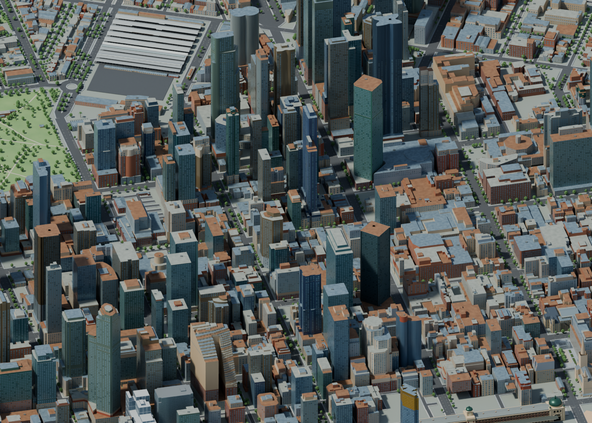

# Melbourne Blender design walkthrough

This is an authored aerial city built on retained public geography. Colours, shading and details are our own materials and meshes. The generated Flinders study helps choose a palette; its invented architecture is not used as evidence or a surface texture.

## 1. Start with the overview

Open `assets/source/environment/city-observatory.blend`. Press numpad 0 to enter the active camera. Select Rendered shading, the rightmost sphere in the viewport header, to see sunlight, glass reflections and shadows. Solid shading hides the final material appearance. The saved camera is `02 Flinders precinct`. For the full city, select `Aerial overview`, hover the viewport and press Ctrl+numpad 0 to make it active, then numpad 0 to enter that camera.

The Yarra anchors the southern edge. The street grid and surveyed building sections establish the city scale. Muted roof colours keep the scene readable from above; warm stone and brick contrast with steel blue glazing.

## 2. Inspect Flinders and the river edge

The `PREVIEW` collection includes `02 Flinders precinct`. Select this camera, hover the viewport and press Ctrl+numpad 0 to make it active, then numpad 0 to view it.

The existing station model remains simplified. Its ochre frontage and copper dome direction are supported by the [City of Melbourne description](https://whatson.melbourne.vic.gov.au/things-to-do/flinders-street-railway-station). [University of Melbourne architectural history](https://www.emelbourne.net.au/biogs/EM00587b.htm) describes red brick, painted render, copper and zinc. This is material evidence, not confirmation of every modelled dimension.

## 3. Inspect the streets and facades

Use `03 Hoddle grid streets` in the same way.

Window bays are separate authored glazing geometry. Roof-edge strips catch light and clarify silhouettes. Asphalt, pavement bands, shallow kerbs and worn lane dashes provide street structure. Lane arrangements, widths and kerbs are illustrative, rather than surveyed traffic engineering. Mapped tree positions have varied authored crowns and modelled trunks. Retained surface railway and tram alignments add transport detail; heights and gauge remain authored. The station heading follows the retained Flinders Street tram segment.

## 4. Find and edit the parts

- `CITY - surveyed envelopes with authored facade materials`: survey sections plus batched window bays and roof cornices. Select a `survey_` object and inspect its Custom Properties for source attribution.
- `CITY - reference-authored landmarks`: editable Flinders and corridor frontage models.
- `GROUND - official horizontal geography, authored levels`: river, road alignment, pavements, street details and park parcels.
- `TREES - mapped locations, authored crowns`: shared crown geometry with independent placements and scales.
- `PREVIEW - lighting and aerial camera`: directional sun, overview and two inspection cameras.

Materials use Principled BSDF shaders, restrained roughness and subtle procedural relief. No photographic surface textures are needed. Cycles, AgX and denoising produce the previews.

## What is still incomplete

Historical building envelopes have not been reconciled with every present-day redevelopment. Individual facade materials and window layouts remain authored approximations. Flat terrain, station platforms, rail infrastructure, landmark ornament, tree coverage outside the retained corridor and street furniture need more work. This pass does not establish a fully accurate current CBD or update the browser's older assets.

Latest live refinements (5 October 2026): 1,619 roof sections now carry small authored mechanical units constrained to surveyed roof faces. Thirty-two major CBD junctions have connected asphalt surfaces with illustrative dashed crossing guides and stop bars. Road connections come from the retained Vicmap dataset; equipment, crossing dimensions and present-day traffic controls are not surveyed. These additions use mesh geometry and procedural materials, with no photographic surface textures.

Incremental workflow: run `scripts/blender/refine_live_city.py` in the open Blender Python console to apply the pass immediately, then return to the 3D View. The script preserves existing objects, skips details already present and does not save or reload the file. Save after inspecting the change. The full builder reuses this pass for reproducibility.

Road surface cleanup: the retained Vicmap ribbons are now unioned and triangulated into continuous asphalt and separate pavement bands, preserving polygon holes. This removes coplanar junction artifacts. `scripts/prepare-city-surfaces.py` regenerates the retained mesh JSON with Shapely 2.1 or later; the triangle-area check verifies coverage of each union. The previous generated ribbons remain hidden in Blender for recovery. Preview widths and levels remain authored assumptions.

Roof shading cleanup: 8,520 retained survey sections now use roof surfaces merged only at matching surveyed heights, with holes preserved. This removes overlapping caps without raising buildings. The replacement has 114,448 upward-facing triangles and three authored roof finishes. `scripts/prepare-city-roofs.py` regenerates the geometry with Shapely 2.1 or later and checks triangle area against each union. The saved street-detail render verifies the former dark roof artifacts have cleared; individual roof colours remain illustrative.

Station rail detail: 4,021 illustrative concrete sleepers now follow retained Vicmap railway polylines in the Flinders precinct. Spacing (0.65m), dimensions and the flat datum are authored assumptions; source UFIs are stored on the mesh. Ballast uses procedural grain. This does not resolve missing individual tracks, platforms or canopies. The Metro Tunnel Historical Heritage Impact Assessment (2017), https://bigbuild.vic.gov.au/__data/assets/pdf_file/0008/229967/MT-Historical-Heritage-Impact-Assessment.PDF, identifies platforms and canopies as heritage fabric, but its text alone is insufficient to reconstruct their precise present-day geometry.

Platform precinct pass: six authored decks represent platform 1, four paired islands (2-3, 4-5, 6-7, 8-9), and platform 10 from the official PTV precinct schematic: https://www.ptv.vic.gov.au/assets/DTP1124-FlindersStreetStation-Precinct-Map_Degraves-Subway_web_Stage-1_v3.pdf. Four illustrative zinc canopies have iron supports, roof seams and safety edges. The schematic establishes arrangement, not scale; extents, heights, materials and canopy profiles are authored. Platforms 12-13, accurate track-to-platform clearances and current redevelopment remain unresolved. The new geometry is grouped under the station placement anchor for editing.

The next canopy pass adds four shallow pitched metal shells above the schematic islands. Their ridge is 0.8 m above the eaves, making the roof planes readable in daylight. The metal verandah treatment is informed by the historical heritage assessment; this particular profile and level are authored approximations, not surveyed dimensions. The existing platform supports and decks remain beneath these shells.

The city facade palette now has sixteen authored variants across the stone, concrete, terracotta and glass families. Every retained survey envelope receives a reproducible variant keyed by its source ID. This softens the repeated four-material appearance while retaining the survey geometry and source metadata. These are plausible art-directed finishes, not evidence of each building's present-day colour; individual landmark materials still need reference-specific treatment. No photographic texture nodes are introduced.

The river edge pass traces the retained Vicmap Hydro water boundary with a narrow authored coping strip. Segments lying on the dataset clip rectangle are excluded so the artificial crop does not acquire a bank. The strip is 0.9 m wide with a flat illustrative vertical datum; bank construction type, profile and current condition are unverified. Park grass gains low-frequency procedural colour variation without any image texture. The retained inventory includes one park polygon hole; the subsequent parcel correction preserves it in the replacement geometry.

The parcel correction replaces all 29 original grass parcels with constrained triangulations that preserve the retained boundaries and the interior hole in Birrarung Marr. Six named promenade or civic-square parcels receive authored paving; unidentified parcels, the Aquarium parcel and unspecified river frontage receive neutral ground. Named parks retain illustrative grass. This corrects the blanket interpretation of the inventory category without claiming measured surface cover or current park paths. Original generated parcels remain hidden and recoverable.

The bridge carriageway pass restores road surfacing on eight retained survey decks using Vicmap road features classified as `bridge`, which the ordinary-road selection omitted. The authored 9 m carriageway bands are clipped inside the surveyed deck outlines, preserving a 0.8 m edge margin and using the retained deck elevation with a small anti-overlap offset. Both road UFIs and survey IDs are retained on the Blender objects. Widths, materials, lane allocations and kerbs remain illustrative. This pass was saved through background Blender because the Mac was locked; the existing open Blender window requires reloading the saved file after unlock to show it.

The daylight refinement replaces the constant world colour with Blender's procedural multiple-scattering sky. Its direction follows the existing preview sun, with the sky sun disc disabled to avoid a second direct-light source. The sky fill is reduced to 0.055 strength and 0.6 saturation after render comparison, keeping warmer stone and station tones readable. This is an authored preview atmosphere, not current Melbourne weather or measured atmospheric conditions, and it uses no photographic environment map. The scene remains saved for reload after the Mac is unlocked.

The vegetation refinement replaces the shared 20-face angular crown with one 320-face smooth irregular crown. All 3,100 mapped tree instances keep their existing transforms and source IDs and still share a single mesh. The silhouette and shading are authored, with a small deterministic radial variation; individual species, canopy sizes, pruning and seasonal condition remain unverified. This is a preview-quality geometry improvement, not a new tree survey.

The park-path pass adds 60 retained Vicmap trail features where they intersect the named park parcels. The clipped union preserves parcel holes, snaps the generated surface to a one-centimetre grid for Blender mesh precision, and produces about 8,361 square metres of path surface. Width is authored at 2.4 m, with a pale procedural surface and flat datum; current width, paving type and accessibility are unverified. The resulting Blender mesh retains the contributing trail UFIs and both road and open-space source references. These paths improve the aerial reading of the park layout without inventing new alignments.

Full-scene review: the overview and Hoddle-grid images are regenerated from the current saved scene, including procedural sky, refined tree crowns, corrected park parcels, mapped park paths and bridge carriageways. `docs/city-scene-audit.json` records the inspected object counts and the absence of image-texture nodes across materials and worlds. These checks verify assembly and provenance coverage, not exact present-day architecture or visual completion. The goal remains incomplete until the broader renders, station clearances, landmark treatment and visible Blender refresh pass review.

The refreshed overview exposes uneven dataset coverage: the building extent exceeds the retained roads and vegetation, leaving sparse northern and outer streets and large neutral ground areas. Southern Cross lacks its characteristic roof, and many facade patterns still repeat. Those are visible incompleteness findings, not merely documentation caveats. The next priority is to reconcile the geographic coverage with public road, park and tree data, then strengthen reference-led landmark geometry.

The expanded road pass retrieves 2,990 unique ordinary-road features from the official Vicmap service across 144.942–144.984 longitude and -37.827–-37.800 latitude. Two ordered API pages are retained with the query, fetch time and response digest; duplicate UFIs and incomplete responses are rejected. This extends street and pavement coverage beyond the earlier corridor query to match the surveyed preview extent. Widths, pavement bands and the flat datum remain authored assumptions. The website's existing road data is unchanged; Blender uses separate retained expanded data and surface files. The overview is regenerated from the updated scene; the older close-up images require refresh after this coverage change.

The road boundary correction clips the generated expanded asphalt and pavement unions to the same projected preview extent used to select surveyed buildings: X -2,000 to 1,250 m and Y -800 to 1,750 m. Raw public road geometry remains retained unchanged. This handles ArcGIS spatial queries returning whole intersecting lines, rather than assuming the query box trims them. Generated mesh bounds, upward normals and triangle area are verified. This is a presentation boundary for this dataset assembly, not evidence that Melbourne ends there; broader vegetation and landmark completeness remain unresolved.

The expanded vegetation pass retains 15,512 City of Melbourne Urban Forest records across the surveyed preview extent, with the export query, fetch time, licence and response digest. Crown instances reconcile by public asset ID to the returned point coordinates, sharing the authored crown mesh; corresponding trunks are batched into one authored mesh. Legacy instances absent from this export remain hidden for recovery. Sizes, heights, trunk diameters, seasonal appearance and actual current condition remain unverified; raw DBH is not interpreted as metres. This expands geographic coverage beyond the original 3,100-tree corridor and does not prove that every public inventory record represents a tree still present today.

The expanded park pass retains 87 official VEAC open-space features across the full survey preview extent and generates 70 selected park parcels, preserving two interior holes. Thirteen named promenade or civic-square parcels receive authored paving; named parks receive illustrative grass and unspecified parcels remain neutral. Source polygons are clipped to the same preview boundary and snapped to a one-centimetre grid for stable mesh precision. This completes the wider parcel coverage pass while internal paths outside the original corridor still need retained alignments; parcel classifications are not proof of measured lawn cover or present-day landscaping.

The wider walking-path pass retains 579 official Vicmap trail features, of which 307 intersect the expanded selected park parcels. Their clipped union covers about 48,779 square metres at the authored 2.4 m width, with the same pale procedural path finish and flat datum. Contributing UFIs, both source references and a source digest revision are retained. This replaces the earlier corridor-only path mesh; actual widths, materials and present-day path condition remain unverified.

### Southern Cross inspection view

Camera `04 Southern Cross roof study` now provides a dedicated western CBD audit view. Its 10 km far clipping distance keeps the complete precinct visible. Reproduce the saved study with `scripts/blender/render_southern_cross_study.py`; the script preserves the saved active camera before rendering. The close-up confirms that the station rail area remains largely uncovered and the distinctive roof is missing. Generic survey envelopes must not be mistaken for a finished station.

The architect's project page was checked on 6 October 2026: https://grimshaw.global/projects/rail-and-mass-transit/southern-cross-station/ . It describes the dune-like roof and natural ventilation function. It does not supply a surveyed mesh or sufficient plan dimensions for direct placement. Roof geometry will be authored against retained alignment evidence; the generated roof study is an interpretation only.

### Southern Cross authored roof, first geometry pass

The previous pipeline excluded survey records 3295 and 3296 for playable train clearance. This city pass restores the landmark roof using record 3296's actual polygon, captured 11 May 2023. The retained raw record and export digest are stored in `southern-cross-authored-roof.json`. Its 34,440.26 m² plan area is covered by 4,592 upward-facing triangles. A smooth, continuous dune profile and procedural zinc finish are authored; no photographic textures or photomesh are imported. The profile stays between relative elevations 8.3 and 17.6 m, derived from this record's elevations relative to its structure minimum, but its wave spacing and shape are not measured roof geometry.

The first silhouette pass remains incomplete: rooflights, apex ventilation details, perimeter treatment and supports require reference-led refinement. The architect's design description informs the dune language rather than validating these authored wave dimensions. Use camera `04 Southern Cross roof study` to inspect this pass.

The next roof pass adds 161 authored standing-seam guides. DDA Engineers' project description (https://dda-engineers.co.uk/project/southern-cross-station, checked 6 October 2026) identifies aluminium standing-seam roofing following the undulating form. Our 1.2 m spacing and direction remain illustrative. The thin metal seam geometry follows the actual rendered triangle surface via vertical ray intersections, rather than an offset idealised wave. It uses an authored dark silver material; no source photograph is applied. The engineer's stated total roof area differs from the retained record's footprint area; this pass preserves the record boundary rather than treating the two as interchangeable.

The Southern Cross support pass adds 15 illustrative steel Y-columns with fork ends fitted to the roof's actual mesh surface, plus an authored 0.18 m roof edge thickness. DDA Engineers describes Y-columns at approximately 40 m centres, but our specific positions and sizes are not measured. Preparation excludes bases within 2.5 m of retained railway centrelines; the minimum accepted centreline distance is 2.67 m. This is a limited mapped clearance check, not validation against actual track envelopes, elevated infrastructure, passenger circulation or engineering requirements. Source rail UFIs remain in the model metadata.

A separate roof-hidden support cutaway is saved as `docs/images/observatory-southern-cross-support-cutaway.png`. It explains the authored support layout; it is not the normal visible city state. The cutaway renderer restores visibility in memory and does not save the hidden roof.

The rooflight pass splits the metal roof into separate metal and diffusing ETFE faces while preserving its plan area. The architect's 2010 journal, `Sculpted by the Wind` (https://grimshaw.global/journal/sculpted-by-the-wind/), describes diffusing double-skin ETFE skylights above platforms. Our four curved 2.8 m bands and their positions are authored approximations, not a measured platform/skylight plan. The split covers approximately 1,948 m² of the retained roof footprint. The ETFE material uses authored colour, roughness and transmission; there are no photograph textures. Rooflight geometry is part of the roof surface, so opaque metal does not sit directly beneath it. The same thin solidify thickness is a visual simplification of both roof materials, not an ETFE cushion construction model. The source triangle interpolation preserves the earlier surface height.
