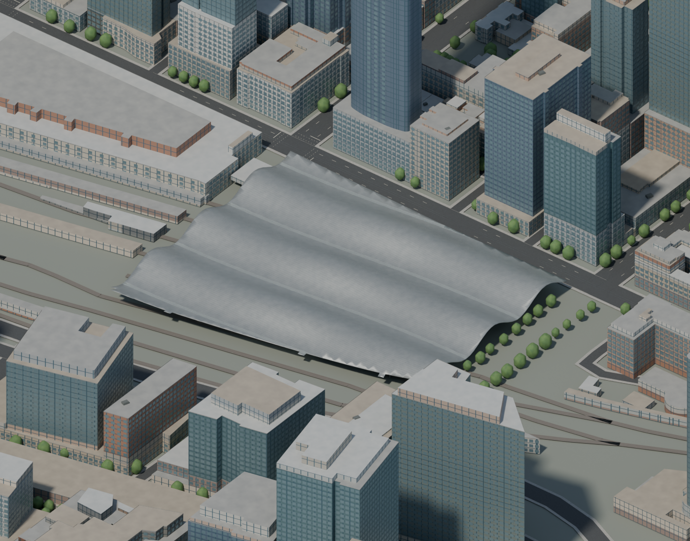

# Historical refinement notes

These notes describe successive passes, including treatments later replaced. The current walkthrough and scene audit are authoritative.

# Melbourne Blender design walkthrough

This is an authored aerial Melbourne scene built on retained public geography. Building finishes, detail geometry and lighting are our own. No photographic surface textures or photomesh are used. Present-day Melbourne is the target, but retained survey dates and authored assumptions remain visible in object metadata.

## Open and explore

Open `assets/source/environment/city-observatory.blend`. The saved active camera is `02 Flinders precinct`. Hover the 3D viewport and press numpad 0 to enter its view. Choose Rendered shading—the rightmost sphere in the viewport header—to see the materials, sky, reflections and shadows. Solid shading will conceal the finished appearance.

To change views, select a camera in the `PREVIEW - lighting and aerial camera` collection, hover the viewport and press Ctrl+numpad 0, then numpad 0. The available views are:

- `Aerial overview`: the whole authored city and Yarra.
- `02 Flinders precinct`: station frontage, platform canopies and river edge.
- `03 Hoddle grid streets`: streets, surveyed building envelopes and facade detail.
- `04 Southern Cross roof study`: the western CBD precinct.
- `05 Southern Cross roof detail`: the authored dune surface and rooflights.
- `06 Federation Square detail`: triangular cladding and precinct envelopes.
- `07 Federation roof inspection`: gable cladding, seams and edges.
- `08 Northbank asset inspection`: riverbank features and Princes Bridge.
- `09 Date palm grove inspection`: authored palms and varied tree crowns.
- `10 St Pauls Cathedral inspection`: spires, masonry, lancet bays and pitched roof.
- `11 Flinders platform inspection`: closer view of canopies, ballast and platforms.
- `12 Southbank paving inspection`: authored bluestone along retained promenade parcels.
- `13 Arts Centre spire inspection`: lattice, gold skirt and theatre material hierarchy.

The Mac was locked during later background passes. The open Blender window may still show an older scene: reload the saved file after preserving any unsaved edits. A saved render is evidence of the file, not proof that the live window has refreshed.

## Walk through the city

Begin with the overview. The retained Yarra boundary and street grid establish geographic structure. The scene has 8,520 surveyed building sections, a sixteen-variant authored facade palette and three main roof finishes. Roof caps merge only at matching survey heights to remove overlaps; illustrative mechanical units on selected flat roof sections provide aerial scale. The glazing and window patterns are authored approximations. A grouped low-rise pass removes the former dark shader grid from 2,765 sections in 2,242 retained structures, varies punched-window proportions and adds shallow sill/lintel strips. Tower grids and generic detailing still need more reference-specific treatment.

Move to Flinders. Ochre frontage, cream trim, copper dome tones and a pitched zinc roof give the station its material identity. [City of Melbourne](https://whatson.melbourne.vic.gov.au/things-to-do/flinders-street-railway-station) and [University of Melbourne architectural history](https://www.emelbourne.net.au/biogs/EM00587b.htm) inform the palette. Six schematic platform decks and four pitched canopies follow the [PTV precinct diagram](https://www.ptv.vic.gov.au/assets/DTP1124-FlindersStreetStation-Precinct-Map_Degraves-Subway_web_Stage-1_v3.pdf), which establishes arrangement rather than measured scale. A schematic eastern deck now represents platforms 12–13 beyond Swanston Street, beneath the covered Federation Square precinct. Its pairing, dimensions and height remain illustrative. Exact track clearances and current redevelopment remain unresolved.

Inspect the streets. The retained expanded query contains 2,990 ordinary-road features, unioned into continuous asphalt and separate pavement bands. Eight bridge carriageways use retained survey deck boundaries and elevations. Park coverage includes 70 selected open-space parcels with two clipped interior holes; thirteen named promenades or squares receive authored paving. The park-path mesh uses 307 retained trail features clipped to selected grass parcels. Road widths, pavement bands, crossing guides, path widths, materials and flat levels are illustrative, not traffic-engineering measurements.

The 15,512 visible tree instances use public Urban Forest point locations. Of these, 15,112 ordinary trees share three authored lobed crown profiles, and 190 mapped Canary Island date palms use layered pinnate crowns. The other 210 palms retain generic shapes. Crown sizes, individual form, season and condition are authored. The narrow river-bank coping follows retained water-boundary segments while excluding artificial clip edges; it does not establish actual bank construction.

Finish at Southern Cross. Its roof is restored on retained survey record 3296's 34,440.26 m² footprint, captured 11 May 2023. Continuous waves, 161 standing-seam guides, four diffusing rooflight bands, fifteen Y-supports and a thin roof edge are authored. [Grimshaw's design description](https://grimshaw.global/projects/rail-and-mass-transit/southern-cross-station/), [architect journal](https://grimshaw.global/journal/sculpted-by-the-wind/) and [project engineer](https://dda-engineers.co.uk/project/southern-cross-station) inform the architectural language. Exact wave, support and rooflight layouts are not measured. Roof area statements in those references are not treated as interchangeable with this survey record's plan area. Apex ventilation details and accurate architectural proportions need further work.

The separate `observatory-southern-cross-support-cutaway.png` temporarily hides the roof to explain the supports. It is not the normal saved scene state. Support bases are at least 2.5 m from retained railway centrelines; this limited check does not certify operational or engineering clearance.

## Find and edit the model

- `CITY - surveyed envelopes with authored facade materials`: survey envelopes, window batches, roof surfaces and equipment. Inspect Custom Properties on `survey_` objects for source identifiers and attribution.
- `CITY - reference-authored landmarks`: Flinders, corridor frontage and Southern Cross roof details.
- `GROUND - official horizontal geography, authored levels`: water, roads, pavements, bridge surfaces, railway alignment, park parcels and paths.
- `TREES - mapped locations, authored crowns`: shared crown geometry, independent point placements and batched trunks.
- `PREVIEW - lighting and aerial camera`: cameras and directional sun.

Materials use Principled BSDF, procedural grain, roughness and subtle relief. A procedural sky, directional sun, Cycles, AgX and denoising supply the preview lighting. The atmosphere is authored; it is not live weather.

## Sources, reproduction and remaining work

The retained data files preserve source URLs, identifiers, query bounds and available export digests. The main sources are City of Melbourne 2023 Building Footprints, City Urban Forest, Vicmap Transport and Hydro, and the VEAC open-space inventory. Inventory categories do not prove actual ground cover; generic finishes do not prove present-day facade colours.

`scripts/blender/refine_live_city.py` applies incremental details in Blender without saving or reloading. `scripts/blender/render_city_review.py` refreshes the overview, Flinders and street images from a loaded file without saving it. The dedicated Southern Cross render scripts provide its wide view, roof detail and explanatory cutaway. Geometry preparation scripts use Shapely; their area and source checks are narrower than visual or present-day validation.

The city is not complete. Flat ground and hard dataset boundaries remain visible, generic facade patterns need variation and landmark-specific treatment, rail/platform reconciliation remains incomplete, and historical building data must be checked against present-day changes. The browser still uses older assets. `docs/city-scene-audit.json` records current findings. The earlier chronological pass notes are preserved in `docs/blender-pass-history.md`.

The facade variation uses retained `structure_id` values so sections belonging to one building share the same window style. `city-facade-groups.json` retains the mapping and raw export digest. Three low-rise proportion families are illustrative, not a building-by-building facade survey. The City of Melbourne's Hoddle Grid Heritage Review (https://participate.melbourne.vic.gov.au/AmendmentC387) and its Alley Building citation (https://librarysearch.melbourne.vic.gov.au/cgi-bin/spydus.exe/ENQ/OPAC/ARCENQ?RNI=1208270&SETLVL=) establish varied commercial facade language; they do not validate the assigned style of each model. Existing window batches remain hidden for recovery. The replacement includes taller buildings' previous window treatment as well as changed low-rise geometry.

The tower material pass removes the former colour-shader grid from 292 glass-facade sections across 264 retained structures. Eight authored reflective tints, roughness variants and a restrained clear coat share a consistent assignment within each source structure. Separate window geometry supplies the fenestration rhythm. This is material refinement on survey geometry, not identification of actual building glazing; specific landmark colours and construction remain unverified.

Ordinary railway ballast ribbons now form a continuous union on fifty retained `railway` features, covering about 35,157 m² at the same authored 3.6 m width and flat level. The explicit `rail_uground_o`, `bridge_rail_o` and `tramway` feature classes are excluded. Unioning removes overlapping ribbon corners; procedural gravel grain supplies the finish. This does not infer yard boundaries or fill missing individual station tracks. The source structure-type codes remain unresolved because the service field metadata has no code domain; those codes were not guessed to make this pass. Original ballast ribbons remain hidden for recovery.

The eastern deck pass deliberately adds no exposed canopy: the retained Vicmap features around its location use `rail_uground_o`, and the PTV map marks the eastern platforms beyond the main precinct. The authored deck remains subordinate to the retained above-ground envelopes. This improves schematic completeness but does not reconstruct platform operations, access, actual covered-station structure or track clearances.

The eastern deck is placed 3.5 m below the earlier local preview level, so it sits beneath the flat ground and does not cross Swanston Street in the aerial view. This is an illustrative covered level, not a surveyed elevation. It is therefore an editable schematic placeholder rather than a new visible aerial feature; inspecting it requires hiding the covering ground and envelopes. The render caught and corrected an initial above-road placement before the pass was committed.

Federation Square now has its own reference-informed cladding layer on ten active selected survey sections belonging to retained structure IDs 806667, 816359, 812338, 805928 and 809180. Its official design page (https://fedsquare.com/history-design, checked 6 October 2026) identifies sandstone, zinc and glass in triangular pinwheel grids. The revised model uses 20,060 authored triangular faces with small reveals and those three material families. A subsequent close-up review replaced the busy four-triangle cells with five-piece right-triangle groups sharing one material. The grouping follows the documented design language; adapted cell ratios, spacing and material distribution remain authored rather than an exact facade reconstruction. The selected envelope group is an authored precinct selection based on retained locations, not a cadastral precinct survey. Survey silhouettes remain unchanged; distinctive roof profiles, exact cladding mapping and individual building identification require further work.

Federation Square surface pass: sandstone and zinc now use authored procedural colour grain and shallow bump shading. No image textures are used; grain dimensions and colour ranges are artistic assumptions. The official Main Square venue page confirms sandstone cobblestones and a 5,000 m² plaza, but its linked event site-plan PDF returned HTTP 404 during this pass. Plaza boundary and paving geometry therefore remain unresolved rather than being inferred from all vacant foreground space. Reference: https://fedsquare.com/venues/main-square.

Street-edge pass: shallow concrete kerbs now follow boundary edges of the continuous Vicmap-derived road mesh. The 16 cm width and 12.5 cm rise are authored visual assumptions; map clipping edges are omitted. This improves aerial road/footpath separation but does not establish actual driveway openings, accessible ramps or kerb profiles. Those details remain incomplete.

Federation roof source reconciliation: record 20246 (2018, Flat) overlaps record 20248 (2022, Gable) by 99.9457 percent and shares its structure/elevations. The older facade is hidden and its duplicate authored cladding omitted; both original records are retained in `federation-roof-source-audit.json`. The roof union still uses the survey maximum elevation. Gable ridge position and precise profile remain unresolved; the Hip section is dated 2018. These are historical observations rather than present-day confirmation.

Federation gable pass: sections 20247 and 20248 now have authored linear gable planes within their retained outlines and elevation ranges. The ridge follows each footprint's minimum-rectangle long axis; its direction and profile are inferred, not measured. Matching flat-cap areas are cut out and upper-section walls/cladding fit to the authored planes. The 2018 Hip section remains unresolved. Reproduce geometry with `scripts/prepare-federation-gables.py` (Shapely), then apply `scripts/blender/refine_federation_gables.py` in Blender.

Roof close-up inspection: camera `07 Federation roof inspection` provides a 100 m view of the two authored gables. Ray checks identify the visible upper plane as the authored gable itself, not an extra flat cap. Facade panels now carry their retained source-section ID, and roof fitting uses that ownership rather than a spatial proximity test, preventing neighbouring section panels from being deformed. Exact roof proportions and surrounding precinct architecture remain incomplete.

Main Square paving pass: an approximate authored footprint now carries procedural sandstone pavers, with 18 × 10 cm blocks and 6 mm joints (authored dimensions). The footprint is guided by the 2019 Heritage Council precinct diagram, clipped around retained ground-level building footprints with a 1 m buffer and road surfaces, then scaled to the official venue's 5,000 m² area. Area calibration does not establish exact location or boundary. No image texture or Nearamnew artwork is reproduced. The .32 m flat preview datum is provisional: the Heritage Council describes an approximately 6 m eastward rise, which remains to be reconciled with building levels. References: https://assets.heritagecouncil.vic.gov.au/assets/Determination-Federation-Square-FINAL.pdf (pages 6 and 57), https://fedsquare.com/venues/main-square.

Gable metal detail: 55 authored seam guides at .9 m spacing and 31 edge-trim guides now fit the two authored gable profiles. Fine curve relief uses .018 m seam and .035 m trim radii with a .025 m vertical offset. These dimensions and the seam schedule are authored, not surveyed; the official design description supports the zinc material family. Preparation: `scripts/prepare-federation-roof-trim.py`; application: `scripts/blender/refine_federation_roof_trim.py`.

Wider skyline masonry pass: taller structure groups' stone, concrete and terracotta facade sections now retain their authored palette with continuous base-colour shading, roughness .82 and no metallic response. The old shader-painted window grid is removed; separate window geometry remains. This avoids layering a second artificial grid over geometry. Palette assignments still do not establish actual building finishes. Script: `scripts/blender/refine_city_masonry_materials.py`.

Mapped lighting asset pass: 580 selected council feature-lighting asset points now have small authored pole/fixture meshes. The selection requires explicit pole mounting with Flood/Down Light classification (or generic Pole); ambiguous Feature, Up Light, bridge, catenary, wall and ground fixtures are omitted, along with ten points inside retained ground-level building envelopes. The retained API export contains 5,836 total records. The separate 106,037-point lux dataset is not used as pole locations. Pole height (4.5 m), fixture form, orientation and ground level are authored. Asset points do not prove separate physical poles or current operation; this is daytime geometry with no live lighting claim. Source: https://data.melbourne.vic.gov.au/explore/dataset/feature-lighting-including-light-type-wattage-and-location/. Prepare with `scripts/prepare-city-feature-lights.py --raw <saved-json-export>`; source hash and selected records are retained in `city-authored-feature-lights.json`.

Princes Bridge pass: retained survey envelope 36402 now has authored bluestone side shading and a subdued upper-stone finish instead of the generic pale roof finish. Its long outer edges carry a simplified iron railing, 1.1 m high with approximately 1.5 m post spacing. Stone/iron material families are reference-informed; their colour, distribution and all railing dimensions are authored. The retained outline and preview height remain unchanged. Detailed ornament, three-span structure, bridge lamps and reconciled vertical levels remain incomplete. Reference: City of Melbourne Central City Heritage Study Review, https://mvga-prod-files.s3.ap-southeast-4.amazonaws.com/public/2024-07/central-city-heritage-study-review-1993-p5.pdf. Script: `scripts/blender/refine_princes_bridge.py`.

Date-palm pass: 190 retained Canary Island Date Palm points now use an authored stout-trunk and pinnate-frond mesh, replacing generic rounded crowns. The shared mesh has three layers of 16 fronds, including upright shorter upper leaves, shallow leaf ribbons and separate leaflet triangles. An 8 m stem, leaf length, palette and .85–1.15 instance size range are authored; individual height and crown spread were not measured. Point locations and inventory species labels are retained. Botanical form reference: Royal Botanic Gardens Victoria, https://vicflora.rbg.vic.gov.au/flora/taxon/a3860b68-24a3-424a-8906-1f43be6d3497. Other palm species still require appropriate fan/feather forms. Script: `scripts/blender/refine_city_date_palms.py`.

Ordinary tree crown pass: non-palm inventory points now use three shared, authored five-lobed crowns and deterministic rotation, rather than one repeated rounded crown. Each shared profile has 400 triangular faces, preserving instancing. The previous illustrative scale is retained, and point locations are checked against the retained inventory within 1 cm. Lobes, branch structure, canopy size, height, seasonal colour and species-specific form remain authored assumptions. Palm geometry is preserved. Script: `scripts/blender/refine_city_tree_crowns.py`.

St Paul's Cathedral silhouette pass: retained structure 819362 supplies three upper-tower footprints (record 27587, three polygon parts) and the central upper-spire envelope (27583). Generic rectangular upper volumes are retained hidden and matching flat caps/window faces omitted. Authored tapered octagonal spires and simplified corner pinnacles preserve the preview's retained maximum levels: 93.2 m central and 53.6 m side spires. Side shoulders at 38 m, taper, radius, ornament and palette are authored. The cathedral's own guide confirms three spires and sandstone/limestone/bluestone materials; published architectural heights are not treated as interchangeable with the survey's relative heights. Nave roof, Gothic facade, base materials and full architectural proportions remain unfinished. Reference: https://cathedral.org.au/wp-content/uploads/2022/11/2022-English-Guide-Sheet-Final.pdf; official plan: https://cathedral.org.au/wp-content/uploads/2019/08/floorplan.pdf. Script: `scripts/blender/refine_st_pauls_spires.py`.

The cathedral lower survey walls now use the authored warm stone material. Generic rectangular storey grids are removed within the retained lower sections, and illustrative pointed lancet bays follow long wall segments. These bay sizes and spacing are authored, not measured stained-glass or architectural reproductions. Roof pitch, buttresses and precise openings remain unfinished.

The cathedral upper roof now has an authored longitudinal gable clipped to source section 27586, using a dark slate-like material. The ridge stays at the retained 29.6m relative maximum and the illustrative eave is 23m. This is an interim survey-bounded roof, not an exact reconstruction of nave, transept and chancel roof junctions.

Flinders now has an additional authored ballast margin on thirteen retained ordinary railway features, covering approximately 15,248m² within the western station study bounds. The 6.4m total width is illustrative. Retained roads and ground building footprints are excluded; this is neither a complete station track survey nor a measured yard boundary.

The Flinders platform inspection shows four schematic pitched metal canopies with 896 authored seam and edge guides. The 1m seam spacing and trim profile provide scale and shading; exact construction and present-day canopy extents remain unverified. The close view also exposes unfinished station roof treatment, platform ends, access structures and surrounding neutral ground.

The Flinders close-up camera is moved 600m backward along its view axis, preserving orthographic framing. Its earlier position intersected foreground building volumes, producing black clipped faces. The corrected saved render restores their authored colours and fenestration.

The existing Flinders main pitched roof now uses authored metre-scale zinc grain, subtle bump relief and 364 standing-seam/edge guides at an illustrative 0.8m rhythm. No image texture is used. The shallow roof profile, roofing identification and seam schedule remain approximations rather than a measured reconstruction.

Southbank has an authored bluestone paving overlay on three retained named promenade parcels in an illustrative eastern reach. The City completed new bluestone paving between Princes Bridge and Evan Walker Bridge: https://participate.melbourne.vic.gov.au/emerging-tech-testbed/southbank-promenade-1/works-between-princes-bridge-and-evan-walker-bridge-are-now-complete . The overlay covers about 3,590m²; clipping bounds, 1m × 0.5m paver rhythm, joints, colour and flat level are authored. Exact upgrade boundary, upper/lower promenade levels and furniture are unresolved.

Central CBD pavement bands now receive an authored bluestone finish with 1m × 0.5m paver rhythm, informed by City of Melbourne’s August 2024 operating procedure: https://mvga-prod-files.s3.ap-southeast-4.amazonaws.com/public/2024-08/operating-procedure-bluestone.pdf . The document explicitly says coverage remains incomplete. The model’s broad region assignment, colour, joints and flat level are illustrative; it does not map actual existing paver coverage or certify accessibility. Other park and promenade finishes retain their own materials.

Arts Centre Melbourne’s upper spire survey blocks (25568/25569, structure 810427, captured 2018) are replaced by an authored open steel lattice and gold webbing skirt. The centre’s 2024 anniversary release describes gold webbing and the 162m street-level spire: https://www.artscentremelbourne.com.au/-/media/acm/files/about-us/media-centre/media-releases/2024/241001arts-centre-melbournes-theatres-building-celebrates-40-years--media-release.pdf . The model retains the survey-relative 150m top; this datum discrepancy, exact lattice/mast, lighting and current refurbishment remain unresolved. Original blocks remain hidden for recovery.

Camera 13 Arts Centre spire inspection provides a close view of the authored lattice. Its review exposed a generic roof cornice floating above the taper; eight residual cornice faces were removed. The theatre’s generic fenestration and architectural finish remain unfinished.

The theatre beneath the Arts Centre spire now uses authored concrete lower surfaces, bronze ribbed upper panels and two illustrative horizontal glazing bands instead of generic office fenestration. This material hierarchy follows the Heritage Council description: https://assets.heritagecouncil.vic.gov.au/assets/HCV-DETERMINATION-AND-ED-RECCOMENDATION-HER1067-R11128-ARTS-CENTRE-AMEND.pdf . Exact glazing and balcony extents, levels, rib orientation and current redevelopment remain unresolved.

Hamer Hall’s retained sections 3167–3169 (structure 813491, captured May 2023) now share an authored bush-hammered concrete finish. ARM’s project description establishes its circular, raw-concrete identity: https://armarchitecture.com.au/projects/hamer-hall/ . An illustrative upper glazing ribbon provides a first solid/void treatment; exact inset openings, balconies, restaurant curtain and present-day museum works remain unresolved. Camera 14 Hamer Hall inspection shows this pass.

Hamer Hall’s upper drum now has illustrative framed bays following its retained outline. The 2024 AMPA heritage impact statement identifies precast panels with deep openings: https://www.heritage.vic.gov.au/__data/assets/pdf_file/0027/722547/2024.10.28-Updated-AMPA-HIS.pdf . The model’s approximately 5m bay rhythm, 3.4m frame width and 0.45m projecting reveals are authored, not measured original openings. Exact balconies and current works remain unresolved.

The initial all-around Hamer Hall bay rhythm was revised after checking ARM’s exterior description: opaque windows belong to the St Kilda Road side, while the river elevation has irregular carved openings. Framed bays are now limited to an illustrative east-facing sector (outward normal X > 0.3). This orientation cutoff and bay schedule are authored; the river-side carved facade remains unfinished. The earlier all-around mesh is hidden for recovery.
