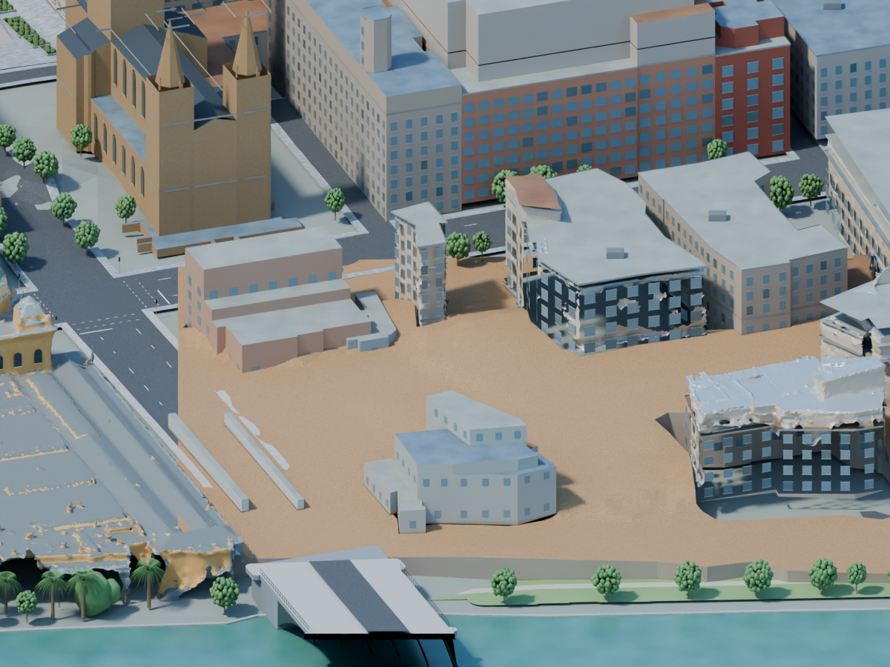
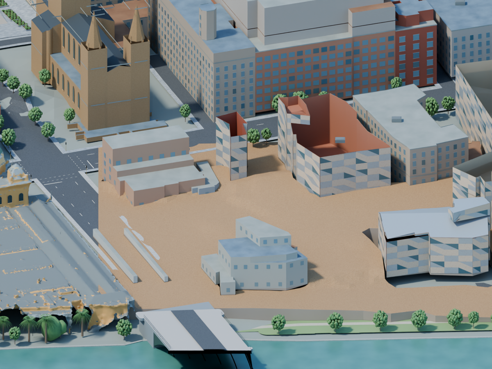
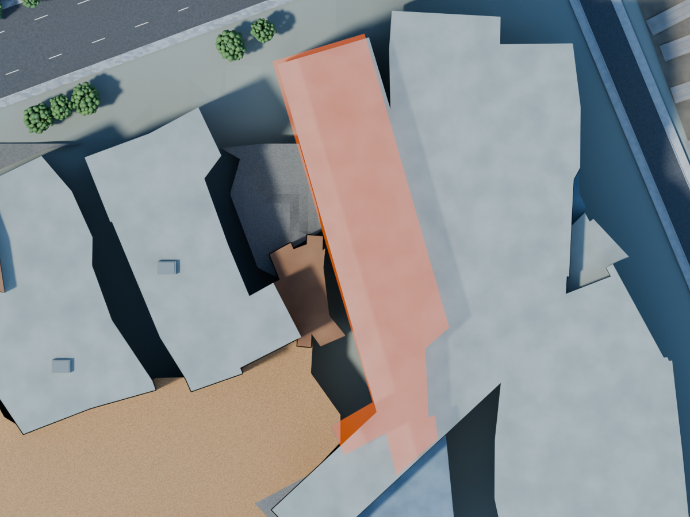
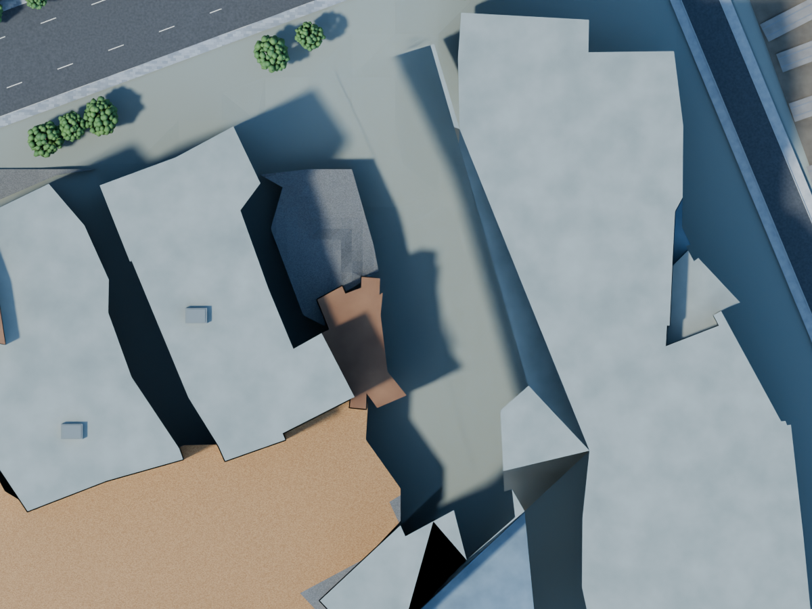

# Federation review and final web handoff

User feedback, 6 October 2026: Federation Square looks weird. User requested updated website code and publication through Sites after Blender work is finished.

## Current visual findings

Inspected saved precinct render `images/observatory-federation-reconciled-streets.png` and current geometry scripts after commit 1cfca12. Cathedral-only material changes since that image do not modify Federation geometry.

- Retained footprint extrusions produce prominent rectangular, stepped building masses. Only two sections receive authored gable profiles; this does not reproduce the full architectural roof silhouette.
- Cladding script tiles rectangular wall cells with two parent triangles, each subdivided into five pieces. It assigns material by a deterministic section/edge/cell key. It does not implement the documented five-panel mega-panel hierarchy or actual material schedule. The result reads as repetitive wallpaper.
- Fitted deck is a broader precinct surface, not an exact Main Square boundary. Uniform stone treatment and smoothed height field obscure distinct plazas, passages, terraces and access routes. Do not substitute the broader deck area for the main plaza area.
- Building/terrain contact, eastern coverage gaps and entrance/step relationships remain unresolved. No visual completion claim warranted.

Primary design reference: https://fedsquare.com/history-design describes interlocking and cascading spaces, and five triangular pieces forming panels, then five panels forming mega-panels. It establishes design language, not exact coordinates or colour values.

Next proposed repair: compare retained municipal capture with architectural references, correct silhouette and distinguish plaza/path boundaries first. Preserve authored materials and retained source geometry for recovery. Exact finishes and reconstructed transitions remain disclosed approximations. User clarification pending on geometry-first versus colour-first priority.

## Final website publication requirement

After Blender acceptance audit, integrate revised geometry/materials into the city observatory web renderer, preserve the uncluttered 3D-first interface, verify interactions and parking/simulated-traffic behaviour, then publish through Sites. Use Sites building and hosting skills. No Sites hosting metadata currently exists in this checkout; registration and deployment are outstanding. Do not publish the walkthrough as a substitute for the interactive city. Preserve unrelated working changes until intentionally integrating the website. Blender material nodes may require supported web material equivalents or baking authored procedural output; do not introduce photographic textures.

First bounded geometry repair: section20248 roof slope fitted to30 captured samples. Two-section IDW trial rejected. Larger roofs, plaza and facade hierarchy still open. Geometry-first clarification unanswered; proceeded with bounded reversible source-supported repair under active city goal.

Paving response: restrained authored stone joints and warmer colour accepted as material-only pass. Broad precinct deck still lacks verified Main Square boundaries. Nested panel trial rejected: no meaningful aerial benefit for 80,150 extra faces. Official venue site-plan links returned404; unavailable plans not used as geometry evidence.

## Reconstruction trials — rejected, 6 October 2026

Canonical scene remains at accepted paving pass. Two unsaved trials inform next work:

1. Untextured captured building surfaces: 56,817 vertices / 106,365 faces extracted within retained Federation section bounds. Our sandstone/zinc materials assigned by surface orientation only, an illustrative diagnostic. Roof tears and holes remain; surviving generic meshes obstruct the replacement. Rejected.
2. Conservative polygon masking inside selected section bounds removed 631 grouped window faces, 1,262 sill/lintel faces, 136 cornice faces, 25 equipment faces, 194 merged roof faces and 32 short-window faces. Roof removal exposed open shells: replacement roof coverage incomplete. Rejected.

No changes applied to saved or open Blender scene. Next: complete per-structure piecewise roof reconstruction before cap masking; verify every masked face has a covering replacement. Nearby regular window grids include adjoining buildings, so do not remove by appearance alone. Audit: `federation-reconstruction-trials.json`.

Primary references checked: [municipal May2020 mesh](https://discover.data.vic.gov.au/dataset/city-of-melbourne-3d-textured-mesh-photomesh-2020) and [Federation architectural design](https://fedsquare.com/history-design). Capture predates present-day target; exact current geometry/material distribution unverified.

Accepted western shard repair: section4607 has complete five-triangle roof coverage before five old caps are hidden. Twelve floating illustrative cornice faces also hidden; all originals recoverable. Larger structures require piecewise surfaces, not this single-plane recipe.

Accepted main roof pass: section20247 shallow capture-supported plane,21 roof triangles,56 approximate perimeter faces, complete954.885m² footprint coverage. Higher section20248 excluded from fitting. Source upper body and gable hidden recoverably; original upper cladding assignments retained. Exact facade and roof-edge detail unresolved.

Official interactive map discovery: https://fedsquare.com/map exposes schematic Square, Buildings, Crossings and accessibility layers. Retained reference stores Square and Buildings coordinates only, no credentials or map images. Square polygon6,245.8m²; deck intersection5,475.91m². Distinguish this from official5,000m² venue description. Warm square paving and assumed neutral surrounding stone partition original deck without altering terrain planes. Public map reuse terms remain unreviewed before website asset publication.

Next significant missing form: official Atrium polygon (~1,765m² schematic, local bounds194..233 /43..139) is currently absorbed into generic precinct envelopes. Correct architectural ownership and model glass/steel volume from primary references and capture.

## Atrium ownership audit — 6 October 2026

Three source sections16221,16222,16223 (structure816359) each overlap1,663.48m² of the official schematic1,765m² Atrium footprint. Generic solids therefore occupy about94% of the mapped glass galleria. Candidate export identifies overlapping source faces and3,294 cladding,64 roof,141 window,282 sill/lintel and48 cornice faces for clipping review. Counts are bounding-box candidates, not a claim that every face should be removed.

Orange overlay is an unsaved diagnostic at localZ40m, not a roof, new building or accepted design. Canonical Blender scene unchanged.810 unique roof samples lie within schematic footprint, with substantial height variation and capture ambiguity; no single flat roof justified.

[Fraser, Brizzi and Hira2003 author-uploaded structural paper](https://www.researchgate.net/publication/254782878_VISION-BASED_MULTI-EPOCH_DEFORMATION_MONITORING_OF_THE_ATRIUM_OF_FEDERATION_SQUARE) distinguishes two Atrium elements. North Atrium:16m high,14m cantilever,200mm square hollow sections,~1.5m frame-skin separation and2m roof trusses. These dimensions do not specify node positions or apply uniformly to the entire visitor-map polygon. [Project structural engineers](https://www.atelierone.com/federation-square) identify their work on main glass Atrium.

Replacement requires clipping overlapping solids and merged details together, reconstructing exposed adjacent-building boundaries/floor, then modelling separate north/south forms and source-guided steel/glass geometry. Keep originals and material assignments recoverable.

Naming correction: official visitor map labels source4607 area East Shard. Earlier scripts use western-shard as a geographic working label; this should not be presented as the demolished historic Western Shard.

## Atrium cut prototype — not applied to saved scene

Reversible surface clipping now clears the schematic corridor across three surveyed masses and their merged cladding, roofs, windows, sill bands and cornices together. Retains252 outside triangles; original source vertices and faces remain recoverable, with original material assignments embedded in Blender text blocks. All candidate face coordinates validate before masking. Validation confirms retained triangles preserve source planes (maximum deviation0.00000672m), winding and outside-footprint ownership (maximum projected overlap1.5e-14m²).

This render is a background-only diagnostic. Canonical and open Blender scene remain unchanged. Dark/open southern edges show why this cut is not an accepted architectural replacement. Next: reconstruct exposed adjacent walls and floor, then separate north/south glass and steel forms. No exact frame nodes or floor elevation established. Primary paper figure image returned404; its prose supplies structural principles but cannot substantiate exact folds. Do not apply the cut alone or claim Federation Square complete. Geometry preparation, clipping script and validation are committed independently of website changes.

## Saved provisional Atrium enclosure

The cut is now accompanied by glazing,200mm square authored frame members, a polished-concrete floor and adjacent-envelope closures. Applied live and saved; active camera36 Federation Atrium inspection. Eight original clipped mesh geometry hashes unchanged. Repeat enclosure run creates no duplicate objects; all new materials contain no image nodes. Fresh saved-file render: `images/observatory-federation-atrium-enclosure.png`.

Thirty roof triangles use local median capture heights with authored8m stationing.108 wall glazing panels and413 frame members are illustrative positions, not surveyed joints. Floor10.7m north to12.2m south is inferred and graded; no interior floor survey. Official venue confirms polished concrete and glass/steel; official2024 entrance photo visually inspected through browser, used as reference only. Broad northern gallery and irregular southern return are still too simplified; exact folded skins, North Atrium cantilever, entrance level reconciliation and surrounding NGV/ACMI ownership/facades remain unfinished. Do not treat this pass as final architectural acceptance. Website integration and Sites publication outstanding.

## Authored mineral palette

Own Federation sandstone/zinc/glass materials adjusted from pale blue/cream to warmer sandstone, dark neutral zinc and deeper glazing. Procedural grain retained; earlier graphs saved as fake-user material backups. Geometry and panel assignments unchanged. Official2024 Atrium exterior reference informs visual direction only; colours not sampled or calibrated. Saved scene marker `federation_material_palette_revision=warm-mineral-v1`. Surrounding generic facades and exact cladding layout still unfinished.

## ACMI and Beer Deluxe classification repair

Official precinct-map overlap identifies source sections17198/17199 (structure805929) as ACMI/Beer Deluxe envelopes. They were omitted from the original Federation cladding selection. Incremental pass adds3540 authored triangles using existing warm sandstone, dark zinc and glass materials at the currently saved survey levels7.05–15.55m and15.55–28.05m. Prior Atrium cuts and fitted roofs preserved. Generic detail meshes have no explicit section ownership attributes, so they were retained rather than masked speculatively; visible front blue grids are occluded by new panels in camera36. Original geometry remains recoverable.

Fresh preview: `images/observatory-federation-acmi-cladding.png`. This is a classification/material repair, not finished architecture: panel placement is approximate, repeating horizontal cells remain too regular, roof shapes and exact mega-panel grouping still need refinement. No photographic textures. Script: `scripts/blender/refine_federation_acmi_facade.py`; audit: `docs/federation-acmi-facade-audit.json`.

## ACMI roof evidence, before replacement

Extracted9616 upward triangle centres from retained untextured May2020 municipal crop inside section17199, reduced to1274 one-metre grid medians. Diagnostic plane z=−0.013963x+0.035872y+26.811044m: median residual0.0823m, p90 residual0.2630m. Roof has shallow slope; current uniform28.05m cap is not an adequate fit. Low returns and roof plant contaminate extrema15.77–29.07m; reject them before fitting replacement. This diagnostic does not approve present-day shape or change saved Blender geometry. Evidence and extraction script retained. Source page fetch returned500 during this check; retained geometry remains authoritative for historical captured samples.

## ACMI captured slope repair

Upper source envelope17199 and its authored cladding now follow robust May2020 roof plane;1180/1274 grid samples retained, median residual0.0721m, p90 residual0.1453m. Fifteen matching cap triangles receive authored zinc finish. Source outline preserved; adjacent roof faces share no changed vertices. Three original meshes retained as fake-user backups named in object properties. Fine relief, plant placement, generic trim and present-day condition remain unresolved. This shallow roof pass does not resolve the larger precinct’s boxy masses or exact facade grouping.

Saved-file render: `images/observatory-federation-acmi-roof.png`, camera36. Scene marker `federation_acmi_roof_revision=captured-slope-v1`. Geometry uses historical municipal capture; material authored, no image texture.

Visual check exposed floating original roof strips after slope repair. Reconciled26 cornice faces and12 illustrative equipment faces vertically to fitted plane; original detail meshes backed up. Placement/existence remain authored assumptions. Saved-file geometry verification proves45 cap vertices fit plane within0.1mm, other-section cladding vertices unchanged, roof topology retained, no image-texture nodes in Federation finish materials.

## ACMI two-level façade grouping

Bounded ACMI pass replaces horizontal stripe-like one-level panel cells with nested five-triangle groups:7400 leaf triangles,1480 intermediate panels. Each parent triangle contains five panels, each panel five leaves. Macro target12×6m and material allocation68% sandstone/26% zinc/6% glass authored, not a measured schedule. Source envelopes and fitted roof retained; earlier3540-triangle cladding hidden, recoverable. Trial visually improved diagonal grouping without the rejected80,150-face precinct-wide cost. Still an approximation: individual buildings need exact skin geometry and openings.

References checked: [official design account](https://fedsquare.com/history-design), five-triangle panel and five-panel mega-panel description; [Heritage Council determination,26 August2019](https://assets.heritagecouncil.vic.gov.au/assets/Determination-Federation-Square-FINAL.pdf), paragraph98, outer skin independent from interiors and adapted to each building. Neither establishes this authored layout. Screenshot `images/observatory-federation-acmi-panels.png`; camera36. No photographic textures.

## Continued visual review and publication scope

User requests actual city website code updated and published through Sites once the Blender work is ready. Walkthrough publication alone does not satisfy this. Current visual review of `images/observatory-federation-acmi-panels.png` still finds provisional Atrium tunnel form, boxy adjacent masses, overly repetitive facade cells and unresolved plaza transitions. Keep completion audit open; address source-supported geometry before further blanket colour changes.

Fresh saved-scene precinct render: `images/observatory-rail-ground-review.png`. Pixel ray diagnostic in `bridge-aerial-surface-diagnostic.json` identifies pale regions as a mixture of Arts Centre roof, Federation closure walls, neutral ground and Princes Bridge cap; railway aggregate already exists. Ray hits are geometric, not an optical visibility proof. No geometry/material change accepted during this diagnostic pass. Next repairs must identify exact owners and retained capture evidence before altering heights or masking geometry.
